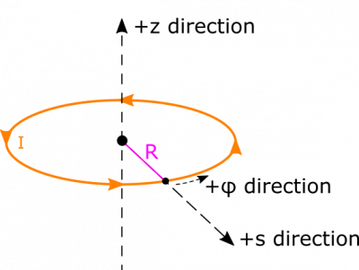
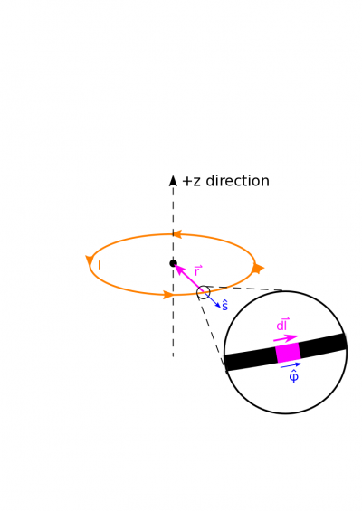
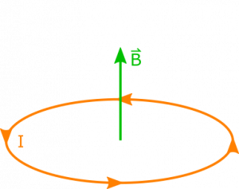

Suppose you have a circular ring, in which which there is a current $I$. The radius of the ring is $R$. The current produces a magnetic field. What is the magnetic field at the center of the ring?

### Facts

- The current in the ring is $I$.
- The radius of the ring is $R$.

### Lacking

- $\overset{\rightarrow}{B}$​

### Approximations & Assumptions

- If we orient the ring in the $xy$-plane and look down, the current flows in the counterclockwise direction: In order to start this problem we need to assign a direction for the current to flow in our loop. Without this assumption there would be no way to assign a dl vector.
- The current is steady: This means the current is not changing with time or space through our ring and is just a constant.
- There are no other contributions to the magnetic field: Any outside currents or moving charges could create a magnetic field that could effect our solution.

### Representations

- We represent the Biot-Savart Law for magnetic field from a current as

$$
\overset{\rightarrow}{B} = \int\frac{\mu_{0}}{4\pi}\frac{I \cdot d\overset{\rightarrow}{l} \times \overset{\rightarrow}{r}}{r^{3}}
$$

- We represent the situation below. We put the center of the ring at the origin. We choose cylindrical coordinates because we will be integrating over the length of the ring, and being able to represent its radius as constant will simplify calculations.

## Solution

Below, we show a diagram with a lot of pieces of the Biot-Savart Law unpacked. We show an example $\text{d}\overset{\rightarrow}{l}$, and a separation vector $\overset{\rightarrow}{r}$. Notice that $\text{d}\overset{\rightarrow}{l}$ is directed along the segment, in the same direction as the current. The separation vector $\overset{\rightarrow}{r}$ points as always from source to observation.

Let's start breaking down some of the components of the Biot-Savart Law we listed in our representations. We can say for now that $\text{d}\overset{\rightarrow}{l}$ is directed in the $\widehat{\phi}$ direction. (Note: We could also express $\widehat{\phi}$ in Cartesian coordinates as $\widehat{\phi} = - \sin(\phi)\widehat{x} + \cos(\phi)\widehat{y}$. This approach would yield the same solution, but we'll stick with cylindrical coordinates for this solution.) The length of our $\text{d}\overset{\rightarrow}{l}$ is $R\text{d}\phi$ which comes from the [arc length](https://en.wikipedia.org/wiki/Arc_length) formula. We can therefore write

$$
\text{d}\overset{\rightarrow}{l} = R\text{d}\phi\widehat{\phi}
$$

### Assumption

We assumed the current was flowing counterclockwise when the loop was viewed from the top. This means our current flows in the same direction as $\phi$. If we had assumed a clockwise current flow then this value would just need a negative in front of it.

We also represent the separation vector using a cylindrical unit vector, too:

$$
\overset{\rightarrow}{r} = {\overset{\rightarrow}{r}}_{\text{obs}} - {\overset{\rightarrow}{r}}_{\text{source}} = 0 - R\widehat{s} = - R\widehat{s}
$$

Now, we combine the two vectors in their cross product:

$$
\text{d}\overset{\rightarrow}{l} \times \overset{\rightarrow}{r} = (R\text{d}\phi\widehat{\phi}) \times ( - R\widehat{s}) = R^{2}\text{d}\phi( - \widehat{\phi} \times \widehat{s}) = R^{2}\text{d}\phi\widehat{z}
$$

Notice that even though the direction of $\widehat{\phi}$ and $\widehat{s}$ depend on the angle $\phi$ at which the vectors exist, their cross product, $\widehat{z}$, does not depend at all on $\phi$. This will greatly simplify our integration later.

In order to set up the integration, we also need the magnitude of the separation vector, which conveniently is just $R$. This should make some intuitive sense because everywhere on the ring would be the same distance away from the center. Lastly, we need the bounds on our integration. We will be integrating over $\text{d}\phi$. We want to account for every piece of the ring, so it will sufficient to set our integration from $\phi = 0$ to $\phi = 2\pi$.

$$
\begin{matrix}
\overset{\rightarrow}{B} & = \int\frac{\mu_{0}}{4\pi}\frac{I \cdot d\overset{\rightarrow}{l} \times \overset{\rightarrow}{r}}{r^{3}} \\
 & = \int_{0}^{2\pi}\frac{\mu_{0}}{4\pi}\frac{I \cdot R^{2}\text{d}\phi\widehat{z}}{R^{3}} \\
 & = \frac{\mu_{0}}{4\pi}\frac{I\widehat{z}}{R}\int_{0}^{2\pi}\text{d}\phi \\
 & = \frac{\mu_{0}I}{2R}\widehat{z}
\end{matrix}
$$

### Assumption

Assuming the current is steady allows us to take the $I$ out of the above integral, if this were not the case we would have to find out how current varies in the direction of $\phi$ and leave it in the integral.

We show the visual result below.

Since the observation point is in the same plane as the ring and at the center, applying RHR to a few different points on the ring will always yield a result in the +z direction at our observation point. This aligns with our answer, which is great. We also would expect the B-field to decrease as the ring got bigger (R increases), as each chunk of current carrying wire would be further away, and increase as it got smaller, as each chunk of current carrying wire would be closer to our observation point. Similarly, we would expect the B-field to increase as the current increases as you would have charges moving faster producing a stronger B-field. These are all things reflected by our equation, so we should be happy with our solution.
