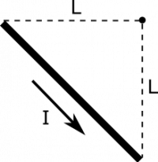
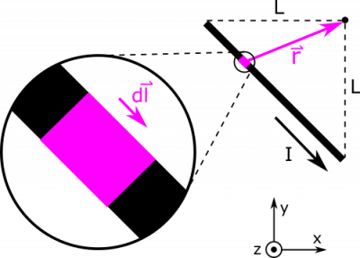
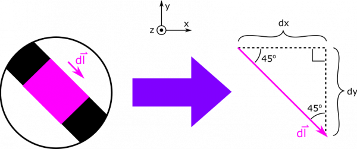

*[Return to Currents make Magnetic Fields notes](/notes/week-10-magnetic-field-of-a-wire/b_current/)*

The notes outline how to find the [magnetic field from a very long wire of current](/notes/week-10-magnetic-field-of-a-wire/b_current/#magnetic_field_from_a_very_long_wire). Now, what is the magnetic field from a single segment? Suppose we have the configuration shown below. Your observation point is at the origin, and the segment of current $I$ runs in a straight line from $\langle - L,0,0\rangle$ to $\langle 0, - L,0\rangle$.

Segment of Current

### Facts

- The current in the segment is $I$.
- The observation point is at the origin.
- The segment stretches from from $\langle - L,0,0\rangle$ to $\langle 0, - L,0\rangle$.

### Lacking

- $\overset{\rightarrow}{B}$​

### Approximations & Assumptions

- The current is steady: This means the current is not changing with time or space through our segment and is just a constant.
- The segment is straight and uniform: This will simplify down our model to where the segment only extends in a single direction, simplifying the separation vector. Also, assuming the segment is uniform (in properties and dimensions) means the current in the segment will be constant, as any discontinuities could have effects on the current.

### Representations

- We represent the Biot-Savart Law for magnetic field from a current as

$$
\overset{\rightarrow}{B} = \int\frac{\mu_{0}}{4\pi}\frac{I \cdot d\overset{\rightarrow}{l} \times \overset{\rightarrow}{r}}{r^{3}}
$$

- We represent the situation with diagram given above.

## Solution

Below, we show a diagram with a lot of pieces of the Biot-Savart Law unpacked. We show an example $\text{d}\overset{\rightarrow}{l}$, and a separation vector $\overset{\rightarrow}{r}$. Notice that $\text{d}\overset{\rightarrow}{l}$ is directed along the segment, in the same direction as the current. The separation vector $\overset{\rightarrow}{r}$ points as always from source to observation.

Segment of Current

For now, we write

$$
\text{d}\overset{\rightarrow}{l} = \langle\text{d}x, - \text{d}y,0\rangle
$$

We write the $y$-component with a negative sign so that $\text{d}y$ can be positive. For the separation vector, we write

$$
\overset{\rightarrow}{r} = {\overset{\rightarrow}{r}}_{obs} - {\overset{\rightarrow}{r}}_{source} = \langle 0,0,0\rangle - \langle x,y,0\rangle = \langle - x, - y,0\rangle
$$

Notice that we can rewrite $y$ as $y = - x - L$. This equation comes from the equation for a straight line, $y = mx + b$, where the slope of the line (or wire in this case) is $m = - 1$ and the y-intercept of the wire is at $b = - L$. An alternate solution to this example could also be to rotate the coordinate system so that the x or y axis lines up with wire. If finding $y$ is troublesome, it may be helpful to rotate your coordinate axes.

Breakdown of dl-vector

We can use geometric arguments to say that $\text{d}y = \text{d}x$. See the diagram above for an insight into this geometric argument. We can now plug in to express $\text{d}\overset{\rightarrow}{l}$ and $\overset{\rightarrow}{r}$ in terms of $x$ and $\text{d}x$:

$$
\text{d}\overset{\rightarrow}{l} = \langle\text{d}x, - \text{d}x,0\rangle
$$

$$
\overset{\rightarrow}{r} = \langle - x,L + x,0\rangle
$$

Now, we can take the cross product and find the magnitude of the $\overset{\rightarrow}{r}$:

$$
\text{d}\overset{\rightarrow}{l} \times \overset{\rightarrow}{r} = \langle 0,0,\text{d}x(L + x) - ( - \text{d}x)( - x)\rangle = \langle 0,0,L\text{d}x\rangle = L\text{d}x\widehat{z}
$$

$$
r^{3} = (x^{2} + (L + x)^{2})^{3/2}
$$

The last thing we need is the bounds on our integral. Our variable of integration is $x$, since we chose to express everything in terms of $x$ and $\text{d}x$. (Earlier we could have equally have chosen to write everything in terms of y and dy though.) We know that our segment begins at $x = - L$, and ends at $x = 0$, so these will be the limits on our integral. Below, we write the integral all set up, and then we evaluate using some assistance some [Wolfram Alpha](https://www.wolframalpha.com/input/?i=integral+from+-L+to+0+of+L%2F(x%5E2%2B(L%2Bx)%5E2)%5E(3%2F2)+dx).

$$
\begin{matrix}
\overset{\rightarrow}{B} & = \int\frac{\mu_{0}}{4\pi}\frac{I \cdot d\overset{\rightarrow}{l} \times \overset{\rightarrow}{r}}{r^{3}} \\
 & = \int_{- L}^{0}\frac{\mu_{0}}{4\pi}\frac{IL\text{d}x}{(x^{2} + (L + x)^{2})^{3/2}}\widehat{z} \\
 & = \frac{\mu_{0}}{2\pi}\frac{I}{L}\widehat{z}
\end{matrix}
$$

You can try to do this by adjusting your x-y coordinate system as well (this is in the example video), and you will get the exact same solution. This is a great way to get some practice solving these problems and it gives you other solutions to check your answer with.
