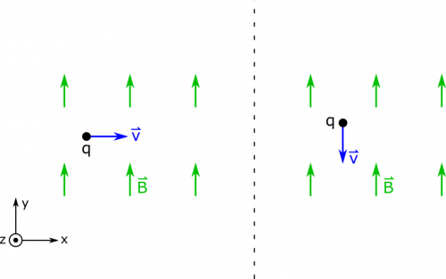

Suppose you have a moving charge ($q = 1.5\text{~mC}$) in a magnetic field ($\overset{\rightarrow}{B} = 0.4\text{~mT~}\widehat{y}$). The charge has a speed of $10\text{~m/s}$. What is the magnetic force on the charge if its motion is in the $+ x$-direction? The $- y$-direction?

### Facts

- The charge is $q = 1.5\text{~mC}$.
- There is an external magnetic field $\overset{\rightarrow}{B} = 0.4\text{~mT~}\widehat{y}$.
- The velocity of the charge is $\overset{\rightarrow}{v} = 10\text{~m/s~}\widehat{x}$ or $\overset{\rightarrow}{v} = - 10\text{~m/s~}\widehat{y}$.

### Lacking

- ${\overset{\rightarrow}{F}}_{B}$​

### Approximations & Assumptions

- The magnetic force on the charge contains no unknown contributions.
- The charge is moving at a constant speed (no other forces acting on it)

### Representations

- We represent the magnetic force on a moving charge as

$$
\overset{\rightarrow}{F} = q\overset{\rightarrow}{v} \times \overset{\rightarrow}{B}
$$

- We represent the two situations below.

## Solution

Let's start with the first case, when $\overset{\rightarrow}{v} = 10\text{~m/s~}\widehat{x}$.

The trickiest part of finding magnetic force is the cross-product. You may remember from the [math review](/notes/week-01-charges-field-potential/math_review/#vector_multiplication) that there are a couple ways to do the cross product. Below, we show how to use vector components, for which it's helpful to rewrite $\overset{\rightarrow}{v}$ and $\overset{\rightarrow}{B}$ with their components.

$$
\begin{matrix}
\overset{\rightarrow}{v} & = \langle 10,0,0\rangle\text{~m/s} \\
\overset{\rightarrow}{B} & = \langle 0,4 \cdot 10^{- 4},0\rangle\text{~T} \\
\overset{\rightarrow}{v} \times \overset{\rightarrow}{B} & = \langle v_{y}B_{z} - v_{z}B_{y},v_{z}B_{x} - v_{x}B_{z},v_{x}B_{y} - v_{y}B_{x}\rangle \\
 & = \langle 0,0,4 \cdot 10^{- 3}\rangle\text{~T} \cdot \text{m/s}
\end{matrix}
$$

Alternatively, we could use the whole vectors and the angle between them. We find that we obtain the same result for the cross product. One would need to use the [Right Hand Rule](/notes/week-09-magnetic-field-moving-point-charge/rhr/) to find that the direction of the cross product is $+ \widehat{z}$. The magnitude is given by

$$
\left| \overset{\rightarrow}{v} \times \overset{\rightarrow}{B} \right| = \left| \overset{\rightarrow}{v} \right|\left| \overset{\rightarrow}{B} \right|\sin\theta = (10\text{~m/s})(4 \cdot 10^{- 4}\text{~T})\sin 90^{\text{o}} = 4 \cdot 10^{- 3}\text{~T} \cdot \text{m/s}
$$

We get the same answer with both methods. Now, for the force calculation:

$$
{\overset{\rightarrow}{F}}_{B} = q\overset{\rightarrow}{v} \times \overset{\rightarrow}{B} = 1.5\text{~mC~} \cdot 4 \cdot 10^{- 3}\text{~T} \cdot \text{m/s~}\widehat{z} = 6\mu\text{N}
$$

Notice that the $\sin 90^{\text{o}}$ is equal to $1$. This means that this is the maximum force that the charge can feel, and we get this value because the velocity and the B-field are exactly perpendicular. Any other orientation would have yielded a weaker magnetic force. In fact, in the second case, when the velocity is parallel to the magnetic field, the cross product evaluates to $0$. See below for the calculations.

$$
\begin{matrix}
\overset{\rightarrow}{v} & = \langle 0, - 10,0\rangle\text{~m/s} \\
\overset{\rightarrow}{B} & = \langle 0,4 \cdot 10^{- 4},0\rangle\text{~T} \\
\overset{\rightarrow}{v} \times \overset{\rightarrow}{B} & = \langle v_{y}B_{z} - v_{z}B_{y},v_{z}B_{x} - v_{x}B_{z},v_{x}B_{y} - v_{y}B_{x}\rangle \\
 & = \langle 0,0,0\rangle
\end{matrix}
$$

Or, with whole vectors:

$$
\left| \overset{\rightarrow}{v} \times \overset{\rightarrow}{B} \right| = \left| \overset{\rightarrow}{v} \right|\left| \overset{\rightarrow}{B} \right|\sin\theta = (10\text{~m/s})(4 \cdot 10^{- 4}\text{~T})\sin 0 = 0
$$

When the velocity is parallel to the magnetic field, ${\overset{\rightarrow}{F}}_{B} = 0$.
