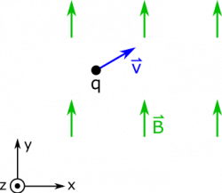
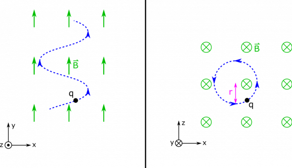

*[Return to Path of a Charge through a Magnetic Field notes](/empcubed/notes/week-11-sources-of-magnetic-fields/q_path/)*

Suppose you have a moving charge $q = 20\text{~mC}$ in a magnetic field $\overset{\rightarrow}{B} = 15\text{~mT~}\widehat{y}$. The charge has a velocity of $\overset{\rightarrow}{v} = (3\widehat{x} + 2\widehat{y})\text{~m/s}$, and a mass of $m = 1\text{~g}$. What does the motion of the charge look like?

### Facts

- There is a charge $q = 20\text{~mC}$.
- The charge has velocity $\overset{\rightarrow}{v} = (3\widehat{x} + 2\widehat{y})\text{~m/s}$.
- The charge has a mass $m = 1\text{~g}$.
- The charge is in a field $\overset{\rightarrow}{B} = 15\text{~mT~}\widehat{y}$.

### Lacking

- The motion of the charge.

### Approximations & Assumptions

- The B-field is constant.
- Charge and Mass of the particle are constant.

### Representations

- We represent the magnetic force on a moving charge as

$$
\overset{\rightarrow}{F} = q\overset{\rightarrow}{v} \times \overset{\rightarrow}{B}
$$

- We represent the situation below.

Moving Charge in a Magnetic Field

## Solution

We can recall an [earlier example](/empcubed/examples/week10_radius_motion_b_field/) where we had to find the motion of a charge in a magnetic field. Based on that example, if our particle were moving in the $\widehat{x}$ direction, then the $\widehat{y}$-directed magnetic field would cause circular motion in the $xz$-plane. The radius of this motion would be, as before,

$$
r = \frac{mv}{qB}
$$

However, in this example the motion of the particle is a little different. There is a $\widehat{y}$ component to the velocity, which is parallel to the magnetic field – to be clear, the velocity as a whole is not parallel to the magnetic field, but the existence of the $\widehat{y}$ component guarantees that they are not perpendicular. Because the magnetic field is directed completely in the $\widehat{y}$-direction, we know that $\overset{\rightarrow}{v} \times \overset{\rightarrow}{B}$ will always be perpendicular to the $\widehat{y}$-direction. In connection with this, since $\overset{\rightarrow}{F} = q\overset{\rightarrow}{v} \times \overset{\rightarrow}{B}$, this means that the $\widehat{y}$ component of the force is zero, $F_{y} = 0$. Since the particle never experiences a force in the $\widehat{y}$-direction, the $\widehat{y}$ component of the velocity will never change.

So it seems like the motion here will not be circular. The magnetic force still plays a role, though because the velocity also has an x-component. From the magnetic force equation, we find that the magnetic force would be:

$$
\overset{\rightarrow}{F} = q\overset{\rightarrow}{v} \times \overset{\rightarrow}{B} = = q(v_{x}\widehat{x} + v_{y}\widehat{y}) \times (B\widehat{y}) = qv_{x}B\widehat{z}
$$

### Assumptions

Our assumptions about the Constant B-Field and chrage are essential in simplifying down the force equation. If these assumptions were not true out force could also have some time and space dependency which would make solving for and predicting the force much more dificult.

This force would still push the particle into a circular motion (while still not affecting the particle's motion in the y-direction.) So the particle would move in an upwards spiraling path.

So when we look at the motion of the particle from the perspective of $+ y$ going into the page, we should see a circle with radius

$$
r = \frac{mv_{x}}{qB} = 10\text{~m}
$$

### Assumption

We assumed the mass was constant, and this allows for uniform circular motion in the x-z plane. If the mass were not constant then the path of the particle could look much different as the radius of curvature of the particle at any instance in time/space could change.

However, because of the constant $\widehat{y}$ component of the velocity, this circle is actually a helix. Two perspectives show the motion below.

Motion of the Moving Charge
