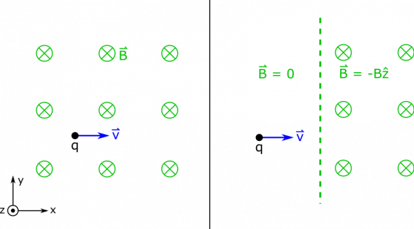
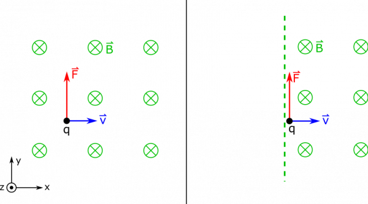
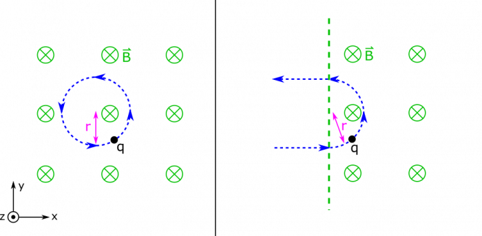

*[Return to Path of a Charge through a Magnetic Field notes](/empcubed/notes/week-11-sources-of-magnetic-fields/q_path/)*

Suppose you have a moving charge $q > 0$ in a magnetic field $\overset{\rightarrow}{B} = - B\widehat{z}$. The charge has a velocity of $\overset{\rightarrow}{v} = v\widehat{x}$, and a mass $m$. What does the motion of the charge look like? What if the charge enters the field from a region with $0$ magnetic field?

### Facts

- There is a charge $q$.
- The charge has velocity $v\widehat{x}$.
- The charge has a mass $m$.
- The charge is in a field $\overset{\rightarrow}{B} = - B\widehat{z}$.

### Lacking

- The motion of the charge.
- How the motion differs if the charge enter from outside the region where the field exists.

### Approximations & Assumptions

- The field is constant.
- In the case where the particle comes from outside, the field is a step function – it goes immediately from $0$ to $B$, and we can draw a boundary.
- The speed of the particle is constant (no other forces acting on the particle)

### Representations

- We represent the magnetic force on a moving charge as

$$
\overset{\rightarrow}{F} = q\overset{\rightarrow}{v} \times \overset{\rightarrow}{B}
$$

- We represent the two situations below.

Moving Charge in a Magnetic Field

## Solution

Let's start with the first case, when the magnetic field exists all around the charge.

We can recall an [earlier example](/empcubed/examples/week10_force_on_charge/) where we had to find the force on a similar charge. One approach we took to find the direction of force was the [Right Hand Rule](/empcubed/notes/week-09-magnetic-field-moving-point-charge/rhr/). Remember that the force here will be

$$
\overset{\rightarrow}{F} = q\overset{\rightarrow}{v} \times \overset{\rightarrow}{B}
$$

So when we use the Right Hand Rule, we point our fingers in the direction of $\overset{\rightarrow}{v}$, which is $\widehat{x}$. When we curl our fingers towards $\overset{\rightarrow}{B}$, which is directed towards $- \widehat{z}$, we find that our thumb ends up pointing in the $\widehat{y}$ direction. Since $q$ is positive, $\widehat{y}$ will be the direction of the force. The math should yield:

$$
\overset{\rightarrow}{F} = q(v\widehat{x}) \times ( - B\widehat{z}) = qvB\widehat{y}
$$

Force on the Moving Charge

So, the force on the charge is at first perpendicular to its motion. This is pictured above. You can imagine that as the charge's velocity is directed a little towards the $\widehat{y}$ direction, the force on it will also change a little, since the cross product that depends on velocity will change a little. In fact, if you remember from [the notes](/empcubed/notes/week-11-sources-of-magnetic-fields/q_path/), this results in circular motion if the charge is in a constant magnetic field.

Finding the radius of this circular motion requires recalling that circular motion occurs when the net force on the particle is perpendicular to the velocity. When this is true, we usually call this net force the [centripetal force](https://en.wikipedia.org/wiki/Centripetal_force). In this example, the centripetal force would be the same force that we computed earlier – the magnetic force – since this is the force that is perpendicular to the particle's motion (or only force in this case). Below, we set the two forces equal to find the radius of the circular motion.

$$
\begin{matrix}
\left| {\overset{\rightarrow}{F}}_{B} \right| & = \left| {\overset{\rightarrow}{F}}_{cent} \right| \\
qvB & = \frac{mv^{2}}{r} \\
r & = \frac{mv}{qB}
\end{matrix}
$$

Notice that the units work out when we check:

$$
\frac{\text{kg} \cdot \text{m/s}}{\text{C} \cdot \text{T}} = \frac{\text{kg} \cdot \text{m/s}}{\text{C} \cdot \frac{\text{kg}}{\text{C} \cdot \text{s}}} = \text{m}
$$

So now we know the radius. You can imagine that if the particle entered from outside the region of magnetic field, it would take the path of a semicircle before exiting the field in the opposite direction. Below, we show what the motion of the particle would be in each situation.

Motion of the Moving Charge
