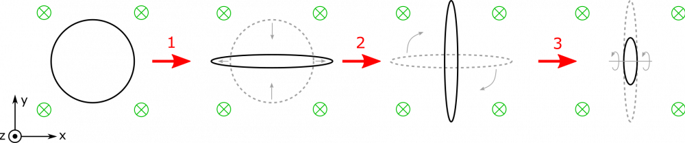

*[Return to Changing Magnetic Flux notes](/empcubed/notes/week-13-em-so-far-flux-shortcuts/b_flux/)*

Suppose you have a magnetic field directed in the $- \widehat{z}$-direction, into the page. There is a flexible, circular loop situated on the page, in the $xy$-plane. You stretch it out in the $\pm x$-direction like a rubber band to change its area. Then you rotate it $90^{\text{o}}$ in the $xy$-plane. Finally, you rotate the loop $60^{\text{o}}$ in the $yz$-plane. What happens to the magnetic flux through the loop during these steps?

### Facts

- The magnetic field is directed into the page.
- The steps for changing and rotating the loop are outlined in the problem statement.

### Lacking

- A description of the magnetic flux.

### Approximations & Assumptions

- The magnetic field is constant in time, and the same everywhere.
- The steps for changing and rotating the loop happen in a reasonable enough amount of time to describe the flux as the motions are happening.

### Representations

- We represent magnetic flux through an area as

$$
\Phi_{B} = \int\overset{\rightarrow}{B} \bullet d\overset{\rightarrow}{A}
$$

- We represent the steps with the following visual:

Steps

## Solution

Since the magnetic field has a uniform direction, and the area of the loop is flat (meaning $d\overset{\rightarrow}{A}$ does not change direction if we move along the area), then we can simplify the dot product:

$$
\int\overset{\rightarrow}{B} \bullet d\overset{\rightarrow}{A} = \int BdA\cos\theta
$$

Since $B$ and $\theta$ do not change for different little pieces ($dA$) of the area, we can pull them outside the integral:

$$
\int BdA\cos\theta = B\cos\theta\int dA = BA\cos\theta
$$

It will be easier to concern ourselves with this value, rather than try to describe the integral calculation each time. At the beginning of the motion, the loop is just a circle. Its area vector and the magnetic field are aligned (parallel), so it has some nonzero magnetic flux.

**Step 1:** As soon as we begin to stretch out our circle, we can imagine that its area begins to decrease, much like when you pinch a straw. We don't change its orientation with respect to the magnetic field, but since its area decreases, we expect that the flux through the loop will also decrease.

**Step 2:** As we rotate the stretched loop, notice that the area vector and magnetic field remain perfectly aligned ($\theta$ does not change). Further, the area itself is not changing. Since the magnetic field is also constant, we don't expect the flux to change at all during this rotation. It remains the same!

**Step 3:** As we rotate the stretched loop again, we are rotating it in such a way that the area vector also rotates. In fact, the area vector becomes less and less aligned with the magnetic field, which indicates that $\cos\theta$ will be decreasing during this motion. This causes us to expect that the magnetic flux through the loop will decrease during this rotation. Alternatively, based on the perspective shown in the representation, one can imagine that the magnetic field “sees” less and less of the loop, indicating that the flux is decreasing.

If the loop were to continue rotating in the last step, eventually we would have zero magnetic flux, and as it rotates back around the other way, we could imagine that the flux would then be defined as “negative”, since $\cos\theta$ would become negative – as long as we don't flip the direction of the area-vector.
