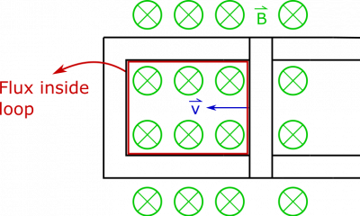
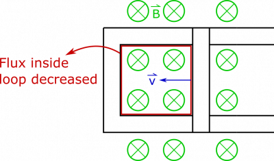
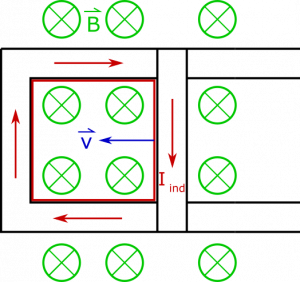

*[Return to The Curly Electric Field and Induced Current notes](/notes/week-13-em-so-far-flux-shortcuts/ind_i/)*

Say we have a bar that is sliding down a pair of connected conductive rails (so current is free to flow through the loop created by the bar and rails), which is sitting in a magnetic field that points into the page. If the bar slides along the rails to decrease the area of the loop, what happens?

### Facts

- The magnetic field is directed into the page.
- The loop is oriented so that the magnetic flux is nonzero.

### Lacking

- A description of the magnetic flux and/or induced current.

### Approximations & Assumptions

- The magnetic field is constant in time, and the same everywhere.
- The sliding of the bar along the rails happens in a reasonable enough amount of time to describe the flux as the motion is happening.

### Representations

- We represent magnetic flux through an area as

$$
\Phi_{B} = \int\overset{\rightarrow}{B} \bullet \text{d}\overset{\rightarrow}{A}
$$

- We represent the steps with the following visual:

Flux Through Loop

## Solution

Since the magnetic field has a uniform direction, and the area of the loop is flat (meaning $\text{d}\overset{\rightarrow}{A}$ does not change direction if we move along the area), then we can simplify the dot product:

$$
\int\overset{\rightarrow}{B} \bullet \text{d}\overset{\rightarrow}{A} = \int B\text{d}A\cos\theta
$$

Since $B$ and $\theta$ do not change for different little pieces ($\text{d}A$) of the area, we can pull them outside the integral:

$$
\int B\text{d}A\cos\theta = B\cos\theta\int\text{d}A = BA\cos\theta
$$

It will be easier to concern ourselves with this value, rather than try to describe the integral calculation each time. As the bar begins moving to the left, the area within the loop begins to close up, as shown below:

Decreased Flux

It should be easy to see the that the magnetic field and the orientation of the loop are not changing, but the area of the loop is decreasing. **The flux through the loop is therefore decreasing, which indicates that a current is induced in the loop**.

To determine the direction of the induced current, consider that when we say the flux decreases, this carries the *assumption that the area vector points in the same direction as the magnetic field*, which is into the page. This helps us define what we mean by “positive”, “negative”, “increase”, and “decrease”. A positive flux then means that the area vector and magnetic field point in the same direction. The fact that our flux is decreasing means that initially there was a large positive magnetic flux and at some time later there was a smaller, positive magnetic flux.

Based on Faraday's law, we know that the induced current should create a magnetic field that opposes the change in flux. The change in flux for this example is a “decrease”, going from a positive value toward zero (or towards a “negative” flux). So we expect the induced current to create a “positive” magnetic field, where “positive” here means that it is pointing in the same direction as the area-vector. Since we chose the area vector to point into the page, we expect for the magnetic field from the induced current to also point into the page. If we point our thumb in the direction of the magnetic field from the induced current then curl our finger, we find that **the induced current is clockwise around the loop**.

Alternatively, you could think of the mobile charges inside the moving bar. Since the bar is moving inside a magnetic field, mobile charges will experience an acceleration due to the magnetic force. The force is $\overset{\rightarrow}{F} = q\overset{\rightarrow}{v} \times \overset{\rightarrow}{B}$, which points down for positive charges, implying that conventional current will be clockwise, which is the same result we reached using Faraday's law. The result is shown below.

Induced Current


