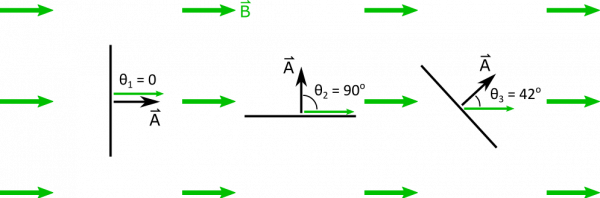
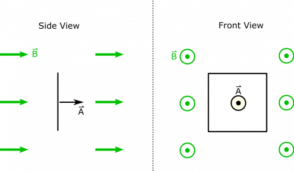

*[Return to Changing Magnetic Flux notes](/empcubed/notes/week-13-em-so-far-flux-shortcuts/b_flux/)*

Suppose you have a magnetic field $\overset{\rightarrow}{B} = 0.6\text{~mT~}\widehat{x}$. Three identical square loops with side lengths $L = 0.5\text{~m}$ are situated as shown below. The perspective shows a side view of the square loops, so they appear very thin even though they are squares when viewed face on.

Square Loops in the B-field

### Facts

- The orientations of the square loops are as indicated above. They can be described by their angles with respect to the magnetic field. $\theta_{1} = 0$, $\theta_{2} = 90^{\text{o}}$, $\theta_{3} = 42^{\text{o}}$.
- The magnetic field is $\overset{\rightarrow}{B} = 0.6\text{~mT~}\widehat{x}$.
- The length of a square's side is $L = 0.5\text{~m}$.

### Lacking

- The magnetic flux through each loop.

### Approximations & Assumptions

- The loops have flat faces.
- The magnetic field does not change with time, and is uniform in space.

### Representations

- We represent magnetic flux through an area as

$$
\Phi_{B} = \int\overset{\rightarrow}{B} \bullet \text{d}\overset{\rightarrow}{A}
$$

- We represent the situation with the given representation in the example statement above. Below, we also show a side and front view of the first loop for clarity.

First Loop

## Solution

Since the magnetic field has a uniform direction, and the area of the loop is flat (meaning $\text{d}\overset{\rightarrow}{A}$ does not change direction either), then we can simplify the dot product:

$$
\overset{\rightarrow}{B} \bullet \text{d}\overset{\rightarrow}{A} = B\text{d}A\cos\theta
$$

Since $B$ and $\theta$ do not change for different little pieces ($\text{d}A$) of the area, we can pull them outside the integral:

$$
\int B\text{d}A\cos\theta = B\cos\theta\int\text{d}A = BA\cos\theta
$$

Area for a square is just $A = L^{2}$, and $\theta$ is different for each loop:

$$
\Phi_{B} = \left\{ \begin{matrix}
BL^{2}\cos 0 = 1.5 \cdot 10^{- 4}\text{~Tm}^{2} & \text{Loop 1} \\
BL^{2}\cos 90^{\text{o}} = 0 & \text{Loop 2} \\
BL^{2}\cos 42^{\text{o}} = 1.1 \cdot 10^{- 4}\text{~Tm}^{2} & \text{Loop 3}
\end{matrix} \right.\ 
$$

Notice that we could've given answers for Loops 1 and 2 pretty quickly, since they are parallel and perpendicular to the magnetic field, respectively, which both simplify the flux calculation greatly.
