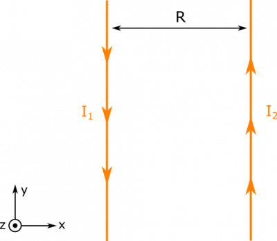
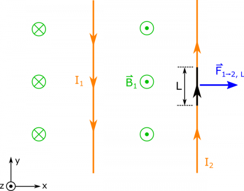

*[Return to Magnetic Force on a Current Carrying Wire notes](/notes/week-12-magnetic-force/i_b_force/)*

Two parallel wires have currents in opposite directions, $I_{1}$ and $I_{2}$. They are situated a distance $R$ from one another. What is the force per length $L$ of one wire on the other?

### Facts

- $I_{1}$ and $I_{2}$ exist in opposite directions.
- The two wires are separated by a distance $R$.

### Lacking

- ${\overset{\rightarrow}{F}}_{1 \rightarrow 2\text{, L}}$​

### Approximations & Assumptions

- The currents are steady: There are many things that could cause the current in these wires to not be steady. Since we are not told anything except the fact these currents exist, we will assume them to be steady to simplify down the model.
- The wires are infinitely long: When the wires are infinitely long the magnetic field from each wire becomes only a function of radial distance away from the wire. This also lets us use a simpler equation derived in the notes for a long wire.
- There are no outside forces to consider: We are not told anything about external magnetic fields or the mass of the wire, so we will omit forces due to gravity, external fields, and other forces.

### Representations

- We represent the magnetic field from a very long wire as

$$
\overset{\rightarrow}{B} = \frac{\mu_{0}I}{2\pi r}\widehat{z}
$$

- We represent the magnetic force on a little piece of current as

$$
\text{d}\overset{\rightarrow}{F} = I\text{d}\overset{\rightarrow}{l} \times \overset{\rightarrow}{B}
$$

- We represent the situation with diagram below.

Two Wires

## Solution

We will start by trying to find the magnetic force on Wire 2. Since there is a current in Wire 1, we know that there will be a magnetic field in the space around that wire. There would also be a magnetic field from the current in Wire 2, but this magnetic field (from Wire 2) won't contribute to the magnetic force on Wire 2 because Wire 2 cannot exert a force on itself. This means that the force on Wire 2 is due to how the magnetic field from Wire 1 interacts with the current going through Wire 2. Mathematically, we would represent this as:

$$
d{\overset{\rightarrow}{F}}_{1 \rightarrow 2} = I_{2}d{\overset{\rightarrow}{l}}_{2} \times {\overset{\rightarrow}{B}}_{1}
$$

We know that the magnetic field from Wire 1 at the location of Wire 2 is given by the magnetic field of a long wire:

$$
{\overset{\rightarrow}{B}}_{1} = \frac{\mu_{0}I_{1}}{2\pi R}\widehat{z}
$$

We can reason that the direction of the field is $+ \widehat{z}$ because of the [Right Hand Rule](/notes/week-09-magnetic-field-moving-point-charge/rhr/). (Point your fingers along the direction of $I_{1}$ and curl them towards Wire 2. Your thumb should point out of the page then.)

Since we know the magnetic field, the next thing we wish to define is $\text{d}{\overset{\rightarrow}{l}}_{2}$. Wire 2 has current directed with $\widehat{y}$ in our representation, so we can say

$$
\text{d}{\overset{\rightarrow}{l}}_{2} = \text{d}y\widehat{y}
$$

When we take the cross product of $d{\overset{\rightarrow}{l}}_{2}$ and $B_{1}$, this gives

$$
\text{d}{\overset{\rightarrow}{l}}_{2} \times {\overset{\rightarrow}{B}}_{1} = \text{d}y\widehat{y} \times \frac{\mu_{0}I_{1}}{2\pi R}\widehat{z}
$$

$$
\text{d}{\overset{\rightarrow}{l}}_{2} \times {\overset{\rightarrow}{B}}_{1} = \frac{\mu_{0}I_{1}}{2\pi R}\text{d}y(\widehat{y} \times \widehat{z})
$$

$$
\text{d}{\overset{\rightarrow}{l}}_{2} \times {\overset{\rightarrow}{B}}_{1} = \frac{\mu_{0}I_{1}}{2\pi R}\text{d}y\widehat{x}
$$

This equation gives us the force on a very small chunk of the wire. If we want to find the force on a large piece of the wire, then we have to integrate, which means we need to choose the limits for our integral. Since we are looking for the force per length (rather than the total force), we can pick whatever kind of length we want - we will choose a segment of the wire with length L to find the force. For convenience, we will select our origin so that the segment of interest extends from $y = 0$ to $y = L$. Now, we can write the total force from Wire 1 on that segment L of Wire 2:

$$
{\overset{\rightarrow}{F}}_{1 \rightarrow 2\text{, L}} = \int_{0}^{L}I_{2}\text{d}{\overset{\rightarrow}{l}}_{2} \times {\overset{\rightarrow}{B}}_{1}
$$

$$
{\overset{\rightarrow}{F}}_{1 \rightarrow 2\text{, L}} = \int_{0}^{L}\frac{\mu_{0}I_{1}I_{2}}{2\pi R}\text{d}y\widehat{x}
$$

$$
{\overset{\rightarrow}{F}}_{1 \rightarrow 2\text{, L}} = \frac{\mu_{0}I_{1}I_{2}L}{2\pi R}\widehat{x}
$$

If we wanted to write the force per length (rather than the total force), we would simply divide by L on both sides:

$$
\frac{{\overset{\rightarrow}{F}}_{1 \rightarrow 2}}{L} = \frac{\mu_{0}I_{1}I_{2}}{2\pi R}\widehat{x}
$$

Force Per Length

If instead we wanted to find the force per length on Wire 1 from Wire 2, then we could do this whole process over again (find the magnetic field from Wire 2 at the location of Wire 1, find $d{\overset{\rightarrow}{l}}_{1}$, take the cross product, integrate over a segment of the wire, divide by L). We can also use what we know about forces and Newton's 3rd law, to say that the force from Wire 2 on Wire 1 should be equal and opposite to the force from Wire 1 on Wire 2.

$$
\frac{{\overset{\rightarrow}{F}}_{2 \rightarrow 1}}{L} = - \frac{\mu_{0}I_{1}I_{2}}{2\pi R}\widehat{x}
$$

We can check this with the right hand rule again. First, we know that the magnetic field from Wire 2 should point out of the page at Wire 1 - point your fingers in the direction of $I_{2}$, curl them toward Wire 1 and then your thumb should point out of the page. We can then find the direction of the force on Wire 1 by pointing your fingers in the direction of $I_{1}$, curling them out of the page toward the magnetic field from Wire 2, and your thumb should point to the left (or the $- \widehat{x}$ direction).

Notice that this force is repellent - the force on Wire 1 would push it away from Wire 2 and the force on Wire 2 would push it away from Wire 1. Had the two current been going in the same direction, one can imagine that the two wires would attract each other.
