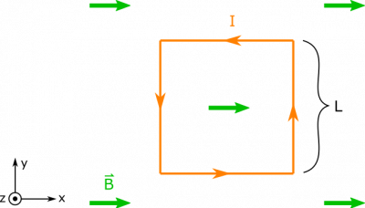
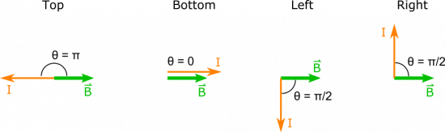
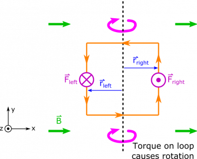

*[Return to Magnetic Force on a Current Carrying Wire notes](/empcubed/notes/week-12-magnetic-force/i_b_force/)*

Suppose you have a square loop (side length $L$) of current $I$ situated in a uniform magnetic field $\overset{\rightarrow}{B}$ so that the magnetic field is parallel to two sides of the loop. What is the magnetic force on the loop of current?

### Facts

- The loop is a square with side-length $L$.
- The magnetic field is parallel to two sides of the loop, and has a magnitude $B$.
- The current in the loop is $I$.

### Lacking

- The magnetic force on the loop.

### Approximations & Assumptions

- The current is in a steady state: This means the current in our loop is not changing with time or space, and is just a constant.
- The magnetic field does not change: This removes any time or space dependency on our magnetic field. Assuming it constant in magnitude and direction across each segment of wire. Depending on what is producing this magnetic field, this could change the accuracy of this assumption.
- There are no outside forces to consider: We are not told anything about the mass of the wire or anything else that could produce a force on the loop. To simplify our model we will assume there are no outside forces like gravity, or other external magnetic fields acting on our loop.
- The current in the loop goes counterclockwise: Since this was not specified in the problem we must assume a direction in order to understand the relationship between the magnetic field and current in our wire. This is important for finding the force, which is really a cross product.

### Representations

- We represent the magnitude of force on a current-carrying wire in a magnetic field as

$$
\left| \overset{\rightarrow}{F} \right| = IBL\sin\theta
$$

- We represent the situation with the diagram below. We arbitrarily choose a counterclockwise direction for the current, and convenient coordinates axes.

Square Loop in a B-field

## Solution

In order to break down our approach into manageable chunks, we split up the loop into its four sides, and proceed. It is easy to find the magnitude of the force on each side, since $\theta$ for each side is just the angle between the magnetic field and the directed current.

Theta for Each Side

This gives the following magnitudes:

$$
\left| \overset{\rightarrow}{F} \right| = \left\{ \begin{matrix}
IBL\sin\pi = 0 & \text{top} \\
IBL\sin 0 = 0 & \text{bottom} \\
IBL\sin\frac{\pi}{2} = IBL & \text{left} \\
IBL\sin\frac{\pi}{2} = IBL & \text{right}
\end{matrix} \right.\ 
$$

It remains to find the direction of the force (the non-zero ones at least), for which we will use the [Right Hand Rule](/empcubed/notes/week-09-magnetic-field-moving-point-charge/rhr/). For the force on the left side, we would point our fingers down in the direction of current and curl them towards the right towards the B-field. Your thumb then points in the direction of the force, which is the $+ \widehat{z}$ direction (again for the left side of the wire). To find the force on the right side then, we would point our fingers up in the direction of the current, and curl them to the right towards the B-field. This then points our thumb in the $- \widehat{z}$ direction (into the page), which tells us the direction of the force on the right side of the loop.

Since these forces point in opposite directions, this means that the net force on the loop is $0$, the loop's center of mass won't move! However, if there was an axis in the middle of the loop, the opposing forces on the opposite sides of the loop would cause the loop to spin. So there could be a [torque](/pcubed/notes/week-12-14-collisions-rotational-motion/torque/)! The diagram below shows visually what happens.

The Loop Rotates

We could also calculate the torque on the loop, using the definition of torque $\overset{\rightarrow}{\tau} = \overset{\rightarrow}{r} \times \overset{\rightarrow}{F}$, where $\tau$ is the torque on the object, $r$ is the distance from the loop to the axis of rotation, and $F$ is the force.

$$
\overset{\rightarrow}{\tau} = \overset{\rightarrow}{r} \times \overset{\rightarrow}{F}
$$

Since we have two forces, we have to take the sum of the torques from those forces.

$$
\overset{\rightarrow}{\tau} = {\overset{\rightarrow}{\tau}}_{left} + {\overset{\rightarrow}{\tau}}_{right}
$$

$$
\overset{\rightarrow}{\tau} = {\overset{\rightarrow}{r}}_{\text{left}} \times {\overset{\rightarrow}{F}}_{\text{left}} + {\overset{\rightarrow}{r}}_{\text{right}} \times {\overset{\rightarrow}{F}}_{\text{right}}
$$

If we say the axis of rotation is in the middle of the loop, then $r_{left}$ and $r_{right}$ would both be $L/2$. We can also plug in what we just for the forces on the left and right sides of the loop. This will then give us the total torque on the loop.

$$
\overset{\rightarrow}{\tau} = \left( - \frac{L}{2}\widehat{x} \right) \times \left( IBL\widehat{z} \right) + \left( \frac{L}{2}\widehat{x} \right) \times \left( - IBL\widehat{z} \right)
$$

$$
\overset{\rightarrow}{\tau} = IBL^{2}\widehat{y}
$$

This sort of rotating loop is the basis for an electrical motor. Essentially you are transferring electric energy (by providing a current through the loop) to kinetic energy (by making the loop spin).

We can check the direction of our torques by using RHR as this is also a cross product. If we put our fingers in the direction of our separation vectors and curl towards the forces, we will find that the torques are in the same direction which would cause our loop to rotate. Another way we can evaluate our solution is by looking at our forces. By now we should be very comfortable with cross products, so we should expect there to be no force on the top or bottom wire by inspection of the problem. Also, since the magnetic field is constant, both sides of the loop have the same length and the currents flow in opposite directions, we should expect the forces to be in opposite directions as well. These evaluations all line up with our solution.
