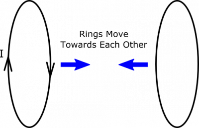
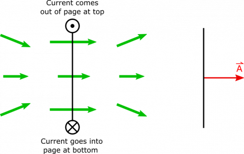
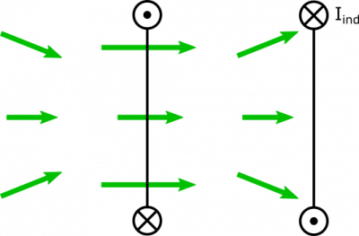

Suppose you have two conducting rings centered on the same axis so that they face one another. One of the rings has a current in it, which produces a magnetic field nearby. The rings are moved towards one another. What happens?

### Facts

- The rings are oriented so that there is a magnetic flux through one due to to the other.
- There is only current in the first ring.

### Lacking

- A description of the magnetic flux and/or induced current.

### Approximations & Assumptions

- There is no current in the second ring before the rings are moved.
- There is no power source for the first ring's current, and so it is free to change in response to changing magnetic fields.

### Representations

- We represent magnetic flux through an area as

$$
\Phi_{B} = \int\overset{\rightarrow}{B} \bullet \text{d}\overset{\rightarrow}{A}
$$

- We represent the steps with the following visual:

## Solution

Before any motion happens, we can look at the rings from a side view, and represent the magnetic field as shown below. In the side view it looks like current is coming out of the page at the top of the coil and going into the page at the bottom. The direction of the magnetic field is determined using the [Right Hand Rule](/notes/week-09-magnetic-field-moving-point-charge/rhr/).

When the rings begin to move towards one another, you can imagine that the second ring experiences an increase in magnetic flux, since the magnetic field is stronger closer to the ring with current. When we say the flux “increases”, we imply that the flux was positive to begin with, so this means we are *assuming that the area-vector of the second ring must point in the same direction as the magnetic field*. In our representation, this would be to the right.

Since the flux is increasing, we expect the induced current in the second ring to oppose this increase. This requires for the induced current to produce a magnetic field pointing to the left. We can use the [Right Hand Rule](/notes/week-09-magnetic-field-moving-point-charge/rhr/) to determine that this means the current will go into the page at the top of the page, and out of the page at the bottom of the loop. We show the resulting induced current below.

In fact, this induced current and resulting magnetic field from the second ring will actually cause a changing flux through the first ring that actually increases its currently momentarily. We are able to reconcile this with conservation of energy because even though the current increases in both rings, the resulting magnetic forces between them opposes their motion.


