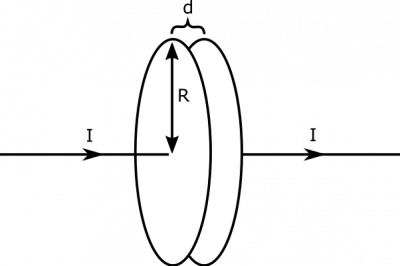
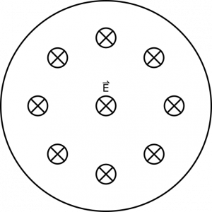
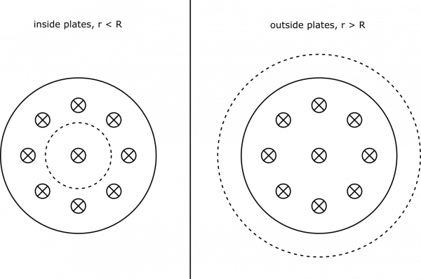
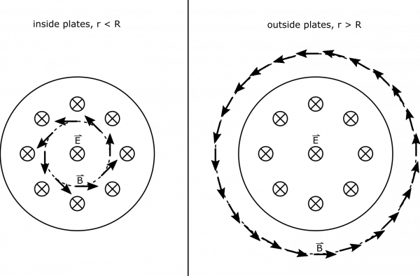

*[Return to Changing Electric Fields notes](https://www.msuperl.org/wikis/pcubed/doku.php?id=184_notes:changing_e)*

Suppose you have a parallel plate capacitor that is charging with a current $I = 3\text{~A}$. The plates are circular, with radius $R = 10\text{~m}$ and a distance $d = 1\text{~cm}$ apart. What is the magnetic field in the plane parallel to but in between the plates?

Charging Capacitors

### Facts

- The capacitor is a parallel plate capacitor with circular plates.
- $R = 10\text{~m}$​
- $d = 1\text{~cm}$​
- The capacitor is charging with a current $I = 3\text{~A}$.

### Lacking

- A description of the magnetic field.

### Approximations & Assumptions

- We are only concerned about a snapshot in time, so the current is $I$, even though this may change at a later time as the capacitor charges.
- The electric field between the plates is the same as the electric field between infinite plates (we'll ignore the electric field at the edges of the capacitor): This allows us to assume the electric field is constant between the plates. This is a good assumption with two big plates that are very close together.
- The electric field outside the plates is zero: This also ties back to having two big plates separated by a small distance. Making this assumption allows us to simplify down our equations when calculating the flux through our surface.

### Representations

- We represent the electric field in a parallel plate capacitor as

$$
\overset{\rightarrow}{E} = \frac{Q/A}{\epsilon_{0}}\widehat{x}
$$

- where $Q$ is the charge on a plate, $A$ is the area of the plate, and $\widehat{x}$ is directed from one plate to the other.

<!-- -->

- We can represent the magnetic field from a changing electric field as

$$
\int\overset{\rightarrow}{B} \bullet \text{d}\overset{\rightarrow}{l} = \mu_{0}I_{enc} + \mu_{0}\epsilon_{0}\frac{\text{d}\Phi_{E}}{\text{d}t}
$$

- We represent the situation with the following visual:

Plane in which we wish to find B-field

## Solution

We wish to find the magnetic field in the plane we've shown in the representations. We know from the notes that a changing electric field should create a curly magnetic field. Since the capacitor plates are charging, the electric field between the two plates will be increasing and thus create a curly magnetic field. We will think about two cases: one that looks at the magnetic field inside the capacitor and one that looks at the magnetic field outside the capacitor.

Due to the circular symmetry of the problem, we choose a circular loop in which to situate our integral $\int\overset{\rightarrow}{B} \bullet \text{d}\overset{\rightarrow}{l}$. We also choose for the loop to be the perimeter of a flat surface, so that the entire thing lies in the plane of interest, and there is no enclosed current (so $I_{enc} = 0$ - there is only the changing electric field). We show the drawn loop below, split into two cases on the radius of the loop.

Circular Loops

Below, we also draw the direction of the magnetic field along the loops. We know the magnetic field is directed along our circular loop (since the changing electric flux creates a curly magnetic field) – if it pointed in or out a little bit, we may be able to conceive of the closed surface with magnetic flux through it, which would imply the existence of a magnetic monopole. This cannot be the case! We also know that the field is directed counterclockwise, due to the increasing electric field into the page. (This comes from an extension of Lenz's Law, but will not needed for this course).

Circular Loops, with B-field shown

We are pretty well set up to simplify our calculation of the integral in the representations, since the B-field is parallel to the loop's perimeter. Below, we show the integral calculation, where the magnetic field at a radius $r$ is displayed as $B(r)$.

$$
\int\overset{\rightarrow}{B} \bullet \text{d}\overset{\rightarrow}{l} = \int B(r)\text{d}l = B(r)\int\text{d}l = 2\pi rB(r)
$$

Next, we need to find the changing electric flux in our loop. Since our loop was described with a flat surface, and the electric field is directed parallel to the area-vector of the loop, we can write electric flux as $\Phi_{E} = \overset{\rightarrow}{E} \bullet \overset{\rightarrow}{A} = EA$. This formula will need to be split up for parts of the surface inside the plates versus outside, since the electric field is different.

$$
\Phi_{\text{E, in}} = EA = \frac{Q/A_{\text{plate}}}{\epsilon_{0}}A_{\text{loop}} = \frac{Q}{\epsilon_{0}\pi R^{2}}\pi r^{2} = \frac{Qr^{2}}{\epsilon_{0}R^{2}}
$$

$$
\Phi_{\text{E, out}} = EA = E_{\text{in}}A_{\text{in}} + E_{\text{out}}A_{\text{out}} = \frac{Q/A_{\text{plate}}}{\epsilon_{0}}A_{\text{plate}} + 0 = \frac{Q}{\epsilon_{0}\pi R^{2}}\pi R^{2} = \frac{Q}{\epsilon_{0}}
$$

Now, if we wish the find the change in flux, we will take a time derivative. Notice that all the terms in the flux expressions above are constant, except for $Q$, which is changing with time as dictated by $I$.

$$
\frac{\text{d}\Phi_{E}}{\text{d}t} = \frac{\frac{\text{d}Q}{\text{d}t}r^{2}}{\epsilon_{0}R^{2}} = \frac{Ir^{2}}{\epsilon_{0}R^{2}}\text{, inside,~}r < R
$$

$$
\frac{\text{d}\Phi_{E}}{\text{d}t} = \frac{\frac{\text{d}Q}{\text{d}t}}{\epsilon_{0}} = \frac{I}{\epsilon_{0}}\text{, outside,~}r > R
$$

We can now connect the pieces together (remember, $I_{enc} = 0$, so we omit it below). We can write:

$$
2\pi rB(r) = \int\overset{\rightarrow}{B} \bullet \text{d}\overset{\rightarrow}{l} = \mu_{0}\epsilon_{0}\frac{\text{d}\Phi_{E}}{\text{d}t} = \mu_{0}\frac{Ir^{2}}{R^{2}}\text{, inside,~}r < R
$$

$$
2\pi rB(r) = \int\overset{\rightarrow}{B} \bullet \text{d}\overset{\rightarrow}{l} = \mu_{0}\epsilon_{0}\frac{\text{d}\Phi_{E}}{\text{d}t} = \mu_{0}I\text{, outside,~}r > R
$$

We are ready to write out the magnetic field.

$$
B(r) = \left\{ \begin{matrix}
\frac{\mu_{0}Ir}{2\pi R^{2}} & & & r < R \\
\frac{\mu_{0}I}{2\pi r} & & & r > R
\end{matrix} \right.\ 
$$

Notice, the distance between the plates has no effect on the magnetic field calculation. Also, the amount of the charge on the plates at a given time does not matter – we only care about how fast the charge is changing (the current!). Also, it is interesting that outside the plates, the magnetic field is the same as it would be for a long wire. This would be just as if the capacitor were not there, and the wire were connected. Below, we show a graph of the magnetic field strength as a function of the distance from the center of the capacitor.

B-Field Strength, Graphed

We have enough information to find the maximum B-field, which is at the edge of the plates:

$$
B_{\text{max}} = \frac{\mu_{0}I}{2\pi R} = \frac{4\pi \cdot 10^{- 7}\text{Tm/A} \cdot 3\text{~A}}{2\pi \cdot 10\text{~m}} = 60\text{~nT}
$$
