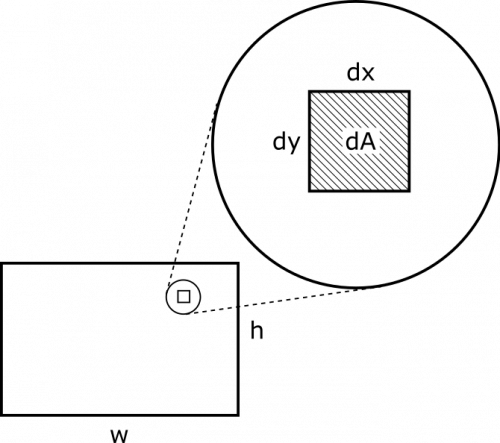

*[Return to Changing Magnetic Fields with Time notes](/empcubed/notes/week-14-induction/b_flux_t/)*

Suppose you have an increasing current through a long wire, $I(t) = I_{0}\frac{t}{t_{0}}$. Next to this wire, there is a rectangular loop of width $w$ and height $h$. The side of the rectangle is aligned parallel to the wire so that the rectangle is a distance $d$ from the wire, and they are both in the same plane. What is the induced voltage in the rectangle? In what direction is the induced current in the rectangle?

### Facts

- The current in the long wire increases with time and is $I(t) = I_{0}\frac{t}{t_{0}}$.
- The rectangle has dimensions $w$ by $h$, and a side with length $h$ is parallel to the wire.
- The rectangle and the wire lie in the same plane, and are separated by a distance $d$.

### Lacking

- $V_{ind}$.
- Direction of $I_{ind}$.

### Approximations & Assumptions

- The long wire is infinitely long and thin and straight: With these assumptions the magnetic field produced by the wire only depends on the radial distance away from the wire and the current in it. This also allows us to use a simplified magnetic field equation from the notes.
- There are no external contributions to the B-field: We are not told about any other external moving charges or currents that could also produce a magnetic field that would effect the flux through our loop, so we will assume the only contribution is from the long wire.

### Representations

- We represent the magnetic field from a very long straight wire as

$$
B = \frac{\mu_{0}I}{2\pi r}
$$

- where direction is determined based on the right hand rule

<!-- -->

- We represent magnetic flux as

$$
\Phi_{B} = \int\overset{\rightarrow}{B} \bullet \text{d}\overset{\rightarrow}{A}
$$

- We can represent induced voltage as

$$
V_{ind} = - \frac{\text{d}\Phi}{\text{d}t}
$$

- We represent the situation with the following visual. We arbitrarily choose a direction for the current.

Wire and Rectangle

## Solution

In order to find the induced voltage, we will need the magnetic flux. This requires defining an area-vector and determining the magnetic field. We can use the [right hand rule](/empcubed/notes/week-09-magnetic-field-moving-point-charge/rhr/) to determine that the magnetic field from the wire is into the page ($- \widehat{z}$) near the rectangle (point your fingers in the direction of the current and curl them toward the rectangle - your thumb should point into the page). For convenience, we will also define for the area vector to be into the page. Since they both point in the same direction, the dot product simplifies:

$$
\Phi_{B} = \int\overset{\rightarrow}{B} \bullet \text{d}\overset{\rightarrow}{A} = \int B\text{d}A
$$

Usually, we would pull the $B$ out of the integral, but **we cannot do that in this case**! That is because $B$ varies for different points in the rectangle's area - the magnetic field would be stronger close to the wire and get weaker as you move to the parts of the rectangle that are farther away. In order to see this a little more clearly, we will break the integral down a little and also insert the expression for the magnetic field from a long wire:

$$
\int_{\text{rectangle}}^{}B\text{d}A = \int_{\text{left to right}}^{}{\int_{\text{top to bottom}}^{}B}\text{d}x\text{d}y = \int_{x = d}^{x = d + w}{\int_{y = 0}^{y = h}\frac{\mu_{0}I}{2\pi x}}\text{d}x\text{d}y
$$

In the first equality, we just changed the integral from over the “rectangle” to be over its two dimensions, “left to right”, and “top to bottom”. We also changed $\text{d}A$ to be in terms of its two dimensions, $\text{d}A = \text{d}x\text{d}y$. A visual is shown below for clarity.

Picture of dA Breakdown

At this point, our integral is set up enough that we can crunch through the analysis. We can pull out constants to the front and calculate to the end:

$$
\begin{matrix}
\int_{x = d}^{x = d + w}{\int_{y = 0}^{y = h}\frac{\mu_{0}I}{2\pi x}}\text{d}x\text{d}y & = \frac{\mu_{0}I}{2\pi}\int_{d}^{d + w}\frac{\text{d}x}{x}\int_{0}^{h}\text{d}y \\
 & = \frac{\mu_{0}I}{2\pi}\left\lbrack \log x \right\rbrack_{d}^{d + w}\lbrack y\rbrack_{0}^{h} \\
 & = \frac{\mu_{0}I}{2\pi}\left( \log(d + w) - \log(d) \right)(h - 0) \\
 & = \frac{\mu_{0}Ih}{2\pi}\log\left( \frac{d + w}{d} \right)
\end{matrix}
$$

At this point, we are equipped to find the induced voltage. Notice that everything in the magnetic flux expression is constant with respect to time, *except for the current* $I$. The induced voltage can then be found by taking the time derivative (to find the changing magnetic flux through the rectangular loop):

$$
V_{ind} = - \frac{\text{d}\Phi}{\text{d}t} = - \frac{\mu_{0}h}{2\pi}\log\left( \frac{d + w}{d} \right)\frac{\text{d}I}{\text{d}t} = - \frac{\mu_{0}h}{2\pi}\log\left( \frac{d + w}{d} \right)\frac{I_{0}}{t_{0}}
$$

Notice that the induced voltage is negative. This means that the induced current produces a magnetic fields whose corresponding flux is negative flux. Since the area-vector was defined as into the page ($- \widehat{z}$), this means that the magnetic field produced by the induced current should be out of the page ($+ \widehat{z}$). By the right hand rule, this means the induced currents is directed *counterclockwise*. See below for a visual.

Induced Current

The induced voltage in this problem was a constant, which means the flux must be changing linearly with time. Thats the only way the derivative can be a constant. If we look at the equation for flux through a loop there are three ways it can change. The first is if the magnetic field changes, the second is if the cross product changes, and the third is if the area changes with time. None of the sides of our loop are moving, so the area is not changing with time. The relationship of our magnetic field and area vector are also not changing as our loop is not rotating and our magnetic field is always in the same direction. This leaves the magnetic field, which is changing in this example. The magnetic field in this problem changes just like the current in the long wire. Since the current in the long wire changes linearly with time, our flux must change linearly with time as well. This means our induced voltage should be a constant as our solution shows.
