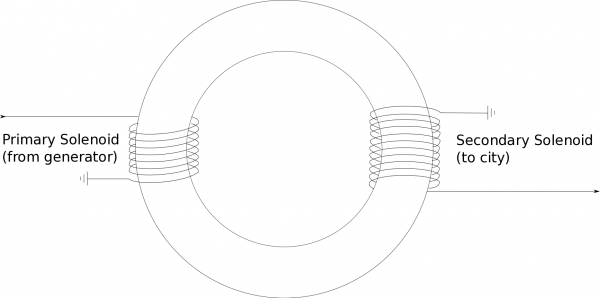
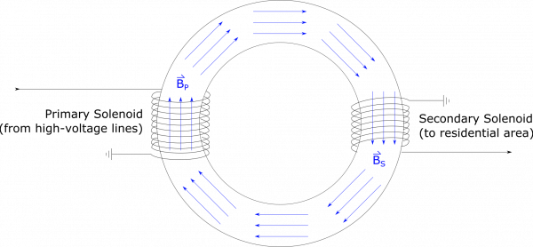

*[Return to Changing Flux from an Alternating Current notes](/notes/week-14-induction/ac/)*

Recall the [discussion on voltage transformers](/notes/week-14-induction/ac/#voltage_transformer). We designed a step-up transformer in the notes, which is used to convert small voltages from a generator into high voltages, which get carried long distances to residential areas. High-voltage power lines are dangerous, though, because the potential difference between the power lines and the ground is so enormous. Before the lines enter a residential area, they are sent to a transformer, from which low-voltage lines carry power to the residential area. How can you design a step-down transformer to convert a line that has a $240\text{~kV}$ potential difference to ground, into a power line that has a $120\text{~V}$ potential difference to ground?

### Facts

- The high-voltage line carries $240\text{~kV}$.
- We want the low-voltage line to carry $120\text{~V}$.
- We know the step-up transformer was created by wrapping two solenoids around an iron ring, and connected the high-voltage line to one solenoid, and the low-voltage line to the other. The low-voltage solenoid had fewer turns. A more detailed representation is shown below.

### Lacking

- We need a design for the step-down transformer.

### Approximations & Assumptions

- We have access to the same materials as we did for the step-up transformer: This allows us to use some of the same relationships from the step-up transformer solution.
- The step-down transformer we are building will have a similar design to the step-up transformer.

### Representations

- We represent magnetic flux as

$$
\Phi_{B} = \int\overset{\rightarrow}{B} \bullet \text{d}\overset{\rightarrow}{A}
$$

- We can represent induced voltage as

$$
V_{ind} = - \frac{\text{d}\Phi}{\text{d}t}
$$

- We represent the step-up transformer, as described in the Facts, with the following visual:

Step-up Transformer

## Solution

It makes sense intuitively to just flip the step-up transformer for our design. If the step-up transformer brings voltage down, we could just reverse it to bring the voltage up. Our design is shown below, where **now the number of turns in the primary solenoid is much greater than the number of turns in the secondary solenoid** – it's just the flipped step-up transformer, as described.

Step-down Transformer

As with the step-up transformer, the two solenoids are wrapped around the same iron ring. When current exists in the primary solenoid, it creates a magnetic field inside the solenoid, aligned along the iron ring. The magnetic field from the solenoid will cause all of the atoms within the iron to align with the magnetic field from the primary solenoid. Because iron atoms are very responsive to magnetic fields, even the atoms that are outside the primary solenoid will align with this magnetic field (largely because they are feeling the effects of their neighboring iron atoms). Because the magnetic field in the primary solenoid is oscillating (due to the alternating current), this means that the magnetic field in all of the iron ring is also constantly changing. For snapshot in time, the field may look like this:

Step-down Transformer with B-field

The iron is able to align its atoms with the magnetic field much faster than the current alternates between directions, which is why we draw the magnetic field the same everywhere. The iron also greatly amplifies the magnetic field that the primary solenoid would produce in air, so even though $B_{P}$ contains magnetic field contributions from the primary solenoid *and* from the iron, the contribution from the iron is far greater. For this reason, we approximate the magnetic field as the same at all locations in the iron. By this approximation, $B_{P} = B_{S}$.

Since the magnetic field in the iron ring is changing with the alternating current, (in the primary solenoid), this will induce a voltage ($V_{S}$) in the secondary solenoid. We can use Faraday's Law to write this as:

$$
-V_{S} = \frac{d\Phi_{B_{S}}}{dt}
$$

The rest of our calculation follows just as it would for the [analysis of the step-up transformer](/notes/week-14-induction/ac/#voltage_transformer). We can rewrite the flux $\Phi_{B2}$ using the flux definition:

$$
\Phi_{B_{S}} = \int{\overset{\rightarrow}{B}}_{S} \bullet {\overset{\rightarrow}{dA}}_{S}
$$

where the area here would be the cross-sectional area of the iron ring (since this is where the magnetic field is). The direction of the magnetic field would always be perpendicular to the area of the cylinder - so the flux would simplfy to:

$$
\Phi_{B_{S}} = B_{S}A_{S}
$$

But this is the magnetic flux through one loop in the secondary solenoid - if we want the total flux through all the loops then we have to multiply by the number of loops:

$$
\Phi_{B_{S}} = B_{S}A_{S}N_{S}
$$

We can then plug this into the voltage equation we wrote above:

$$
-V_{S} = \frac{d}{dt}(B_{S}A_{S}N_{S})
$$

Since $N_{S}$ and $A_{S}$ are constant with respect to time (not adding/taking away loops or increasing/decreasing the area), these terms can come out of the derivative:

$$
-V_{S} = N_{S}A_{S}\frac{d}{dt}(B_{S})
$$

*If we assume that the iron ring has a constant cross-sectional area*, then $A_{P} = A_{S}$ and we already said that $B_{P} = B_{S}$. This means we can rewrite the flux through the secondary solenoid in terms of the magnetic field and area of the primary solenoid.

$$
-V_{S} = N_{S}A_{P}\frac{d}{dt}(B_{P})
$$

If we look at the $A_{P}\frac{d}{dt}(B_{P})$ term, this looks very much like the changing magnetic flux (or induced voltage) through a single loop of the *primary* solenoid:

$$
\frac{d\Phi_{B_{P}}}{dt} = \frac{d}{dt}(B_{P}A_{P})
$$

If we use Faraday's Law, we can rewrite the flux through a single loop of the primary solenoid in terms of the number of coils and the induced voltage in the whole solenoid:

$$
-V_{P} = N_{P}\frac{d}{dt}(B_{P}A_{P})
$$

$$
\frac{d}{dt}(B_{P}A_{P}) = \frac{- V_{P}}{N_{P}}
$$

Finally, We can plug this result into the $V_{S}$ equation above to get the potential in the secondary solenoid as it relates to the potential in the primary solenoid:

$$
-V_{S} = N_{S}\frac{- V_{P}}{N_{P}}
$$

$$
V_{S} = V_{P}\frac{N_{S}}{N_{P}}
$$

Remember, we need to step down from the $240\text{~kV}$ power line to a $120\text{~V}$ line. This is a factor of 2000. One way to achieve this would be to set $N_{P} = 20000$, and $N_{S} = 10$. Due to the huge step down, it may be even easier to design a series of step-down transformers, so that we don't have to have such a large number of turns for the secondary solenoid. Maybe apply a factor of $N_{S}/N_{P} = 1/40$ for one transformer, and then $N_{S}/N_{P} = 1/50$ for a second transformer. You should be able to convince yourself that this would be physically equivalent to just one step-down transformer with $N_{S}/N_{P} = 1/2000$.
