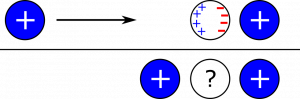

*[Return to Charge and Matter](/empcubed/notes/week-02-charges-superposition/charge_and_matter/)*

Suppose we have a positively charged object near a conductor. What happens to the charge distribution of the conductor when we bring an identical positively charged object near to the other side of the conductor? The situation is pictured below.

### Facts

- Mobile charges in a conductor can move easily through the material.
- The conductor is neutral (total net charge is $0\text{~C}$).
- A smaller distance between charges means a stronger interaction.

### Goal

- What will the charge distribution in the neutral conductor look like?

## Solution

A key fact here is that a **smaller distance between charges means a stronger interaction**. Consider the left-most region of the neutral conductor. The left object attracts negatively charged particles to this region, while the right object repels positively charged particles to this region. It turns out, though, this edge would **not** be neutral Since the left object is closer to this left-most region, its interaction is stronger than the right object, and we end up with a net negative charge in this region. Similarly, the right-most region also has a net negative charge. Since we assumed the conductor is neutral, the positive charge needs to go somewhere, too! The only region remaining is the middle, which must have a net positive charge in order for the conductor to remain neutral. A new representation is shown below.\

