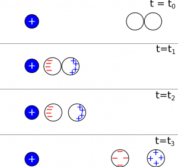
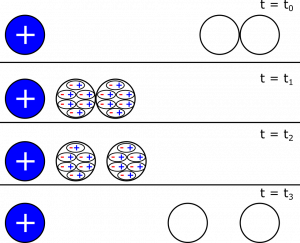

*[Return to Charging and Discharging](/empcubed/notes/week-02-charges-superposition/charging_discharging/)*

In the notes on [Charging and Discharging](/empcubed/notes/week-02-charges-superposition/charging_discharging/#charging), we saw how to charge a pair of conductors using induction. The relevant figure is shown below as a representation. Is it possible to charge a pair of insulators using induction? Why or why not?

### Facts

- Electrons in an insulator are tightly bound to the nucleus, so the atoms can polarize but charges cannot move freely through an insulator.

### Representations

- From the notes, we can pull a representation for how we would charge *conductors* using induction:

Induction with Conductors

- We can model the atoms in an insulator as little ovals (like the one below), that show when one side of the atom is more positive or negative than the other side. When ovals are not shown, this will just mean the atoms are not polarized.

Polarized Atom

### Goal

- Create an explanation for whether it is possible to charge a pair of insulators using induction.

## Solution

### Assumption

Right away, we make the assumption that an induction process for insulators would look the same as it does for conductors. The reason we make this assumption is because this process, as described in the notes, is our basis for understanding how charging by induction works. If it looks the same and involves the same steps, we can more easily describe what we think will happen.

We show the analogous “induction with insulators” with a step-by-step representation below. We knew from the facts that electrons cannot move freely between insulators, which is one of the key differences between insulators and conductors. At time $t = t_{0}$, both of the insulating balls start out as neutral. At time $t = t_{1}$, when the connected balls are moved close the charged object, the atoms in the insulators would polarize, but the electrons are not free to move further or to move from one ball to the next. This means when the insulating balls are separated at $t = t_{2}$, there are two polarized but overall neutral balls. As the balls are pulled farther away from the positive charge, they become less and less polarized, eventually returning to the same state that they were before at $t = t_{0}$ (neutral, not polarized).

Induction with Insulators

*The critical difference between conductors and insulators is that electrons can flow from one conductor to the other, but for insulators, the electrons are bound to their nuclei*. Because of this, the *insulators do not charge by induction.*
