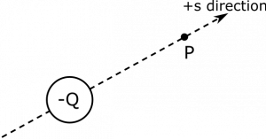
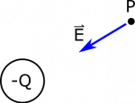

*[Return to Electric Field](/notes/week-01-charges-field-potential/pc_efield/)*

Suppose we have a negative charge $- Q$. What is the magnitude of the electric field at a point $P$, which is a distance $R$ from the charge? Draw the electric field vector on a diagram to show the direction of the electric field at $P$.

### Facts

- There is a negative charge $- Q$.
- The point $P$ is a distance $R$ away from the charge, with the orientation shown below in our representation.
- The electric field from the point charge at a particular observation location can be written as

$$
\overset{\rightarrow}{E} = \frac{1}{4\pi\epsilon_{0}}\frac{q}{r^{2}}\widehat{r},
$$

- where $q$ represents the charge, $r$ is the distance, and $\widehat{r}$ is the unit-vector pointing from the point charge source to the observation location.

### Representations

Negative Point Charge -Q, and Point P

### Assumptions

- Constant charge: Makes charge in electric field equation not dependent on time or space as no information is given in problem suggesting so.
- Charge is not moving: This makes our separation vector fixed in time as a moving charge would have a changing separation vector with time.

### Goal

- Find the magnitude and direction of the electric field at $P$.

## Solution

### Approximation

We approximate the charge with value $- Q$ as a point charge. This may not be the case, but our approximation does not seem unreasonable based on the limited information. In fact, this approximation is necessary, since we do not yet know how to represent electric field apart from the electric field from a point charge. We proceed with this in mind.

The electric field at $P$ is given by the electric field from a point charge:

$$
\overset{\rightarrow}{E} = \frac{1}{4\pi\epsilon_{0}}\frac{q}{r^{2}}\widehat{r}
$$

We can plug in our charge ($- Q$) and the magnitude of the separation vector (magnitude $R$) to get:

$$
\overset{\rightarrow}{E} = \frac{1}{4\pi\epsilon_{0}}\frac{( - Q)}{R^{2}}\widehat{r}
$$

This leaves us to find the unit vector $\widehat{r}$. The first thing to do would be to draw in the separation vector, ${\overset{\rightarrow}{r}}_{- Q \rightarrow P}$. This vector points from the charge $- Q$ to Point $P$ since $P$ is where we want to find the electric field (our observation location). We need to define a set of coordinate axes. We could pick the normal $x$- and $y$-axes, but this would make writing the $\overset{\rightarrow}{r}$ and $\widehat{r}$ more difficult because there would be both $x$- and $y$-components to the separation vector (since it points in some diagonal direction).

s-direction drawn in

Instead, we'll pick a coordinate direction that falls along the same axis as the separation vector, ${\overset{\rightarrow}{r}}_{- Q \rightarrow P}$. Since this is a coordinate direction that we're naming, let's call this the $\widehat{s}$ direction. That means that ${\overset{\rightarrow}{r}}_{- Q \rightarrow P}$ points in the $\widehat{s}$ direction, so $\widehat{r} = \widehat{s}$. Plugging this into our electric field equation gives:

$$
\overset{\rightarrow}{E} = \frac{1}{4\pi\epsilon_{0}}\frac{- Q}{R^{2}}\widehat{s}
$$

Since the charge is negative, this means that the electric field points in the *opposite* direction of the separation vector. To make this more explicit, we could put the negative sign right next to our unit-vector:

$$
\overset{\rightarrow}{E} = \frac{1}{4\pi\epsilon_{0}}\frac{Q}{R^{2}}( - \widehat{s})
$$

This gives the magnitude of the electric field as

$$
\left| \overset{\rightarrow}{E} \right| = \frac{1}{4\pi\epsilon_{0}}\frac{Q}{R^{2}}
$$

with the direction is given by $- \widehat{s}$. The electric field at $P$ therefore points from $P$ to the point charge. You'll find this to be true for all negative charge - **the electric field points towards negative charges**. A diagram indicating the direction of the electric field is shown below.

Charge Distribution Induced From Two Sides, Solution
