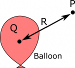

*[Return to Electric Potential](/notes/week-01-charges-field-potential/pc_potential/)*

Suppose we have a positively charged balloon with total charge $Q = 5.0 \cdot 10^{- 9}\text{~C}$. What is the electric potential (also called voltage) at a point $P$, which is a distance $R = 50\text{~cm}$ from the center of the balloon?

### Facts

- The balloon has total charge $Q = 5.0 \cdot 10^{- 9}\text{~C}$.
- The point $P$ is a distance $R = 50\text{~cm}$ away from the center of the balloon.
- The electric potential due to a point charge can be written as

$$
V = \frac{1}{4\pi\epsilon_{0}}\frac{q}{r},
$$

- where $q$ represents the charge and $r$ is the distance.

### Representations

### Assumption

We assume $P$ lies outside of the balloon. We make this assumption because it was not specified, but this seems to make more sense than $P$ being inside the balloon. This also helps us draw the representation below, which can be used to bolster our approximation later on of the balloon as a point charge.

Charged Balloon, and Point P

### Goal

- Find the electric potential at $P$.

## Solution

### Approximation

We approximate the balloon as a point charge. We do this because we have the tools to find the electric potential from a point charge. This seems like a reasonable approximation because the balloon is not too spread out, and we are interested in points outside the balloon. so the balloon might “look” like a point charge from the perspective of an observation location that is little far away.

### Assumption

The electric potential infinitely far away from the balloon is $0\text{~V}$. Read [here](/notes/week-02-charges-superposition/superposition/#superposition_of_electric_potential) for why this is important.

The electric potential at $P$ is given by

$$
\begin{matrix}
V & = \frac{1}{4\pi\epsilon_{0}}\frac{q}{r} \\
 & = \frac{1}{4\pi \cdot 8.85 \cdot 10^{- 12}\frac{\text{C}}{\text{Vm}}}\frac{5 \cdot 10^{- 9}\text{~C}}{0.5\text{~m}} \\
 & = 90\text{~V}
\end{matrix}
$$
