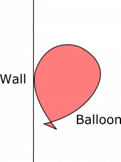
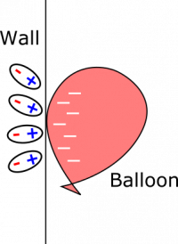

*[Return to Electric Force](/empcubed/notes/week-03-electric-force-energy/pc_force/)*

When you rub part of a rubber balloon against wool (or your hair), electrons will leave the wool, which is slightly conductive, and go onto the balloon. The rubber on the balloon is much less conductive (rubber is more of an insulator than wool), and the electrons will not readily leave the balloon. As a result, the balloon becomes negatively charged. Imagine you bring the negatively charged balloon up to a wall, and it sticks (This is possible! A quick internet search will yield many explanations and demonstrations. You can also try it yourself). Why would the balloon stay in one place on the wall? Draw a free body diagram for the balloon to help your explanation.

### Facts

- The balloon is negatively charged.
- The balloon is stuck to the wall.

### Representations

### Assumptions

We need to make a few assumptions to simplify our representation. The assumptions listed below are all reasonable, and will allow us to talk about the balloon and the wall without making any leaps in our logic.

- The balloon is motionless.
- The balloon is touching the wall at exactly one point.
- The wall is perfectly vertical (parallel to the gravitational force).

Balloon stuck to wall

### Goal

- Find a way to explain why the balloon sticks to the wall.

## Solution

We observe the balloon stuck motionless to the wall. If we want to draw a free body diagram to analyze the forces, we know that the net force must be zero. If we had to list out the forces, we could start with gravity. That will point straight down. Also, since the balloon is up against the wall, there must be a normal force from the wall, too. To simplify our model, we make an assumption:

### Assumption

We assume that there is no appreciable force of friction between the wall and the balloon. This assumption is not absolutely necessary – depending on what you think of the other forces at play, friction may or may not play a role. For our solution, we do not use friction, since we think it makes the discussion a little simpler.

We know the balloon is motionless, so air resistance is not a factor here, as it often is with balloons. The only other force we could have is the electric force between the balloon and the wall. Since the net force on our balloon is zero, the free body diagram looks something the following representation:

Balloon Force Diagram

In order to describe how we might get this diagonal electric force, we'll make a few more assumptions.

### Assumptions

We assume two things about the charges in the balloon and in the wall:

- The balloon is not very conductive, so the electrons from the wool are stuck where they are. We'll say they are distributed near the part of the balloon close to the wall.
- The wall is a perfect insulator, and is neutral.

We make the first assumption about the balloon because it will be easier to see where the electric force comes from if we can pinpoint where the negative charges in the balloon are. We make the second assumption about the wall so that we can model the wall using polarized atoms, which will interact with the negatively charged balloon to produce a force. If the wall were not neutral, there might be other electric force considerations, which would only complicate the situation.

With these assumptions in mind, it's reasonable to say that the interaction between the wall and the extra negative charges on the balloon is much stronger than the interaction between the wall and any polarized atoms in the balloon. For this reason, we can ignore polarized atoms in the balloon. This seems reasonable, since a balloon will not stick to a wall without having rubbed the balloon with something that will transfer some of its electrons to the balloon.

We can use the following representation, in which the balloon is motionless, to show how we are thinking of the balloon and the wall at this point:

Balloon Stuck to Wall (with charges shown)

We know that the balloon is negatively charged from rubbing it on wool/hair. When we bring the charged balloon close to the wall, the atoms in the wall near to the balloon become polarized with the electron clouds being pushed away from the negative balloon. See the notes on [Charges and Matter](/empcubed/notes/week-02-charges-superposition/charge_and_matter/) for more information on polarization. This means that the negative balloon is now *attracted* to the positive nuclei in the polarized wall. (The balloon is also repelled from the negative electron clouds, but since the nuclei are closer to the balloon, the attractive force is more powerful).

Notice that the electric force needs to point both to the left and upward in order for the net force to be zero. If you were to try this experiment out yourself, you may notice the balloon rolling slightly up and down (oscillating) before settling to a motionless state. As the balloon rolls, the charge distribution on the balloon moves in the same way that the balloon does, which changes the direction of the electric force on the balloon from the wall. When the balloon settles, we know it has come to a place where the direction and magnitude of the electric force results in a net force of zero.

*Another note on our assumption about friction*: We do not include friction in the force diagram. We assume the electric force has enough of an upwards component that friction contributes nothing. However, depending on assumptions that you make, you may have friction in your force diagram. In reality, there is probably both friction and a slightly upwards electric force component at play here.
