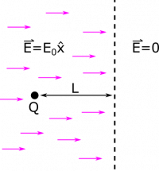

*[Return to Electric Potential Energy](/empcubed/notes/week-03-electric-force-energy/pc_energy/)*

Suppose you have a particle with a mass $m$, charge $Q$, initially at rest in an electric field $\overset{\rightarrow}{E} = E_{0}\widehat{x}$. The electric field extends for a distance $L$ in the $+ \widehat{x}$-direction before dropping off abruptly to 0. So, the magnitude of the electric field is exactly $E_{0}$, and then exactly $0$. There is no in-between. What happens to the particle if $Q > 0$? What if $Q < 0$? What if $Q = 0$? In one of these cases, the particle exits the electric field. What is its velocity when it reaches the region of zero electric field?

### Facts

- The particle starts at rest.
- It has mass $m$.
- It has charge $Q$, which can be positive or negative or zero.
- The particle is a distance $L$ from the boundary of the electric field.
- We can write the change in electric potential energy (from an initial location “$i$” to a final location “$f$”) for a point charge two ways here:

$$
\begin{matrix}
\Delta U & = - \int_{i}^{f}\overset{\rightarrow}{F} \bullet d\overset{\rightarrow}{r} & & & & & & (1) \\
\Delta U & = q\Delta V & & & & & & (2)
\end{matrix}
$$

- We can write the change in electric potential (from an initial location “$i$” to a final location “$f$”) as

$$
\begin{matrix}
\Delta V = - \int_{i}^{f}\overset{\rightarrow}{E} \bullet d\overset{\rightarrow}{r} & & & & & & (3)
\end{matrix}
$$

- We can represent the electric force on point charge as

$$
\begin{matrix}
\overset{\rightarrow}{F} = q\overset{\rightarrow}{E} & & & & & & & & (4)
\end{matrix}
$$

### Representations

Particle Q in the Electric Field

### Assumption

No gravitational effects are being considered in this problem. Typically point charges are really small and have negligible masses. This means that the gravitational force would be very small compared to the electric force acting on the particle in the accelerator and can be excluded from the calculations and representation.

### Goal

- Find out which direction the particles moves, if at all. This will probably depend on the value of $Q$, since this is what varies.
- The velocity of the particle when it reaches the boundary of the electric field.

## Solution

### Approximation

We will approximate the particle as a *point charge*. We already know it is a “particle” which is a pretty small thing, so our approximation seems reasonable. We want to make this approximation because it allows us to use certain tools, like the equation for electric force in the Facts, tools that can only be applied to point charges.

In order to figure out what will happen to the particle, we can use our expression (equation 4) for the force on a point charge due to an electric field: $\overset{\rightarrow}{F} = q\overset{\rightarrow}{E} = QE_{0}\widehat{x}$. From this expression we can tell what will happen based on the sign of the charge $Q$.

If $Q = 0$, then $\overset{\rightarrow}{F} = (0)\overset{\rightarrow}{E}$. So no matter how big the electric field is, if the particle is uncharged, it won't feel a force. If $Q < 0$, the force will be in the $- \widehat{x}$-direction opposite of the electric field, which is to the left in our figure. Since the particle starts from rest, it will accelerate to the left, and will not leave the electric field. Alternatively, if $Q > 0$, then the force will be in the $+ \widehat{x}$-direction following the electric field direction, which is to the right. The positive particle will accelerate from rest to the right, and will reach the region of zero electric field.

Okay, so now the only thing we need to find is the velocity of the particle ($Q > 0$) when it reaches the boundary of the electric field. Where can we start? Let's break down what is happening to the particle. It starts from rest. Since it has charge, and the electric field at its location is nonzero, it feels an electric force. The force acts on the particle, and the particle accelerates. When it leaves the electric field, its acceleration drops to zero, so it is moving at constant velocity.

It would be easy to find the electric force (like we did above), but it's not obvious how we'd find out the amount of time the particle spends in the electric field. We would need to know the timing in order to use force to find the change in momentum ($\overset{\rightarrow}{F} = \Delta\overset{\rightarrow}{p}/\Delta t$). So we won't try to go down that road. Alternatively, we could find the velocity if we knew the kinetic energy. As it turns out, there is a way to set up a conservation-of-energy-type solution…

### Plan

We will use conservation of energy to find the final velocity of the particle. We'll go through the following steps.

- Our system will be the single particle.
- The initial state is when the particle is at rest in the electric field.
- The final state is when the particle exits the electric field.
- We expect the system to experience a decrease in electric potential energy, and an equivalent increase in kinetic energy.
- We can use the new kinetic energy to find the corresponding velocity.

We have listed two expressions (Equations (1) and (2)) for the electric potential energy of the particle. You can check for yourself that both lead us to the following equation (using Equations (3) and (4)):

$$
\Delta U = - q\int_{i}^{f}\overset{\rightarrow}{E} \bullet d\overset{\rightarrow}{r}
$$

We choose the path of integration to start at the current location of the particle, and end at place where the particle exits the electric field, as outlined in the Plan. The particle will follow a straight line in the $+ x$-direction (when $Q > 0$, as explained earlier). So we can set $\text{d}\overset{\rightarrow}{r} = \text{d}x \cdot \widehat{x}$. We also need to define the path endpoints, so we'll say the particle starts at $x_{i} = x_{0}$, which means the integration will end at $x_{f} = x_{0} + L$. You'll see that it won't matter in the end what $x_{0}$ is, since it drops out. In fact, it is common to set $x_{0} = 0$, for simplicity of calculation. In this example, we'll leave it as $x_{0}$.

$$
\begin{matrix}
\Delta U & = - q\int_{i}^{f}\overset{\rightarrow}{E} \bullet \text{d}\overset{\rightarrow}{r} \\
 & = - Q\int_{x_{0}}^{x_{0} + L}E_{0}\text{d}x(\widehat{x} \bullet \widehat{x}) \\
 & = - QE_{0}\int_{x_{0}}^{x_{0} + L}\text{d}x \\
 & = \left. \  - QE_{0}x \right|_{x_{0}}^{x_{0} + L} \\
 & = - QE_{0}(x_{0} + L - x_{0}) \\
 & = - QE_{0}L
\end{matrix}
$$

### Assumption

Assuming the electric field is constant within the accelerator allows the $E_{0}$ to be taken out of the integral in this problem.

The physical significance of this result is that the particle “loses” $QE_{0}L$ of electric potential energy as it travels through the electric field. We do not transfer any energy to the surroundings (through heat, friction, etc.), so this “lost” potential energy must have just been converted to kinetic energy.

$$
0 = \Delta E_{\text{sys}} = \Delta U + \Delta K = - QE_{0}L + \frac{1}{2}m(v_{f}^{2} - v_{i}^{2})
$$

### Assumption

Assuming there is a conservation of energy allows the total change in energy of the system to be zero.

Remember that ${\overset{\rightarrow}{v}}_{i} = 0$, so we can solve for the unknown ${\overset{\rightarrow}{v}}_{f}$:

$$
\begin{matrix}
 & 0 = - QE_{0}L + \frac{1}{2}m(v_{f}^{2} - 0) \\
 \Rightarrow \  & QE_{0}L = \frac{1}{2}mv_{f}^{2} \\
 \Rightarrow \  & \frac{2QE_{0}L}{m} = v_{f}^{2}
\end{matrix}
$$

We reasoned earlier that the particle will be traveling in the $+ x$-direction, so the final velocity will be

$$
{\overset{\rightarrow}{v}}_{f} = \sqrt{\frac{2QE_{0}L}{m}}\widehat{x}
$$
