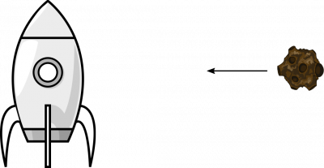
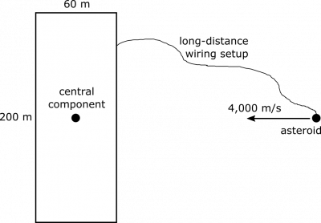

*[Return to Electric Potential Energy](/empcubed/notes/week-03-electric-force-energy/pc_energy/)*

Suppose your friend is vacationing in Italy, and she has lent you her spaceship for the weekend. You have gathered together a group of friends and you are currently cruising through the heavens together and having a great time. You are surrounded by nothingness in all directions. Suddenly, the radar starts beeping ferociously. The ship is on a collision course with an asteroid. You are not too worried about survival – the ship is practically indestructible. However, you know your friend would be devastated if you returned her spaceship with a scratch or dent from the asteroid. You need to prevent the collision.

You and everyone else on the ship has forgotten the combination to unlock the control room, and you don't want to disrupt your friend's peaceful vacation with worries about an asteroid, not to mention the outrageous rates on interstellar phone calls. You cannot change the ship's course. However, the message from the radar system may have given you some information you can use:

“The asteroid is coming from the due starboard direction with respect to the ship. The asteroid is approaching with a speed of 4,000 meters/second with respect to the ship. The asteroid has a mass of 20,000 kilograms. The asteroid has a charge of 50 Coulombs. As always, our ship is 200 meters long, and 60 meters wide. Collision will occur in 10 minutes.”

You get to thinking, and you remember there is another set of controls in an unlocked room. This set of controls is designed specifically to prevent asteroid collisions. The ship uses an advanced long-distance wiring setup to extract charge from the asteroid and bring it to a component located at the center of the ship. By charging the component, a repulsive electric force is generated between the asteroid and the component. Is it possible to charge the component in this way to prevent a collision? If so, what is the minimum amount of charge you can extract from the asteroid to prevent the collision? What happens if we extract all the charge from the asteroid (the component is charged to $50\text{~C}$, and the asteroid becomes neutral)?

### Facts

- The asteroid has mass $m = 20000\text{~kg}$.
- The asteroid has speed $v = 4000\text{~m/s}$.
- The asteroid has charge $Q = 50\text{~C}$.
- The ship is $200\text{~m}$ long and $60\text{~m}$ wide.
- The asteroid will reach the ship in $10\text{~minutes}$.
- The asteroid is approaching from the starboard (right) direction.
- The central component can be charged using charge from the asteroid.
- The electric potential energy of a point charge in the electric field of another point charge is

$$
U_{r} = \frac{1}{4\pi\epsilon_{0}}\frac{q_{1}q_{2}}{r}
$$

- This was derived in the notes [here](/empcubed/notes/week-03-electric-force-energy/pc_energy/#general_relationship_-_energy_and_force).

### Goal

\* Prevent the asteroid collision using the long-distance wiring setup.

### Representations

### Approximations

We want to make a useful representation, so we make some approximations to help us simplify the model.

- We approximate the asteroid as a point charge.
- We approximate the ship as a rectangle (as seen in the representation below).
- We approximate the central component as a point charge.
- We approximate that the path of the asteroid goes straight toward the central component.

These are all reasonable approximations, as asteroid and central component are both much smaller than the ship, so it's okay to treat them as point charges. The shape of the ship and trajectory of the asteroid are not explicitly discussed in the problem statement, but it would make sense for us to model the ship as a rectangle, since its dimensions are preserved, and the straight path of the asteroid also makes sense since we are in outer space.

## Solution

This is a complicated problem. We will definitely need a plan. Before we dive into the numbers, let's describe what will happen qualitatively. If we can extract some charge from the asteroid, then both the asteroid and the central component will be positively charged. Two positive point charges will repel, so as the asteroid gets closer to the ship, it slows down, until eventually (hopefully!) it will come to stop, and start moving away from the ship. The thing we are most concerned about is how close the asteroid will approach before turning around – we don't want it to get close enough to scrape the side of the ship. It might make sense to take a conservation-of-energy approach, since the asteroid will be losing kinetic energy and gaining electric potential energy as it approaches the ship, and we can track this numerically.

### Plan

We will use conservation of energy to find the distance the asteroid can reach. We'll go through the following steps.

- The system is the asteroid.
- The initial state is when the asteroid is very far away, an hour from impact.
- The final state is when the asteroid has stopped before crashing into the ship.
- We expect the system to experience a increase in electric potential energy, and an equivalent decrease in kinetic energy.
- We can use the change in kinetic energy to find the change in electric potential energy, which can be used to find the charge needed on the central component.

The asteroid's kinetic energy will become electric potential energy as it approaches the spaceship. Its change in kinetic energy will be pretty straightforward to calculate (we'll plug in all the numbers at the end):

$$
\Delta K = \frac{1}{2}m(v_{f}^{2} - v_{i}^{2}) = - \frac{1}{2}mv^{2}
$$

### Assumptions

We did not include the ship in our system. What if its energy changes due to the incoming asteroid? Well, in order to simplify problem, we will just assume its kinetic energy doesn't change.

- The ship is currently floating through space, and therefore has constant velocity.
- The ship is far more massive than the asteroid to the degree that its current constant-velocity motion is not affected by the asteroid.

Based on our representations, this seems like a reasonable assumption. Also, we are happy to make this assumption, since it is a worst-case assumption. The reason a humungous ship is the worst case, is because it will not be significantly repelled by the asteroid. If our ship were tiny, we would not have to worry as much about collision, since we would move away from the asteroid just due to the repelling electric force.

The change in electric potential energy will depend on how close the asteroid gets to the ship, and how we choose to charge the central component. Currently, its distance is $4000\text{~m/s} \cdot 60\text{~seconds/minute} \cdot 10\text{~minutes} = 2.4 \cdot 10^{6}\text{~m}$. We also know $q_{comp} + q_{ast} = 50\text{~C}$, and we don't want the asteroid to approach the central component at a distance any closer than $30\text{~m}$ (this is half the width of the ship, and the distance from the central component to the wall). For simplicity of calculation, we'll orient our coordinates so that the central component is at the origin, and the asteroid lies on the $x$-axis. We'll keep the initial and final positions of the asteroid as variables:

$$
\begin{matrix}
\Delta U & = \frac{1}{4\pi\epsilon_{0}}\frac{q_{ast}q_{comp}}{x_{f}} - \frac{1}{4\pi\epsilon_{0}}\frac{q_{ast}q_{comp}}{x_{i}} \\
 & = \frac{q_{comp}q_{ast}}{4\pi\epsilon_{0}}\left( \frac{1}{x_{f}} - \frac{1}{x_{i}} \right)_{*}
\end{matrix}
$$

Ultimately, we want to figure out what $q_{comp}$ needs to be. $q_{ast}$ also depends on this, so let's solve for $q_{comp}q_{ast}$, using energy conservation, as we outlined earlier. We want $x_{f} > 30\text{~m}$, which leads to the following.

$$
\begin{matrix}
0 & = \Delta U + \Delta K \\
 & = \frac{q_{comp}q_{ast}}{4\pi\epsilon_{0}}\left( \frac{1}{x_{f}} - \frac{1}{x_{i}} \right) - \frac{1}{2}mv^{2} \\
 & < \frac{q_{comp}q_{ast}}{4\pi \cdot 8.85 \cdot 10^{- 12}\frac{\text{C}^{2}}{\text{Jm}}}\left( \frac{1}{30\text{~m}} - \frac{1}{2.4 \cdot 10^{6}\text{~m}} \right) - \frac{1}{2}\left( 20000\text{~kg} \cdot \left( 4000\text{~m/s} \right)^{2} \right) \\
 & = \frac{q_{comp}q_{ast}}{\text{C}^{2}} \cdot 3.00 \cdot 10^{8}\text{~J} - 1.6 \cdot 10^{11}\text{~J}
\end{matrix}
$$

This yields

$$
q_{comp}q_{ast} > \frac{1.6 \cdot 10^{11}\text{~J}}{3.00 \cdot 10^{8}\text{~J}}\text{~C}^{2} = 530\text{~C}^{2}
$$

Remember that we have the constraint $q_{comp} + q_{ast} = 50\text{~C}$. With this in mind, can we prevent the collision? Setting $q_{ast} = 50\text{~C} - q_{comp}$, we obtain

$$
q_{comp}(50\text{~C} - q_{comp}) = 50\text{~C} \cdot q_{comp} - q_{comp}^{2} > 530\text{~C}^{2}
$$

To still save the ship while charging the central component minimally, one simply needs to solve the quadratic equation based on the inequality above: $50\text{~C} \cdot q_{comp} - q_{comp}^{2} = 530\text{~C}^{2}$. An application of the quadratic formula or a quick query to Wolfram-Alpha gives a minimum charge of $q_{comp} \approx 15\text{~C}$, which means $35\text{~C}$ remains on the asteroid. Notice that if we transfer all the charge from the asteroid to the central component, $q_{comp}q_{ast} = 0$, since $q_{ast} = 0$. If we do this, the asteroid will collide with the ship! It's worth convincing yourself that this result makes sense.

### $*$Note about $\Delta U$

We include a $1/x_{i}$ term, which we know is very small, and will not contribute to the change in electric potential energy. Technically, this term shouldn't be there at all! This is because when the asteroid was located at $x_{i}$, before we even used the controls to create the long-distance wiring setup, the charge on the central component was 0, and there was no electric force on the asteroid at all. When we create the wiring setup and extract charge, we also increase the electric potential energy by a small amount proportional to the $1/x_{i}$ term, which means the initial speed (initial here meaning directly after the wiring) actually is *slightly* less than $4000\text{~m/s}$. To be exactly correct, we would need to either scrap the $1/x_{i}$ term, or use a slightly lower initial speed – depending on when we want the “initial” state to be defined, either directly before or directly after the wiring. However, this difference is negligible, and the expression we have for $\Delta U$ as it is right now may be encountered again in other contexts, so we leave it alone.
