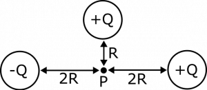
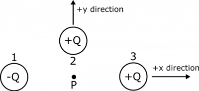
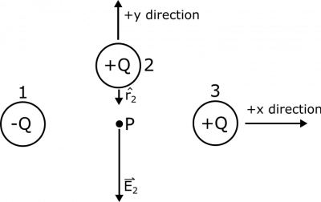
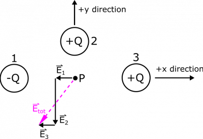

*[Return to superposition](/notes/week-02-charges-superposition/superposition/)*

Suppose we have a distribution of point charges in a plane near a point $P$. There are three point charges: Charge 1 with charge $- Q$, a distance $2R$ to the left of $P$; Charge 2 with charge $Q$, a distance $R$ above $P$; and Charge 3 with charge $Q$, a distance $2R$ to the right of $P$. Find the electric potential and the electric field at the point $P$.

### Facts

- All charges in the distribution are point charges.
- There are three point charges:
  - $- Q$, a distance $2R$ to the left of $P$
  - $Q$, a distance $R$ above $P$
  - $Q$, a distance $2R$ to the right of $P$
- The electric field from a point charge can be written as

$$
\overset{\rightarrow}{E} = \frac{1}{4\pi\epsilon_{0}}\frac{q}{r^{2}}\widehat{r}.
$$

- The electric potential from a point charge can be written as

$$
V = \frac{1}{4\pi\epsilon_{0}}\frac{q}{r}.
$$

- We can use superposition to add electric field contributions from the point charges (vector superposition): ${\overset{\rightarrow}{E}}_{tot} = {\overset{\rightarrow}{E}}_{1} + {\overset{\rightarrow}{E}}_{2} + {\overset{\rightarrow}{E}}_{3}$.
- We can use superposition to add electric potential contributions from the point charges (scalar superposition): $V_{tot} = V_{1} + V_{2} + V_{3}$.

### Representations

Point Charge Distribution

### Assumptions

- Charge is constant: Simplifies the values of each charge meaning they are not charging or discharging over time.
- Charges are not moving: Simplifies the separation vectors of each charge as these would be changing if the charges were moving through space.

### Goal

- Find the electric field and electric potential at P.

## Solution

In this example, it makes sense to set up coordinate axes so that the $x$-axis stretches from left to right, and the $y$-axis stretches from down to up. To make it easier to discuss the example, we'll also label the point charges as Charge 1, Charge 2, and Charge 3, as shown in an updated representation.

Point Charge Distribution with Labels

First, let's find the contribution from Charge 1. The separation vector ${\overset{\rightarrow}{r}}_{1}$ points from the source to the observation ($1 \rightarrow P$), so ${\overset{\rightarrow}{r}}_{1} = 2R\widehat{x}$, and

$$
\widehat{r_{1}} = \frac{{\overset{\rightarrow}{r}}_{1}}{|r_{1}|} = \frac{2R\widehat{x}}{2R} = \widehat{x}
$$

Visually, this is what we know about $\widehat{r_{1}}$, and what we expect for ${\overset{\rightarrow}{E}}_{1}$, since Charge 1 is negative:

E-vector and r-hat for Charge 1

Now, we can find ${\overset{\rightarrow}{E}}_{1}$ and $V_{1}$. Before we show the calculation, though, we need to make an assumption about the electric potential.

### Assumption

The electric potential infinitely far away from $P$ is $0\text{~V}$. Read [here](/notes/week-02-charges-superposition/superposition/#superposition_of_electric_potential) for why this is important.

Now, we are ready to find the contributions from Charge 1 on the electric field and electric potential.

$$
{\overset{\rightarrow}{E}}_{1} = \frac{1}{4\pi\epsilon_{0}}\frac{q}{r^{2}}\widehat{r} = \frac{1}{4\pi\epsilon_{0}}\frac{- Q}{4R^{2}}\widehat{x} = - \frac{1}{16\pi\epsilon_{0}}\frac{Q}{R^{2}}\widehat{x}
$$

$$
V_{1} = \frac{1}{4\pi\epsilon_{0}}\frac{q}{r} = \frac{1}{4\pi\epsilon_{0}}\frac{- Q}{2R} = - \frac{1}{8\pi\epsilon_{0}}\frac{Q}{R}
$$

These answers seem to make sense: We have a negative electric potential, which we would expect from a negative charge. We also found that our electric field points toward Charge 1, which we would again expect because Charge 1 is negative.

For Charge 2, we expect the following representation to be accurate, again since the separation vector ${\overset{\rightarrow}{r}}_{2}$ points from the source to the observation ($2 \rightarrow P$), and Charge 2 is positive:

E-vector and r-hat for Charge 1

We can see that $\widehat{r_{2}} = - \widehat{y}$, and

$$
{\overset{\rightarrow}{E}}_{2} = \frac{1}{4\pi\epsilon_{0}}\frac{q}{r^{2}}\widehat{r} = \frac{1}{4\pi\epsilon_{0}}\frac{Q}{R^{2}}( - \widehat{y}) = - \frac{1}{4\pi\epsilon_{0}}\frac{Q}{R^{2}}\widehat{y}
$$

$$
V_{2} = \frac{1}{4\pi\epsilon_{0}}\frac{q}{r} = \frac{1}{4\pi\epsilon_{0}}\frac{Q}{R}
$$

These answers should also make sense for a few reasons: 1) we now have a positive electric potential (coming from the positive Charge 2), 2) the electric field points away from Charge 2 (which we could expect since Charge 2 is positive), and 3) both the magnitude of the electric field and the electric potential are larger than those from Charge 1, which makes sense because Charge 2 is closer to Point $P$ than Charge 1 was.

For Charge 3, we expect the following representation to be accurate, since Charge 3 is positive:

E-vector and r-hat for Charge 1

We can see that $\widehat{r_{3}} = - \widehat{x}$ (Pointing from Charge 3 to $P$), and

$$
{\overset{\rightarrow}{E}}_{3} = \frac{1}{4\pi\epsilon_{0}}\frac{q}{r^{2}}\widehat{r} = \frac{1}{4\pi\epsilon_{0}}\frac{Q}{4R^{2}}( - \widehat{x}) = - \frac{1}{16\pi\epsilon_{0}}\frac{Q}{R^{2}}\widehat{x}
$$

$$
V_{3} = \frac{1}{4\pi\epsilon_{0}}\frac{q}{r} = \frac{1}{4\pi\epsilon_{0}}\frac{Q}{2R} = \frac{1}{8\pi\epsilon_{0}}\frac{Q}{R}
$$

Again, we get a positive electric potential from the positive charge (so this is good), and we get an electric field that points away from the positive charge, so we are happy.

E-vector superposition

Now that we have the individual contributions from the point charges, we can use the principle of superposition to add together the electric field vectors and the electric potentials. See above the representation for superposition of electric fields.

$$
{\overset{\rightarrow}{E}}_{tot} = {\overset{\rightarrow}{E}}_{1} + {\overset{\rightarrow}{E}}_{2} + {\overset{\rightarrow}{E}}_{3} = - \frac{1}{16\pi\epsilon_{0}}\frac{Q}{R^{2}}\widehat{x} - \frac{1}{4\pi\epsilon_{0}}\frac{Q}{R^{2}}\widehat{y} - \frac{1}{16\pi\epsilon_{0}}\frac{Q}{R^{2}}\widehat{x} = \frac{1}{8\pi\epsilon_{0}}\frac{Q}{R^{2}}( - \widehat{x} - 2\widehat{y})
$$

$$
V_{tot} = V_{1} + V_{2} + V_{3} = - \frac{1}{8\pi\epsilon_{0}}\frac{Q}{R} + \frac{1}{4\pi\epsilon_{0}}\frac{Q}{R} + \frac{1}{8\pi\epsilon_{0}}\frac{Q}{R} = \frac{1}{4\pi\epsilon_{0}}\frac{Q}{R}
$$

So our total electric potential is positive - this should make sense as we have two positive charges and only one negative charge, and even better, one of the positive charges is much closer to $P$ than the other charges so it should have a stronger effect. We found that our electric field points down and to the left, which is away from both of the positive charges and towards the negative charge – again consistent with what we expect.
