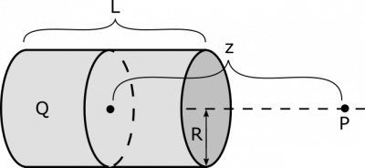
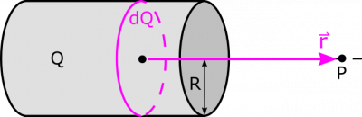

### Note: Super Challenge Problem!! -- This is a beyond the scope of this class (so you won't be expected to solve this kind of problem), but it is a cool example of how to expand from lines to areas of charge if you are interested

Suppose we have a cylindrical shell with radius $R$ and length $L$ that has a uniform charge distribution with total charge $Q$. The cylinder does not have bases, so the charge is only distributed on the wall that wraps around the cylinder at the radius $R$. What is the electric field at a point $P$, which is a distance $z$ from the center of the cylinder, along the axis that passes through the center of the cylinder and parallel to its wall? What happens to the electric field as $z = 0$? What about for very large $z$? Why?

### Facts

- The point $P$ is a distance $z$ away from the center of the cylinder.
- The cylinder has a charge $Q$, which is uniformly distributed.
- The cylinder has length $L$ and radius $R$.
- The electric field due to a ring with the same dimensions in the $xy$-plane at a point along the $z$-axis is

$$
\overset{\rightarrow}{E} = \frac{1}{4\pi\epsilon_{0}}\frac{Qz}{(R^{2} + z^{2})^{3/2}}\widehat{z}
$$

- We found this out in the [previous example](/examples/week4_charge_ring/).

### Goal

- Find the electric field at $P$.

### Assumptions

- This is a perfect cylinder: This simplifies down the geometry of the problem and allows us to use any equations related to the geometry of the cylinder
- There is no top or bottom: We make this assumption so that we can break the cylinder up into rings and not have to do anything with the top or bottom sides of the cylinder (essentially we are dealing with a 2D tube).

### Representations

## Solution

### Approximation

We begin with an approximation, which will make our calculations simpler, and makes sense based on our representation:

- The thickness of the cylindrical shell is infinitesimally small, and we can approximate it as 2-dimensional shell.

We also make a plan to tackle the integrating, which is tough, especially considering this example is a “Super Challenge Problem”.

### Plan

We will use integration to find the electric field from the entire cylindrical shell. We'll go through the following steps.

- Slice the cylindrical shell into thin rings, which we know about from the [previous example](/examples/week4_charge_ring/).
- Write an expression for $\text{d}Q$, which is the charge of one of the rings.
- Decide on a consistent way to define the location of the ring, and use this to write an expression for $\text{d}Q$
- Assign a variable location to the $\text{d}Q$ piece, and then use that location to find the separation vector, $\overset{\rightarrow}{r}$.
- Write an expression for $\text{d}\overset{\rightarrow}{E}$.
- Figure out the bounds of the integral, and integrate to find electric field at $P$.

Notice that our $\text{d}Q$ is different than other $\text{d}Q$s we have used so far. But using a whole ring as our $\text{d}Q$ makes sense. The cylindrical shell is 2-dimensional, which means that if our $\text{d}Q$ is a small patch of the surface, then we will have a 2-dimensional integral, which is doable but more complicated than necessary. Instead, we can take a thin slice of the entire cylinder, which gives us a ring. We only need an integral for traversing along the *length* of the cylinder, and we are able to account for the entire surface of the cylinder while travelling in only one dimension. We will represent our $\text{d}Q$ as a fraction of the total $Q$ based on the thickness of our ring (we set our coordinates such that $+ x$-direction is to the right, and the center of the cylinder is at the origin):

$$
\text{d}Q = \lambda\text{d}l = \frac{Q\text{d}x}{L}
$$

We choose $\overset{\rightarrow}{r}$ based on what we know about the electric field from a ring. In the [previous example](/examples/week4_charge_ring/), we determined an electric field vector that depends on $z$. Notice that the $z$ from that example is the same $z$ here. The vector also was aligned with the $z$-axis, which in this example is along the axis that passes through the cylinder and through the point $P$. The tricky part is determining the location of the “source”, since a ring occupies many points in space. As long as we are consistent, though, we will be okay. Based on the result previous example, it makes sense to have the source location just be the center of the ring. As always, $\overset{\rightarrow}{r}$ is directed from source to point of observation:

$$
\overset{\rightarrow}{r} = z\widehat{x} - x\widehat{x} = (z - x)\widehat{x}
$$

Now that we are okay on defining $\text{d}Q$ and $\overset{\rightarrow}{r}$, we update the representation to reflect these decisions:  text etgdsygt fzuhf gfsfzubfuzsuf z xd uyfg cgi. kki99ki.

Trivially, we also have $r = |\overset{\rightarrow}{r}| = |z - x|$. We retain the absolute value notation, so that we can generalize for when $P$ is inside the cylinder. You see below that the absolute value notation immediately drops out.

The electric field $\text{d}\overset{\rightarrow}{E}$ from our ring of charge $\text{d}Q$ is then

$$
\text{d}\overset{\rightarrow}{E} = \frac{1}{4\pi\epsilon_{0}}\frac{r\text{d}Q}{(R^{2} + r^{2})^{3/2}}\widehat{r} = \frac{1}{4\pi\epsilon_{0}}\frac{|z - x|Q\text{d}x}{L(R^{2} + |z - x|^{2})^{3/2}}\left( \frac{(z - x)\widehat{x}}{|z - x|} \right) = \frac{1}{4\pi\epsilon_{0}}\frac{(z - x)Q\text{d}x}{L(R^{2} + (z - x)^{2})^{3/2}}\widehat{x}
$$

From here, we can easily set up the integral for calculating the electric field. We set the limits of integration to be $- L/2$ to $L/2$, since we placed the origin at the center of the cylinder, and we are integrating over its length in $x$:

$$
\begin{matrix}
\overset{\rightarrow}{E} & = \int\text{d}\overset{\rightarrow}{E} \\
 & = \int_{- L/2}^{L/2}\frac{Q}{4\pi\epsilon_{0}L}\frac{(z - x)\text{d}x}{(R^{2} + (z - x)^{2})^{3/2}}\widehat{x} \\
 & = \frac{Q\widehat{x}}{4\pi\epsilon_{0}L}\int_{- L/2}^{L/2}\frac{(z - x)\text{d}x}{(R^{2} + (z - x)^{2})^{3/2}} \\
 & = \frac{Q\widehat{x}}{4\pi\epsilon_{0}L}\left\lbrack \frac{1}{\sqrt{R^{2} + (z - x)^{2}}} \right\rbrack_{- L/2}^{L/2} \\
 & = \frac{Q\widehat{x}}{4\pi\epsilon_{0}L}\left( \frac{1}{\sqrt{R^{2} + \left( z - \frac{L}{2} \right)^{2}}} - \frac{1}{\sqrt{R^{2} + \left( z + \frac{L}{2} \right)^{2}}} \right)
\end{matrix}
$$

For $z = 0$, we have

$$
\overset{\rightarrow}{E} = \frac{Q\widehat{x}}{4\pi\epsilon_{0}L}\left( \frac{1}{\sqrt{R^{2} + \left( \frac{L}{2} \right)^{2}}} - \frac{1}{\sqrt{R^{2} + \left( \frac{L}{2} \right)^{2}}} \right) = 0
$$

This makes sense because $P$ will be at the center of the cylindrical shell. Any electric field vector contribution from one ring-slice will be cancelled out perfectly with the opposite slice. Now, for very large $z$, we expand the denominators in our fractions:

$$
\overset{\rightarrow}{E} = \frac{Q\widehat{x}}{4\pi\epsilon_{0}L}\left( \frac{1}{\sqrt{R^{2} + z^{2} - Lz + \frac{L^{2}}{4}}} - \frac{1}{\sqrt{R^{2} + z^{2} + Lz + \frac{L^{2}}{4}}} \right)
$$

Next, we eliminate the constant terms in the denominators, since these will be very small compared to terms with $z$:

$$
\overset{\rightarrow}{E} = \frac{Q\widehat{x}}{4\pi\epsilon_{0}L}\left( \frac{1}{\sqrt{z^{2} - Lz}} - \frac{1}{\sqrt{z^{2} + Lz}} \right) = \frac{Q\widehat{x}}{4\pi\epsilon_{0}Lz}\left( \frac{1}{\sqrt{1 - \frac{L}{z}}} - \frac{1}{\sqrt{1 + \frac{L}{z}}} \right)
$$

Since $L/z$ is very small, we can approximate $\sqrt{1 - L/z} \approx 1 - L/2z$, and $\sqrt{1 + L/z} \approx 1 + L/2z$. This can be checked quickly by computing or looking up the Taylor series for $\sqrt{1 + x}$ about $x_{0} = 0$. Now, we finish our calculation:

$$
\begin{matrix}
\overset{\rightarrow}{E} & = \frac{Q\widehat{x}}{4\pi\epsilon_{0}Lz}\left( \frac{1}{1 - \frac{L}{2z}} - \frac{1}{1 + \frac{L}{2z}} \right) \\
 & = \frac{Q\widehat{x}}{4\pi\epsilon_{0}Lz}\left( \frac{\left( 1 + \frac{L}{2z} \right) - \left( 1 - \frac{L}{2z} \right)}{\left( 1 - \frac{L}{2z} \right)\left( 1 + \frac{L}{2z} \right)} \right) \\
 & = \frac{Q\widehat{x}}{4\pi\epsilon_{0}Lz}\left( \frac{\frac{L}{z}}{1 - \frac{L^{2}}{4z^{2}}} \right) = \frac{Q\widehat{x}}{4\pi\epsilon_{0}z^{2}}\left( \frac{1}{1 - \frac{L^{2}}{4z^{2}}} \right) \\
 & = \frac{Q\widehat{x}}{4\pi\epsilon_{0}\left( z^{2} - \frac{L^{2}}{4} \right)}
\end{matrix}
$$

Since $z$ is very large we will once again eliminate any constant terms tied in with it.

$$
\overset{\rightarrow}{E} = \frac{1}{4\pi\epsilon_{0}}\frac{Q}{z^{2}}\widehat{x}
$$

As we can see this is exactly the equation we get for a point charge! This should be expected. When viewing charged objects from far away they can be approximated as points, kinda like looking at a person from a distance.
