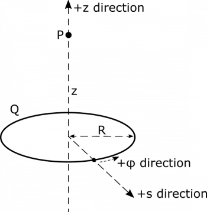
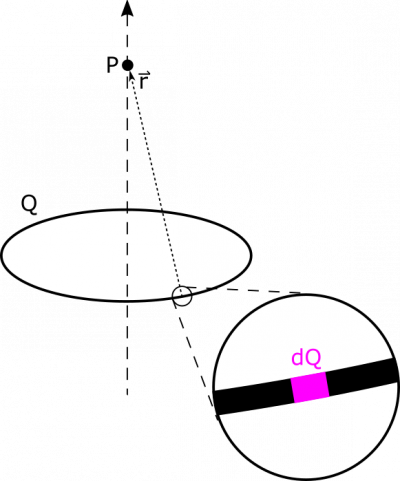
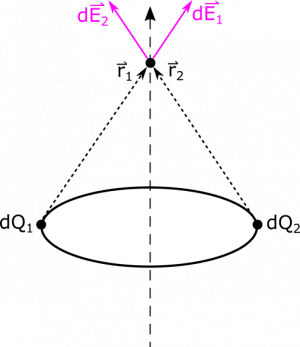

*[Return to line of charge](/notes/week-04-modeling-distributions-of-charge/linecharge/)*

Suppose we have a ring with radius $R$ that has a uniform charge distribution with total charge $Q$. What is the electric field at a point $P$, which is a distance $z$ from the center of the ring, along a line perpendicular to the plane of the ring? What happens to the electric field if $z = 0$ (i.e., when $P$ is in the center of the ring rather than above it)? Why?

### Facts

- The point $P$ is a distance $z$ away from the center of the ring.
- The ring has a charge $Q$, which is uniformly distributed.

### Lacking

- Electric field at $P$.
- $\text{d}Q$ and $\overset{\rightarrow}{r}$
- The electric field from the point charge can be written as

$$
\overset{\rightarrow}{E} = \frac{1}{4\pi\epsilon_{0}}\frac{q}{r^{3}}\overset{\rightarrow}{r}
$$

### Representations

We can represent the ring and $P$ as follows, with coordinates chosen conveniently. We choose cylindrical coordinates because we will be integrating over the length of the ring, and being able to represent its radius as constant will simplify calculations. 

## Solution

### Approximation

We begin with an approximation, which will make our calculations simpler, and makes sense based on our representation:

- The thickness of the ring is infinitesimally small, and we can approximate it as a circle.
- The ring is in a perfect circle.

We also make a plan to tackle the integrating, which is a little tougher in cylindrical coordinates.

### Plan

We will use integration to find the electric field from the ring. We'll go through the following steps.

- Reason about the geometry of the ring to find and $\text{d}l$ and $\lambda$.
- Write an expression for $\text{d}Q$.
- Assign a variable location to the $\text{d}Q$ piece, and then use that location to find the separation vector, $\overset{\rightarrow}{r}$.
- Write an expression for $\text{d}\overset{\rightarrow}{E}$.
- Figure out the bounds of the integral, and integrate to find electric field at $P$.

Just like before, we want to write our $\text{d}Q$ in terms of the little bit of length; however this time, our $\text{d}Q$ is spread over a little bit of the ring. We could try to write this little bit of length in terms of $\text{d}x$ or $\text{d}y$, but that gets complicated because we need the length to represent a little piece of the ring. Instead, we will think of this little piece of the ring in terms of the little bit of the angle it represents (this length of a circle is sometimes referred to as [arc length](https://en.wikipedia.org/wiki/Arc_length)). Our $\text{d}Q$ is drawn in an updated representation: 

So the $\text{d}Q$ in our representation takes up a small angle out of the whole circle, which we can call $\text{d}\phi$. The length of our $\text{d}Q$ is therefore $R\text{d}\phi$ (which comes from the [arc length](https://en.wikipedia.org/wiki/Arc_length) formula). Remember from the notes on [line charges](/notes/week-04-modeling-distributions-of-charge/dq/#dq_-_chunks_of_charge) that we can write $\text{d}Q = \lambda\text{d}l$. Since the charge $Q$ is uniformly distributed on the ring, we use the length of the ring or circumference ($2\pi R$) to write the line charge density $\lambda = Q/2\pi R$. Now, we have an expression for $\text{d}Q$:

$$
\text{d}Q = \lambda\text{d}l = \frac{Q}{2\pi R}R\text{d}\phi = \frac{Q\text{d}\phi}{2\pi}
$$

### Assumption

The charge is evenly distributed along the ring. This also assumes the ring is a perfect conductor where charges will distribute evenly along the conductor. If this were not true, the charge density along the ring would not be constant.

To find an expression for $\overset{\rightarrow}{r}$, we can also consult the representation. $\overset{\rightarrow}{r}$ points from the location of $\text{d}Q$ to the point $P$. The location of $\text{d}Q$ is ${\overset{\rightarrow}{r}}_{\text{d}Q} = R\widehat{s}$. This unit vector $\widehat{s}$ may be unfamiliar, since we are used to working in Cartesian coordinates. $\widehat{s}$ is the unit vector that points along the radius of a cylinder centered on the $z$-axis in our cylindrical coordinate system. In fact, $\widehat{s}$ actually depends on $\phi$, and is more appropriately written as a function in terms of $\phi$, or $\widehat{s}(\phi)$. We do not acknowledge the $\phi$-dependence in some of our expressions here, because as you will soon see, all terms containing $\widehat{s}$ will disappear.

The location of $P$ is ${\overset{\rightarrow}{r}}_{P} = z\widehat{z}$. Then we have $\overset{\rightarrow}{r} = {\overset{\rightarrow}{r}}_{P} - {\overset{\rightarrow}{r}}_{\text{d}Q} = z\widehat{z} - R\widehat{s}$. This makes sense looking at the direction $\overset{\rightarrow}{r}$ points in our representation – it points in towards the center ($- \widehat{s}$ bit) and points up toward P ($+ \widehat{z}$ bit). We also need to know the magnitude $|\overset{\rightarrow}{r}|$, which is simply $\sqrt{\overset{\rightarrow}{r} \bullet \overset{\rightarrow}{r}} = \sqrt{R^{2} + z^{2}}$.

The electric field $\text{d}\overset{\rightarrow}{E}$ from our charge $\text{d}Q$ is then

$$
\text{d}\overset{\rightarrow}{E} = \frac{1}{4\pi\epsilon_{0}}\frac{\text{d}Q}{r^{3}}\overset{\rightarrow}{r} = \frac{1}{8\pi^{2}\epsilon_{0}}\frac{Q\text{d}\phi}{(R^{2} + z^{2})^{3/2}}(z\widehat{z} - R\widehat{s})
$$

From here, we can set up the integral for calculating the electric field:

$$
\overset{\rightarrow}{E} = \int\text{d}\overset{\rightarrow}{E} = \int\frac{1}{8\pi^{2}\epsilon_{0}}\frac{Q\text{d}\phi}{(R^{2} + z^{2})^{3/2}}(z\widehat{z} - R\widehat{s})
$$

There are still a couple issues to sort out before we proceed. First, what are the limits of integration? We are integrating over $\text{d}\phi$, which represents a small slice of the ring, as shown in our representation. We want to integrate over all of the slices of the ring, so we set our limits of integration to cover all of the angles in the circle: $0$ to $2\pi$ (which are the starting and ending values for $\phi$).

Before we dive into the second issue, it's worth updated the plan, since this ended up a bit more complicated than anticipated.

### Plan

We need to update the plan. Here are the steps we will take. We just now finished setting up the integral.

- We are not sure how to take an integral when $\widehat{s}$ is involved.
- Zoom out. Try to figure out what the electric field might look like qualitatively.
- Try to simplify the integral to match our expectations for what the result will be.

The second issue has to do with the $\widehat{s}$ terms, since $\widehat{s}$ depends on $\phi$. Before we proceed, let's split up the integral for clarity:

$$
\overset{\rightarrow}{E} = \frac{Q}{8\pi^{2}\epsilon_{0}}\int_{0}^{2\pi}\frac{\text{d}\phi}{(R^{2} + z^{2})^{3/2}}(z\widehat{z} - R\widehat{s}) = \frac{Q}{8\pi^{2}\epsilon_{0}}\left( \int_{0}^{2\pi}\frac{z\text{d}\phi}{(R^{2} + z^{2})^{3/2}}\widehat{z} - \int_{0}^{2\pi}\frac{R\text{d}\phi}{(R^{2} + z^{2})^{3/2}}\widehat{s} \right)
$$

Since $\widehat{s}$ depends on $\phi$, $\widehat{s}$ is not constant over the path of our integration. We can actually use the symmetry of the example to get rid of this issue. Notice that electric field vectors from opposite points in the ring would have the same radial components, which will cancel out, since the radial components have opposite $\widehat{s}$-values (e.g., $\widehat{s}(\phi = 0) = - \widehat{s}(\phi = \pi)$). See below. This is called “rotational symmetry about the $z$-axis”. Because the charge distribution does not change when we rotate in this way, we can argue that the electric field vector at $P$ must also not change when we rotate it about $z$-axis, meaning that it has no radial component! All the $\widehat{s}$ components in our electric field vector calculation must cancel out, as described above.

Now, we can write the electric field vector without the $\widehat{s}$ components, which at this point we know is still the same electric field vector.

$$
\begin{matrix}
\overset{\rightarrow}{E} & = \frac{Q}{8\pi^{2}\epsilon_{0}}\int_{0}^{2\pi}\frac{z\text{d}\phi}{(R^{2} + z^{2})^{3/2}}\widehat{z} \\
 & = \frac{1}{8\pi^{2}\epsilon_{0}}\frac{Qz\widehat{z}}{(R^{2} + z^{2})^{3/2}}\int_{0}^{2\pi}\text{d}\phi \\
 & = \frac{1}{8\pi^{2}\epsilon_{0}}\frac{Qz\widehat{z}}{(R^{2} + z^{2})^{3/2}}2\pi \\
 & = \frac{1}{4\pi\epsilon_{0}}\frac{Qz}{(R^{2} + z^{2})^{3/2}}\widehat{z}
\end{matrix}
$$

As $z \rightarrow 0$, notice that $\overset{\rightarrow}{E} \rightarrow 0$, which makes sense when you consider the symmetry argument again. If $z = 0$, then the point $P$ is at the center of the ring. Every electric field contribution from a given point on the ring will cancel out completely with the opposite point on the ring.
