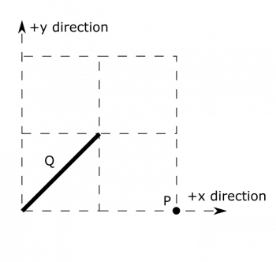
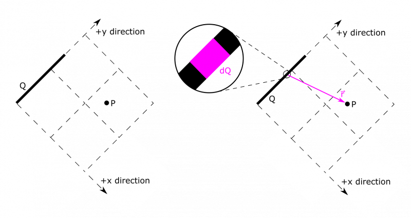
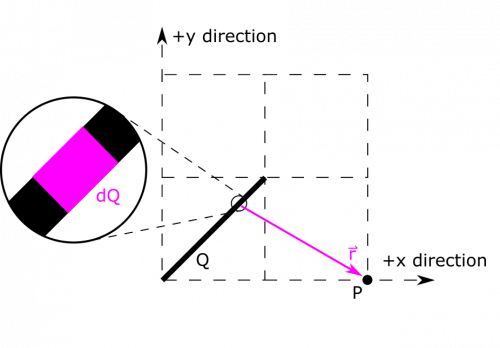
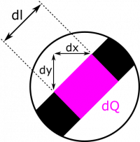

*[Return to $dQ$](/empcubed/notes/week-04-modeling-distributions-of-charge/dq/)*

Suppose we have a segment of uniformly distributed charge stretching from the point $\langle 0,0,0\rangle$ to $\langle 1\text{~m},1\text{~m},0\rangle$, which has total charge $Q$. We also have a point $P = \langle 2\text{~m},0,0\rangle$. Define a convenient $\text{d}Q$ for the segment, and $\overset{\rightarrow}{r}$ between a point on the segment to the point $P$. Also, give appropriate limits on an integration over $\text{d}Q$ (you don't have to write any integrals, just give appropriate start and end points). First, do this for the given coordinate axes. Second, define a new set of coordinate axes to represent $\text{d}Q$ and $\overset{\rightarrow}{r}$ in a simpler way and redo.

### Facts

- The segment stretches from $\langle 0,0,0\rangle$ to $\langle 1\text{~m},1\text{~m},0\rangle$.
- The segment has a charge $Q$, which is uniformly distributed.
- $P = \langle 2\text{~m},0,0\rangle$.

### Goal

- Define and explain $\text{d}Q$ and $\overset{\rightarrow}{r}$ for two sets of coordinate axes.

### Representations

- For the first part, we can draw a set of coordinate axes using what we already know. The first part of the example involves the following representation:

- For the second part when we define a new set of coordinate axes, it makes sense to line up the segment along an axis. We choose the $y$-axis. We could have chosen the $x$-axis, and arrived at a very similar answer. Whichever you like is fine!

## Solution

Before we begin, we'll make an approximate to simplify our calculations:

### Approximation

- The thickness of the segment is infinitesimally small, and we can approximate it as a line segment.

We know how to draw $\text{d}Q$ and $\overset{\rightarrow}{r}$, so we can start with an update to the representation. 

It will also be helpful to see how the dimensions of $\text{d}Q$ break down. Here is how we choose to label it: 

The segment extends in the $x$ and $y$ directions. A simple calculation of the Pythagorean theorem tells us the total length of the segment is $\sqrt{2}\text{~m}$, so we can define the line charge density $\lambda = Q/\sqrt{2}\text{~m}$. When we define $\text{d}l$, we want it align with the segment, so we can have $\text{d}l = \sqrt{\text{d}x^{2} + \text{d}y^{2}}$. Since $x = y$ along the segment, we can simplify a little bit. $\text{d}l = \sqrt{\text{d}x^{2} + \text{d}x^{2}} = \sqrt{2}\text{d}x$. Note, that we chose to express in terms of $\text{d}x$, instead of $\text{d}y$. This is completely arbitrary, and the solution would be just as valid the other way. Now, we can write an expression for $\text{d}Q$:

$$
\text{d}Q = \lambda\text{d}l = \frac{\sqrt{2}}{\sqrt{2}\text{~m}}Q\text{d}x = \frac{Q}{1\text{~m}}\text{d}x
$$

Next, we need $\overset{\rightarrow}{r}$. We will put it in terms of $x$, not $y$, just as we did for $\text{d}Q$. A choice of $y$ instead of $x$ here would be valid had we chosen to express $\text{d}Q$ in terms of $\text{d}y$ earlier. We know ${\overset{\rightarrow}{r}}_{P} = \langle 2\text{~m},0,0\rangle$, and ${\overset{\rightarrow}{r}}_{\text{d}Q} = \langle x,y,0\rangle$. Again, $x = y$, so we can rewrite ${\overset{\rightarrow}{r}}_{\text{d}Q} = \langle x,x,0\rangle$. We now have enough to write $\overset{\rightarrow}{r}$:

$$
\overset{\rightarrow}{r} = {\overset{\rightarrow}{r}}_{P} - {\overset{\rightarrow}{r}}_{\text{d}Q} = \langle 2\text{~m} - x, - x,0\rangle
$$

Because we picked $\text{d}x$ and $x$ as our variable, we are all set up to integrate over $x$. This means that our limits of integration also have to match the total length that we want to add up *in terms of the* $x$ *variable*, which goes from $0$ to $1\text{~m}$. So our limits of integration would be from $0$ to $1\text{~m}$.

------------------------------------------------------------------------

In the second set of axes, the segment extends only in the $y$ direction. This problem is now very similar to the examples in the notes. The length of the segment is still $\sqrt{2}\text{~m}$, so we can define the line charge density $\lambda = Q/\sqrt{2}\text{~m}$. When we define $\text{d}l$, we want it align with the segment, which is much simpler this time: $\text{d}l = \text{d}y$. Now, we can
