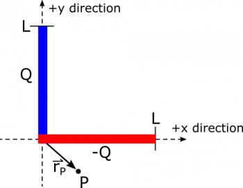
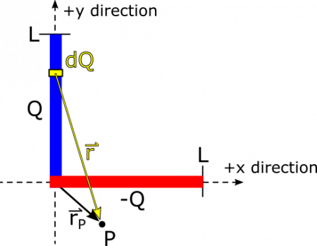
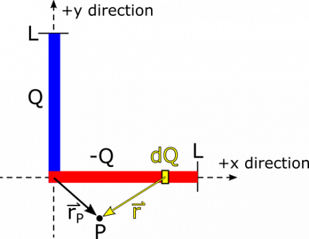

*[Return to $dQ$](/empcubed/notes/week-04-modeling-distributions-of-charge/dq/)*

Suppose we have two segments of uniformly distributed charge, one with total charge $+ Q$, the other with $- Q$. The two segments each have length $L$, and lie crossed at their endpoints in the $xy$-plane. The segment with charge $+ Q$ lies along the $y$-axis, and the segment with charge $- Q$ lies along the $x$-axis. See below for a diagram of the situation. Create an expression for the electric field ${\overset{\rightarrow}{E}}_{P}$ at a point $P$ that is located at ${\overset{\rightarrow}{r}}_{P} = r_{x}\widehat{x} + r_{y}\widehat{y}$. You don't have to evaluate integrals in the expression.

### Facts

- One segment lies on the $y$-axis stretching from $0$ to $L$, with charge $Q$ uniformly distributed.
- The other segment lies on the $x$-axis stretching from $0$ to $L$, with charge $- Q$ uniformly distributed.
- The point $P$ is at the arbitrary location ${\overset{\rightarrow}{r}}_{P} = r_{x}\widehat{x} + r_{y}\widehat{y}$
- The electric field due to a point charge is

$$
\overset{\rightarrow}{E} = \frac{1}{4\pi\epsilon_{0}}\frac{q}{r^{3}}\overset{\rightarrow}{r}
$$

- The electric field at $P$ is the superposition of contributions from the two segments:

$$
{\overset{\rightarrow}{E}}_{P} = {\overset{\rightarrow}{E}}_{+ Q} + {\overset{\rightarrow}{E}}_{- Q}
$$

### Goal

- Find ${\overset{\rightarrow}{E}}_{P}$.

### Representations

## Solution

### Approximation

We begin with an approximation, which will make our calculations simpler, and makes sense based on our representation:

- The thicknesses of both segments are infinitesimally small, and we can approximate them as line segments.

This example is complicated enough that it's worthwhile to make a plan.

### Plan

We will use integration to find the electric field from each segment, and then add the electric fields together using superposition. We'll go through the following steps.

- For the first segment, find the linear charge density, $\lambda$.
- Use $\lambda$ to write an expression for $\text{d}Q$.
- Assign a variable location to the $\text{d}Q$ piece, and then use that location to find the separation vector, $\overset{\rightarrow}{r}$.
- Write an expression for $\text{d}\overset{\rightarrow}{E}$.
- Figure out the bounds of the integral, and integrate to find electric field at $P$.
- Repeat the above steps for the other segment of charge.
- Add the two fields together to find the total electric field at $P$.

Because we know that electric fields add through superposition, we can treat each of the charges separately, find the electric field, then add the fields together at $P$ at the end. We can begin with the electric field due to the segment along the $y$-axis. We start by finding $\text{d}Q$ and $\overset{\rightarrow}{r}$. The charge is uniformly distributed so we have a simple line charge density of $\lambda = Q/L$. The segment extends in the $y$-direction, so we have $\text{d}l = \text{d}y$. This gives us $\text{d}Q$:

$$
\text{d}Q = \lambda\text{d}l = \frac{Q\text{d}y}{L}
$$

### Assumption

The charge is evenly distributed along each segment of charge. This allows each little piece of charge to have the same value along each line.

The separation vector $\overset{\rightarrow}{r}$ points from the source of the electric field to the observation point. The source is $\text{d}Q$, which is located at $y\widehat{y}$, and the observation point is ${\overset{\rightarrow}{r}}_{P} = r_{x}\widehat{x} + r_{y}\widehat{y}$. Then we have the separation vector:

$$
\overset{\rightarrow}{r} = {\overset{\rightarrow}{r}}_{P} - y\widehat{y} = r_{x}\widehat{x} + r_{y}\widehat{y} - y\widehat{y} = r_{x}\widehat{x} + (r_{y} - y)\widehat{y}
$$

Now, we have enough to define the electric field from the small piece ($\text{d}Q$) of the segment - plugging the $\text{d}Q$ and $\overset{\rightarrow}{r}$ we just found:

$$
\text{d}\overset{\rightarrow}{E} = \frac{1}{4\pi\epsilon_{0}}\frac{\text{d}Q}{r^{3}}\overset{\rightarrow}{r} = \frac{1}{4\pi\epsilon_{0}}\frac{Q\text{d}y}{L \cdot |r_{x}\widehat{x} + (r_{y} - y)\widehat{y}|^{3}}(r_{x}\widehat{x} + (r_{y} - y)\widehat{y})
$$

Next, we integrate over the entire segment to find an expression for its contribution to the electric field vector at $P$. The limits of our integral are based on the variable of integration, which is $y$. This denotes the length along the segment on the $y$-axis, which stretches from $0$ to $L$, so these are our limits of integration.

$$
{\overset{\rightarrow}{E}}_{+ Q} = \int_{0}^{L}\frac{1}{4\pi\epsilon_{0}}\frac{Q\text{d}y}{L \cdot |r_{x}\widehat{x} + (r_{y} - y)\widehat{y}|^{3}}(r_{x}\widehat{x} + (r_{y} - y)\widehat{y})
$$

Next, we can do a similar analysis to find the electric field vector contribution from the segment that lies along the $x$-axis. See below for a visual of $\text{d}Q$ and $\overset{\rightarrow}{r}$. See if you can convince yourself that for the segment along the $x$-axis, $\text{d}Q = \frac{- Q\text{d}x}{L}$, and $\overset{\rightarrow}{r} = (r_{x} - x)\widehat{x} + r_{y}\widehat{y}$.

From here, we can find $\text{d}\overset{\rightarrow}{E}$:

$$
\text{d}\overset{\rightarrow}{E} = \frac{1}{4\pi\epsilon_{0}}\frac{\text{d}Q}{r^{3}}\overset{\rightarrow}{r} = \frac{1}{4\pi\epsilon_{0}}\frac{- Q\text{d}x}{L \cdot |(r_{x} - x)\widehat{x} + r_{y}\widehat{y}|^{3}}((r_{x} - x)\widehat{x} + r_{y}\widehat{y})
$$

To find the contribution from the entire segment, we again must determine the endpoints of our integration. Our variable of integration is $x$ this time, which denotes the distance along the segment that lies on the $x$-axis. This distance stretches from $0$ to $L$, so these are our limits of integration:

$$
{\overset{\rightarrow}{E}}_{- Q} = \int_{0}^{L}\frac{1}{4\pi\epsilon_{0}}\frac{- Q\text{d}x}{L \cdot |(r_{x} - x)\widehat{x} + r_{y}\widehat{y}|^{3}}((r_{x} - x)\widehat{x} + r_{y}\widehat{y})
$$

Then the final electric field vector at $P$ is the sum of the two contributions, because of vector superposition. (You can pull out the constants to simplify the integral if you want.)

$$
\begin{matrix}
\overset{\rightarrow}{E} & = {\overset{\rightarrow}{E}}_{+ Q} + {\overset{\rightarrow}{E}}_{- Q} \\
 & = \int_{0}^{L}\frac{1}{4\pi\epsilon_{0}}\frac{Q\text{d}y}{L \cdot |r_{x}\widehat{x} + (r_{y} - y)\widehat{y}|^{3}}(r_{x}\widehat{x} + (r_{y} - y)\widehat{y}) + \int_{0}^{L}\frac{1}{4\pi\epsilon_{0}}\frac{- Q\text{d}x}{L \cdot |(r_{x} - x)\widehat{x} + r_{y}\widehat{y}|^{3}}((r_{x} - x)\widehat{x} + r_{y}\widehat{y}) \\
 & = \frac{Q}{4\pi\epsilon_{0}L}\left( \int_{0}^{L}\frac{\text{d}y}{|r_{x}\widehat{x} + (r_{y} - y)\widehat{y}|^{3}}(r_{x}\widehat{x} + (r_{y} - y)\widehat{y}) - \int_{0}^{L}\frac{\text{d}x}{|(r_{x} - x)\widehat{x} + r_{y}\widehat{y}|^{3}}((r_{x} - x)\widehat{x} + r_{y}\widehat{y}) \right)
\end{matrix}
$$

At this point we have the integrals set up, which you could solve by hand if you so desire or plug them into Wolfram Alpha, Mathematica, or some other computation program.
