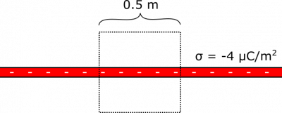
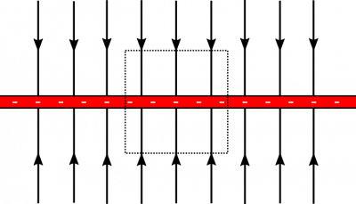

Suppose you have a plane of charge with a uniform surface charge density of $\sigma = - 4\mu\text{C/m}^{2}$. What is the electric flux through a cube with side-length $l = 0.5\text{~m}$ that is placed halfway into the plane? Feel free to use the electric field due to an infinite uniform plane of charge: $\overset{\rightarrow}{E} = \frac{\sigma}{2\epsilon_{0}}( \pm \widehat{z})$ (where $\pm \widehat{z}$ points away from plane). Notice that the strength of the electric field does not depend on the distance from the plane – it is constant apart from a change in direction when you cross over to the other side of the plane.

### Facts

- The cube has side-length $l = 0.5\text{~m}$.
- The cube is halfway into the plane – presumably this means the plane bisects the cube.
- The plane has surface charge density $\sigma = - 4\mu\text{C/m}^{2}$.

### Lacking

- $\Phi_{e}$ for the cube.

### Approximations & Assumptions

- There are no other charges that contribute appreciably to the flux calculation.
- The cube is aligned with respect to the plane so that all of its faces are either parallel or perpendicular to the plane.

### Representations

- We represent the electric flux through a surface with:

$$
\Phi_{e} = \int\overset{\rightarrow}{E} \bullet \text{d}\overset{\rightarrow}{A}
$$

- We represent the electric field due to a plane of uniform surface charge density with:

$$
\overset{\rightarrow}{E} = \frac{\sigma}{2\epsilon_{0}}( \pm \widehat{z})
$$

- We represent the situation with the following diagram.

## Solution

First, we evaluate the situation qualitatively. Consider the electric field lines of the charged plane:  You might notice that we have oriented the cube conveniently. The electric field is parallel to the sides of the cube, so there are no electric field lines entering or exiting from the side of the cube. So the flux through the sides should be $0$. For the top and bottom of the cube, the electric field lines are perpendicular to the surface, which means they are parallel to the area-vectors. These facts will greatly simplify our integral calculation of the flux.

$$
\begin{matrix}
\Phi_{\text{total}} & = \Phi_{\text{sides}} + \Phi_{\text{top}} + \Phi_{\text{bottom}} \\
 & = 0 + \int_{\text{top}}^{}\overset{\rightarrow}{E} \bullet \text{d}\overset{\rightarrow}{A} + \int_{\text{bottom}}^{}\overset{\rightarrow}{E} \bullet \text{d}\overset{\rightarrow}{A} \\
 & = \int_{\text{top}}^{}E\widehat{z} \bullet \text{d}A\widehat{z} + \int_{\text{bottom}}^{}E( - \widehat{z}) \bullet \text{d}A( - \widehat{z}) \\
 & = E\int_{\text{top}}^{}\text{d}A + E\int_{\text{bottom}}^{}\text{d}A \\
 & = E \cdot (A_{\text{top}} + A_{\text{bottom}}) \\
 & = \frac{\sigma}{2\epsilon_{0}}(2l^{2}) \\
 & = \frac{\sigma l^{2}}{\epsilon_{0}}
\end{matrix}
$$

When we plug in values for $\sigma$, $l$, and $\epsilon_{0}$, we get $\Phi_{\text{cube}} = 1.15 \cdot 10^{5}\text{~Vm}$.

Notice that in the next section of notes, we define “Gauss' Law”, which states that the total flux through a close surface is the amount of charge enclosed divided by $\epsilon_{0}$. A quick check for this example shows us that the charge enclosed by the sphere covers an area of $l^{2}$, which means the charge is $\sigma \cdot l^{2}$. If we had used Gauss' Law, we would have quickly found that

$$
\Phi_{\text{cube}} = \frac{Q_{\text{enclosed}}}{\epsilon_{0}} = \frac{\sigma l^{2}}{\epsilon_{0}}
$$

This is the same result! An alternative question for this example could have been: What is the electric field due to a uniformly charged plane? If we were not given the electric field at the beginning, we could have used symmetry arguments and Gauss' Law to work backwards, starting with the charge enclosed, and then using the integral formula for electric flux to solve for the electric field. There are sometimes electric fields that we do not know off-hand, and Gauss' Law is often the best tool to find them.
