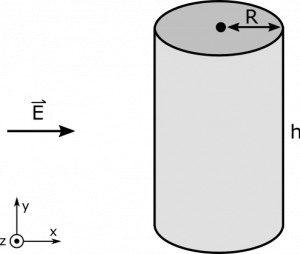
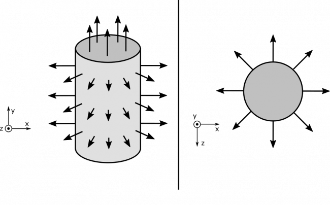
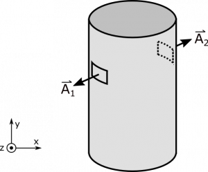

*[Return to Electric Flux and Area Vectors notes](https://www.msuperl.org/wikis/pcubed/doku.php?id=184_notes:e_flux)*

A constant electric field $\overset{\rightarrow}{E}$ is directed along the $x$-axis. If we imagine a cylindrical surface with radius $R$ and height $h$ is situated in the field so that the bases of the cylinder are parallel to the $xz$-plane. What is the electric flux through the cylinder?

### Facts

- The cylinder is closed.
- The cylinder has radius $R$ and height $h$.
- The electric field is directed along the $x$-axis, which is parallel to the bases of the cylinder.

### Lacking

- $\Phi_{\text{cylinder}}$​
- $\overset{\rightarrow}{A}$ of cylinder, or $\text{d}\overset{\rightarrow}{A}$ pieces.

### Approximations & Assumptions

- The electric field is constant.
- The electric flux through the cylinder is due only to $\overset{\rightarrow}{E}$.
- We can approximate infinitesimally small pieces of the cylinder's area as flat.

### Representations

- We represent the electric flux through a flat surface with:

$$
\Phi = \overset{\rightarrow}{E} \bullet \overset{\rightarrow}{A}
$$

- We represent the situation with the following diagram:

Cylinder

## Solution

Before we dive into the math, let's reason about the nature of the situation. It will be helpful to visualize how the area vector $\text{d}\overset{\rightarrow}{A}$ would look for different parts of the cylinder's surface. Here is a visual from a couple perspectives, where each arrow represents the direction of $\text{d}\overset{\rightarrow}{A}$ at its location. Remember that the convention for closed surfaces is that area-vectors are directed outside.

Cylinder Area-Vectors

Notice that the area vectors on the bases of the cylinder are pointing along the $y$-axis. Since the electric field is aligned with the $x$ axis, there will be no flux through the top and bottom of the cylinder. The math is here:

$$
\Phi_{\text{top}} = \overset{\rightarrow}{E} \bullet {\overset{\rightarrow}{A}}_{\text{top}} = (E\widehat{x}) \bullet (\pi R^{2}\widehat{y}) = 0
$$

The same is true for bottom. For completeness, the math is here:

$$
\Phi_{\text{bottom}} = \overset{\rightarrow}{E} \bullet {\overset{\rightarrow}{A}}_{\text{bottom}} = (E\widehat{x}) \bullet (\pi R^{2}( - \widehat{y})) = 0
$$

The wall of the cylinder is not so easy. Before we set up some nasty integral, consider the symmetry of the cylinder. For every tiny piece of the wall, there another tiny piece directly opposite, which will have the opposite area-vector. See below for a visual.

Opposite Area-Vectors

If we were to calculate the electric flux through the cylinder's wall, we could set it up like a sum over all the little pieces of area that add up to the entire wall.

$$
\Phi_{\text{wall}} = \sum_{\text{entire wall}}^{}\Phi_{\text{little piece}} = \sum_{\text{entire wall}}^{}\overset{\rightarrow}{E} \bullet {\overset{\rightarrow}{A}}_{\text{little piece}}
$$

Each little piece will have a “matching piece”, like ${\overset{\rightarrow}{A}}_{1}$ and ${\overset{\rightarrow}{A}}_{2}$ in the figure. Since area-vectors point out of the surface, matching pieces will be opposites: ${\overset{\rightarrow}{A}}_{1} = - {\overset{\rightarrow}{A}}_{2}$. Since the electric field is constant everywhere, we find that the fluxes are also opposites:

$$
\Phi_{A_{1}} = \overset{\rightarrow}{E} \bullet {\overset{\rightarrow}{A}}_{1} = E \cdot (\widehat{x} \bullet {\overset{\rightarrow}{A}}_{1}) = E \cdot (\widehat{x} \bullet - {\overset{\rightarrow}{A}}_{2}) = - \overset{\rightarrow}{E} \bullet {\overset{\rightarrow}{A}}_{2} = - \Phi_{A_{2}}
$$

It shouldn't be too surprising at this point to see that everything cancels out. When we match up the terms, we get:

$$
\Phi_{\text{matching pieces}} = \Phi_{A_{1}} + \Phi_{A_{2}} = 0
$$

We can continue in the manner for the entire wall, and we will find that

$$
\Phi_{\text{wall}} = 0
$$

In total,

$$
\Phi_{\text{cylinder}} = \Phi_{\text{top}} + \Phi_{\text{bottom}} + \Phi_{\text{wall}} = 0
$$
