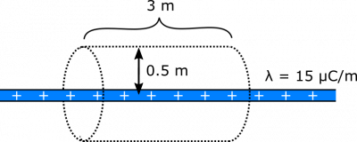
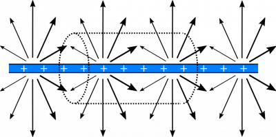

*[Return to Enclosed Charge notes](https://www.msuperl.org/wikis/pcubed/doku.php?id=184_notes:q_enc)*

Suppose you have a line of charge with a uniform linear charge density of $\lambda = 15\mu\text{C/m}$. What is the electric flux through a cylinder with radius $R = 0.5\text{~m}$, and length $l = 3\text{~m}$ that is placed so that its axis is aligned with the line of charge? Feel free to use the electric field due to an infinite uniform line of charge: $\overset{\rightarrow}{E} = \frac{\lambda}{2\pi r\epsilon_{0}}\widehat{r}$ (where $\widehat{r}$ points away from line, and $r$ is the distance from the line).

### Facts

- The cylinder has radius $R = 0.5\text{~m}$, and length $l = 3\text{~m}$.
- The axis of the cylinder is aligned with the line charge.
- The line charge has linear charge density $\lambda = 15\mu\text{C/m}$.

### Lacking

- $\Phi_{e}$ for the cylinder.

### Representations

- We represent the electric flux through a surface with:

$$
\Phi_{e} = \int\overset{\rightarrow}{E} \bullet \text{d}\overset{\rightarrow}{A}
$$

- We represent the electric field due to an infinite line of uniform charge density with:

$$
\overset{\rightarrow}{E} = \frac{\lambda}{2\pi r\epsilon_{0}}\widehat{r}
$$

- We represent the situation with the following diagram.

Charged Line and Cylindrical Surface

### Approximations & Assumptions

There are a few approximations and assumptions we should make in order to simplify our model.

- There are no other charges that contribute appreciably to the flux calculation.
- The cylinder is aligned with respect to the line so that its bases are perpendicular to the line, and its wall is parallel (as described). This is just a geometric simplification for the model, and ensures the electric field through the cylinder wall is constant as the wall will be at a uniform distance away from the line of charge at any point.
- Line of charge is very very long: This allows us to use the electric field equation provided in the problem statement, and ensures the electric field is constant through the wall of our cylinder.

## Solution

First, we evaluate the situation qualitatively. Consider the electric field vectors from the charged line near the surface of the cylinder:

Positively Charged Line – Electric Field Lines

It's a little tough to demonstrate the electric field vectors with only two dimensions to draw on, but you can imagine that the thicker arrows point out of the page more, and the thinner arrows point into the page more (but the magnitude of the arrows are all the same). In essence, each vector points directly away from and perpendicular to the line of charge, as indicated in the formula for electric field from a line charge.

The electric field vectors are parallel to the bases of the cylinder, so $\overset{\rightarrow}{E} \bullet \text{d}\overset{\rightarrow}{A} = 0$ on the bases. So the flux through the bases should be $0$. For the wall of the cylinder, the electric field vectors are perpendicular to the surface, which means they are parallel to the area-vectors. These facts will greatly simplify our integral calculation of the flux.

$$
\begin{matrix}
\Phi_{\text{total}} & = \Phi_{\text{bases}} + \Phi_{\text{wall}} \\
 & = 0 + \int_{\text{wall}}^{}\overset{\rightarrow}{E} \bullet \text{d}\overset{\rightarrow}{A} \\
 & = \int_{\text{wall}}^{}E\widehat{r} \bullet \text{d}A\widehat{r} \\
 & = E\int_{\text{wall}}^{}\text{d}A \\
 & = EA_{\text{wall}} \\
 & = \frac{\lambda}{2\pi R\epsilon_{0}} \cdot 2\pi Rl \\
 & = \frac{\lambda l}{\epsilon_{0}}
\end{matrix}
$$

When we plug in values for $\lambda$, $l$, and $\epsilon_{0}$, we get $\Phi_{\text{cylinder}} = 5.08 \cdot 10^{6}\text{~Vm}$.

Notice that in the [next section of notes](https://www.msuperl.org/wikis/pcubed/doku.php?id=184_notes:gauss_ex), we define “Gauss' Law”, which states that the total flux through a close surface is the amount of charge enclosed divided by $\epsilon_{0}$. A quick check for this example shows us that the charge enclosed by the cylinder covers a length of $l$, which means the charge is $\lambda l$. If we had used Gauss' Law, we would have quickly found that

$$
\Phi_{\text{cylinder}} = \frac{Q_{\text{enclosed}}}{\epsilon_{0}} = \frac{\lambda l}{\epsilon_{0}}
$$

This is the same result! An alternative question for this example could have been: What is the electric field due to a uniformly charged line? If we were not given the electric field at the beginning, we could have used symmetry arguments and Gauss' Law to work backwards, starting with the charge enclosed, and then using the integral formula for electric flux to solve for the electric field. There are sometimes electric fields that we do not know off-hand, and Gauss' Law is often the best tool to find them.
