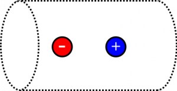
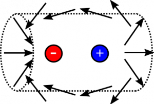

*[Return to Electric Flux through Curved Surfaces notes](https://www.msuperl.org/wikis/pcubed/doku.php?id=184_notes:eflux_curved)*

Suppose you have a two charges, one with value $5\mu\text{C}$, the other with value $- 5\mu\text{C}$. There are at separate locations, a distance $1\text{~m}$ apart, and they can be modeled as a dipole. What is the flux through a cylinder with radius $4\text{~m}$ and length $16\text{~m}$ that encloses this dipole?

### Facts

- The dipole charges are $q = 5\mu\text{C}$, $- q = - 5\mu\text{C}$.
- The dipole distance is $1\text{~m}$.
- The cylinder has radius $4\text{~m}$ and length $16\text{~m}$.

### Lacking

- $\Phi_{e}$ through the cylinder

### Approximations & Assumptions

- The axis of the cylinder is aligned with the dipole.
- The dipole and cylinder are centered with respect to each other.
- The electric flux through the cylinder is due only to the dipole (i.e., no other charges exist).
- The charges are point charges, which indeed means we can model them as a dipole.

### Representations

- We represent the situation with the following diagram.

Dipole and Gaussian cylinder

## Solution

First, notice that we probably do not want to do any calculations here, since the it will not be fun to take a dot-product of the dipole's electric field and the area-vector, and it will get very messy very quickly when we start integrating over the surface of the cylinder. Instead, we evaluate the situation more qualitatively. Consider the electric field vectors of the dipole near the surface of the cylinder:

Dipole Electric Field Lines

Notice that the vectors near the positive charge are leaving the cylinder, and the vectors near the negative charge are entering. Not only this, but they are mirror images of each other. Wherever an electric field vector points out of the cylinder on the right side, there is another electric field vector on the left that is pointing into the cylinder at the same angle. These mirror image vectors also have the same magnitude, though it is a little tougher to visualize.

We could write this as a comparison between the left and right side of the cylinder. The $\text{d}\overset{\rightarrow}{A}$-vectors are mirrored for left vs. right, and the $\overset{\rightarrow}{E}$-vectors are mirrored, but opposite $\left( {\overset{\rightarrow}{E}}_{left} = - {\overset{\rightarrow}{E}}_{right} \right)$. We tentatively write the equality,

$$
\Phi_{left} = - \Phi_{right}
$$

Putting it together, we tentatively write:

$$
\Phi_{\text{cylinder}} = \Phi_{left} + \Phi_{right} = 0
$$

We gain more confidence when we read the [next section of notes](https://www.msuperl.org/wikis/pcubed/doku.php?id=184_notes:gauss_ex), where we define “Gauss' Law”. This law states that the total flux through a close surface is the amount of charge enclosed divided by $\epsilon_{0}$, the [permittivity of free space](https://en.wikipedia.org/wiki/Vacuum_permittivity).

$$
\Phi_{\text{total}} = \int\overset{\rightarrow}{E} \cdot \text{d}\overset{\rightarrow}{A} = \frac{Q_{\text{enclosed}}}{\epsilon_{0}}
$$

Since the total charge of the dipole is $0$, then indeed the charge enclosed is $0$, and we were correct with our reasoning about the electric field and flux above.
