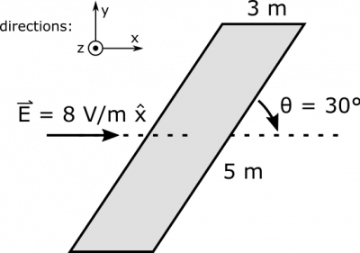

*[Return to Electric Flux and Area Vectors notes](https://www.msuperl.org/wikis/pcubed/doku.php?id=184_notes:e_flux)*

Suppose you have a uniform electric field $\overset{\rightarrow}{E} = 8\text{~V/m~}\widehat{x}$. There is a tilted rectangular surface with dimensions $3\text{~m}$ (perpendicular to the field), and $5\text{~m}$ (at an angle of $\theta = 30^{\circ}$ to field). What is the electric flux through the surface?

### Facts

- $\overset{\rightarrow}{E} = 8\text{~V/m~}\widehat{x}$​
- The surface is a rectangle $3\text{~m}$ by $3\text{~m}$.
- The surface is tilted at an angle of $30^{\circ}$ to the field.

### Lacking

- $\Phi_{e}$​
- $\overset{\rightarrow}{A}$​

### Representations

- We represent the electric flux through a flat surface with:

$$
\Phi = \overset{\rightarrow}{E} \bullet \overset{\rightarrow}{A}
$$

- We represent the situation with the following diagram. Note that the top of the rectangle aligns along the $z$-direction, but we represent using a perspective that also shows area. The little coordinate axes drawn may be unfamiliar. The circle with the dot simply means that the $+ z$-axis comes straight out of the page. A circle with an X would mean into the page. Just think of an arrow either seen head-on (all you see is the point), or seen from behind (you see the feathers).

Tilted Surface

### Approximations & Assumptions

There are a few simplifying approximations and assumptions we should make before solving this problem.

- The electric field is constant: Allows the electric field to be constant through our area which simplifies down the flux equation.
- The surface is flat: Allows all the area vectors associated with the surface to point in the same direction.
- The electric flux through the surface is due only to $\overset{\rightarrow}{E}$.

## Solution

In order to find electric flux, we must first find $\overset{\rightarrow}{A}$. Remember in the [notes on flux](https://www.msuperl.org/wikis/pcubed/doku.php?id=184_notes:e_flux#area_as_a_vector) that area can be a vector when we define it as a [cross product](/empcubed/notes/week-01-charges-field-potential/math_review/#vector_multiplication) of width and length vectors. Here, we can use the following for width and length, with width being the top of the rectangle, and pointing out of the page, and length being the longer side, and pointing at an upwards angle:

$$
\overset{\rightarrow}{w} = 3\text{~m~}\widehat{z}
$$

$$
\overset{\rightarrow}{l} = 5\text{~m~} \cdot \cos 30^{\circ}(\widehat{x}) + 5\text{~m~}\sin 30^{\circ}\widehat{y} = 4.33\text{~m~}\widehat{x} + 2.5\text{~m~}\widehat{y}
$$

Now, we can find the area vector would be (using that [matrix form of the cross product](https://www.msuperl.org/wikis/pcubed/doku.php?id=183_notes:cross_product)):

$$
\begin{matrix}
\overset{\rightarrow}{A} & = \overset{\rightarrow}{l} \times \overset{\rightarrow}{w} \\
 & = (4.33\text{~m~}\widehat{x} + 2.5\text{~m~}\widehat{y}) \times (3\text{~m~}\widehat{z}) \\
 & = 12.99\text{~m}^{2}( - \widehat{y}) + 7.5\text{~m}^{2}\widehat{x} \\
 & = 7.5\text{~m}^{2}\widehat{x} - 12.99\text{~m}^{2}\widehat{y}
\end{matrix}
$$

We could have also found this area vector by doing width cross length $\overset{\rightarrow}{A} = \overset{\rightarrow}{w} \times \overset{\rightarrow}{l}$ - this would give us an area vector with exactly the same magnitude but pointing in the opposite direction ($\overset{\rightarrow}{A} = - 7.5\text{~m}^{2}\widehat{x} + 12.99\text{~m}^{2}\widehat{y}$). Because it is open surface (doesn't close off some volume), there is no convention to help us pick whether we should do width cross length or length cross width. Either would be equally correct. Anyways, we can proceed to determine the electric flux:

$$
\begin{matrix}
\Phi_{e} & = \overset{\rightarrow}{E} \bullet \overset{\rightarrow}{A} \\
 & = (8\text{~V/m~}\widehat{x}) \bullet (7.5\text{~m}^{2}\widehat{x} - 12.99\text{~m}^{2}\widehat{y}) \\
 & = 60\text{~Vm}
\end{matrix}
$$

This makes sense cause the max flux through the surface would occur when the the surface was perpendicular to the electric field and the area vector was in the same direction as the electric field. This would result in a flux of $120Vm$. Since the surface in this case is $30^{\circ}$ away from the electric field we would expect there to be a much smaller flux due to the large angle between the area vector and the electric field.
