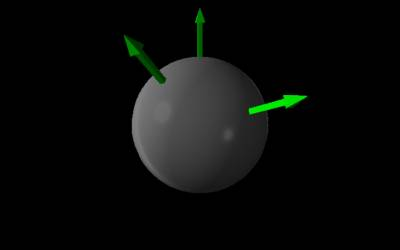

*[Return to Electric Flux through Curved Surfaces notes](https://www.msuperl.org/wikis/pcubed/doku.php?id=184_notes:eflux_curved)*

Suppose you have a point charge with value $1\mu\text{C}$. What are the fluxes through two spherical shells centered at the point charge, one with radius $3\text{~cm}$ and the other with radius $6\text{~cm}$?

### Facts

- The point charge has charge $q = 1\mu\text{C}$.
- The two spheres have radii $3\text{~cm}$ and $6\text{~cm}$.

### Lacking

- $\Phi_{e}$ for each sphere
- $\text{d}\overset{\rightarrow}{A}$ or $\overset{\rightarrow}{A}$, if necessary

### Representations

- We represent the electric flux through a surface with:

$$
\Phi_{e} = \int\overset{\rightarrow}{E} \bullet \text{d}\overset{\rightarrow}{A}
$$

- We represent the electric field due to a point charge with:

$$
\overset{\rightarrow}{E} = \frac{1}{4\pi\epsilon_{0}}\frac{q}{r^{2}}\widehat{r}
$$

- We represent the situation with the following diagram. Note that the circles are indeed spherical shells, not rings as they appear.

Point charge and two spherical shells

### Approximations & Assumptions

There are a few approximations and assumptions we should make in order to simplify our model.

- There are no other charges that contribute appreciably to the flux calculation.
- There is no background electric field.
- The electric fluxes through the spherical shells are due only to the point charge.

The first three assumptions ensure that there is nothing else contributing or affecting the flux through our spheres in the model.

- Perfect spheres: This will simplify our area vectors and allows us to use geometric equations for spheres in our calculations.
- Constant charge for the point charge: Ensures that the point charge is not charging or discharging with time.

## Solution

Before we dive into calculations, let's consider how we can simplify the problem by thinking about the nature of the electric field due to a point charge and of the $\text{d}\overset{\rightarrow}{A}$ vector for a spherical shell. The magnitude of the electric field will be constant along the surface of a given sphere, since the surface is a constant distance away from the point charge. Further, $\overset{\rightarrow}{E}$ will always be parallel to $\text{d}\overset{\rightarrow}{A}$ on these spherical shells, since both are directed along the radial direction from the point charge. See below for a visual. A more in-depth discussion of these symmetries can be found in the notes of [using symmetry](https://www.msuperl.org/wikis/pcubed/doku.php?id=184_notes:eflux_curved#making_use_of_symmetry) to simplify our flux calculation.

Area-vectors and E-field-vectors point in same direction

Since the shell is a fixed distance from the point charge, the electric field has constant magnitude on the shell. Since $\overset{\rightarrow}{E}$ is parallel to $\text{d}\overset{\rightarrow}{A}$ and has constant magnitude (on the shell), the dot product simplifies substantially: $\overset{\rightarrow}{E} \bullet \text{d}\overset{\rightarrow}{A} = E\text{d}A$. We can now rewrite our flux representation:

$$
\Phi_{e} = \int\overset{\rightarrow}{E} \bullet \text{d}\overset{\rightarrow}{A} = E\int\text{d}A
$$

Note that $E$ is a scalar value representing $\overset{\rightarrow}{E}$ as a magnitude, which includes a sign indicating direction along the point charge's radial axis. We can rewrite $E$ using the formula for the electric field from a point charge.

$$
E = \frac{1}{4\pi\epsilon_{0}}\frac{q}{r^{2}}\left| \widehat{r} \right| = \frac{1}{4\pi\epsilon_{0}}\frac{q}{r^{2}}
$$

We can plug in values for $q$ and $r$ for each spherical shell, using what we listed in the facts. For the smaller shell, we find $E = 1.0 \cdot 10^{7}\text{~N/C}$. For the larger shell, we find $E = 2.5 \cdot 10^{6}\text{~N/C}$.

To figure out the area integral, notice that the magnitude of the area-vector is just the area. This means that our integrand is the area occupied by $\text{d}A$. Since we are integrating this little piece over the entire shell, we end up with the area of the shell's surface:

$$
\int\text{d}A = A = 4\pi r^{2}
$$

The last expression, $4\pi r^{2}$, is just the surface area of a sphere. We can plug in values for $r$ for each spherical shell, using what we listed in the facts. For the smaller shell, we have $A = 1.13 \cdot 10^{- 2}\text{~m}^{2}$. For the larger shell, we have $A = 4.52 \cdot 10^{- 2}\text{~m}^{2}$.

Now, we bring it together to find electric flux, which after all our simplifications can be written as $\Phi_{e} = EA$. For our two shells:

$$
\begin{matrix}
\Phi_{\text{small}} & = 1.0 \cdot 10^{7}\text{~N/C~} \cdot 1.13 \cdot 10^{- 2}\text{~m}^{2} = 1.13 \cdot 10^{5}\text{~Nm}^{2}\text{/C} \\
\Phi_{\text{large}} & = 2.5 \cdot 10^{6}\text{~N/C~} \cdot 4.52 \cdot 10^{- 2}\text{~m}^{2} = 1.13 \cdot 10^{5}\text{~Nm}^{2}\text{/C}
\end{matrix}
$$

We get the same answer for both shells! It turns out that the radius of the shell does not affect the electric flux for this example. You'll see later that electric flux through a closed surface depends *only* on the charge enclosed. The surface can be weirdly shaped, and we can always figure out the flux as long as we know the charge enclosed.
