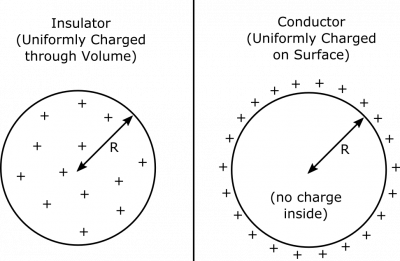
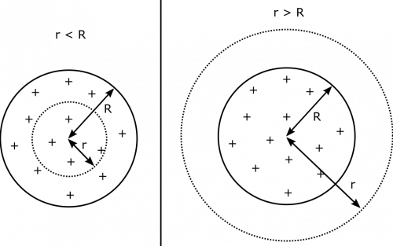
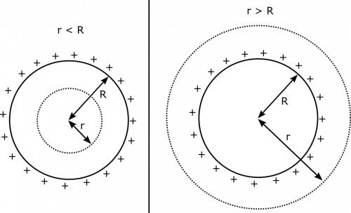

Suppose you have an insulating ball that has been charged somehow. The charging was very thorough and it seems like the ball is pretty much uniformly charged. It has a charge $Q$ and a radius $R$. What is the electric field at a distance $r$ from the center of the ball? Be sure to account for both cases $r < R$ (inside the ball) and $r > R$ (outside the ball). You may find Gauss' Law to be useful here. Repeat for the case when the ball is a conductor.

### Facts

- The ball is either an insulator (part A), or a conductor (part B).
- The ball has total charge $Q$ and radius $R$.

### Lacking

- $\Phi_{e}$ for the ball.
- The “Gaussian surface” we will use for our application of Gauss' Law.
- $\overset{\rightarrow}{E}(\overset{\rightarrow}{r})$​

### Representations

- We represent the electric flux through a surface with:

$$
\Phi_{e} = \int\overset{\rightarrow}{E} \bullet \text{d}\overset{\rightarrow}{A}
$$

- We represent Gauss' Law as:

$$
\Phi_{e} = \frac{Q_{\text{enclosed}}}{\epsilon_{0}}
$$

- We represent the situation with the following diagram. The insulating case (part A) is shown on the left, and the conductor (part B) is on the right.

Charged Ball as an Insulator or Conductor

### Assumptions

There are a few assumptions that can be made to simplify down our model before starting any calculations.

- There are no other charges that affect our calculations.
- The ball is not discharging.
- For the sake of representation, we assume $Q > 0$ (we don't make this assumption for the calculation, it just helps to visualize little charges as little $+$ signs).

## Solution (Part A)

A step-by-step approach to using Gauss' Law is shown in the notes for a line of charge. We will take a similar approach here.

The ball is an insulator. We need to figure out the electric field at a given distance $r$ from the center of the sphere. Before we choose a Gaussian surface, we should consider the symmetry of the problem. Notice that we have spherical symmetry: this means that we can rotate the entire system about the center of the sphere, and the problem does not change at all. This is because the charge is uniformly distributed throughout the ball. We can reason from this that the electric field must be aligned in the radial direction (directly towards or away from the center). If the electric field were directed otherwise, it would change when we rotate about the sphere, and we would not have spherical symmetry! So we can write:

$$
\overset{\rightarrow}{E}(\overset{\rightarrow}{r}) = E(r)\widehat{r}
$$

Note that $r$ here is same $r$ in the premise of the problem: the distance from the center of the sphere. At this point, it becomes a little more clear what type of Gaussian surface we are after. If we choose the Gaussian surface to be a spherical shell centered with the ball, then its area-vectors will be parallel to $\overset{\rightarrow}{E}$, and $E(r)$ will be constant on its surface, since the shell's radius does not change. We draw our Gaussian surface with dotted lines, as indicated below. We keep the radius as a variable $r$, and we include two drawings to reiterate that we could have $r < R$ or $r > R$.

Gaussian Sphere for r\<R and for r\>R

The next step after choosing our Gaussian surface is to write the flux through the surface. Based on our symmetry argument above, the calculation should simplify nicely. Notice below that the $\widehat{r}$ unit vectors come the fact that both $\overset{\rightarrow}{E}$ and $\text{d}\overset{\rightarrow}{A}$ are aligned in the radial direction (directly towards or away from the center).

$$
\begin{matrix}
\Phi_{\text{total}} & = \int\overset{\rightarrow}{E} \bullet \text{d}\overset{\rightarrow}{A} \\
 & = \int E(r)\widehat{r} \bullet \text{d}A\widehat{r} \\
 & = \int E(r)\text{d}A \\
 & = E(r)\int\text{d}A \\
 & = E(r)A_{\text{spherical shell}} \\
 & = E(r) \cdot 4\pi r
\end{matrix}
$$

### Approximation

In order to take the electric field term out of the integral we must approximate our ball as a perfect sphere. Having a perfect sphere ensures all the area vectors are parallel to the electric field vectors. This also ensures that the electric field is constant through our Gaussian surface at a given radius.

Notice that the above result is the same for both $r < R$ and $r > R$. Next, we need to find the total charge enclosed by the Gaussian surface. Here, it is helpful to determine the charge density in our insulator. There is helpful section in the notes on [determining charge density](/notes/week-04-modeling-distributions-of-charge/dq/). Since our ball is uniformly charged throughout its volume, we just need to divide the total charge by the total volume. The volume charge density is then:

$$
\rho = \frac{Q_{\text{total}}}{V_{\text{total}}} = \frac{Q}{\frac{4}{3}\pi R^{3}} = \frac{3Q}{4\pi R^{3}}
$$

### Assumption

Having a constant charge density is only possible if we assume that the ball is evenly charged throughout its volume. This may or may not be the case depending on how our insulator is charged.

The charge enclosed by the Gaussian surface, then, would relate to the charge density. For $r < R$, the surface does not enclose the entire ball, so we would just multiply the volume that the Gaussian surface encloses by the charge density to find the charge contained in the Gaussian surface.

$$
Q_{\text{enclosed}}(r < R) = \rho \cdot V_{\text{spherical shell}} = \frac{3Q}{4\pi R^{3}} \cdot \frac{4}{3}\pi r^{3} = \frac{Qr^{3}}{R^{3}}
$$

For $r > R$, the Gaussian surface contains the entire ball, so the charge enclosed is just $Q$. Below, we show how it breaks down for both cases.

$$
Q_{\text{enclosed}} = \left\{ \begin{matrix}
\frac{Qr^{3}}{R^{3}} & r < R \\
Q & r > R
\end{matrix} \right.\ 
$$

We are now fully equipped to solve for the electric field. Remember that Gauss' Law states $\Phi_{e} = Q_{\text{enclosed}}/\epsilon_{0}$. For $r < R$:

$$
E(r) = \frac{\Phi_{\text{total}}}{4\pi r^{2}} = \frac{Q_{\text{enclosed}}}{4\pi\epsilon_{0}r^{2}} = \frac{Qr}{4\pi\epsilon_{0}R^{3}}
$$

For $r > R$:

$$
E(r) = \frac{\Phi_{\text{total}}}{4\pi r^{2}} = \frac{Q_{\text{enclosed}}}{4\pi\epsilon_{0}r^{2}} = \frac{Q}{4\pi\epsilon_{0}r^{2}}
$$

Together:

$$
E(r) = \left\{ \begin{matrix}
\frac{1}{4\pi\epsilon_{0}}\frac{Qr}{R^{3}} & r < R \\
\frac{1}{4\pi\epsilon_{0}}\frac{Q}{r^{2}} & r > R
\end{matrix} \right.\ 
$$

Outside the ball, the electric field exists as if the ball were a point charge! It is also important to note that the relationships seen in our above equations also agree with what we already know about insulating spheres of charge.

## Solution (Part B)

We repeat the process above for the case that the ball is a conductor. Notice that much of the reasoning is the exact same. We still have spherical symmetry, and we choose the same Gaussian surface. It is pictured below for both $r < R$ and $r > R$.

Gaussian Sphere for r\<R and for r\>R

The only thing that is different here is the charge enclosed by the Gaussian surface. Since all the excess charge on a conductor hangs out on the surface, the inside of the conductor is neutral. So if $r < R$, then the charge enclosed by the Gaussian surface is $0$. If $r > R$, then the Gaussian surface encloses the whole ball, and the charge enclosed is $Q$. Below we list these results together.

$$
Q_{\text{enclosed}} = \left\{ \begin{matrix}
0 & r < R \\
Q & r > R
\end{matrix} \right.\ 
$$

We are now fully equipped to solve for the electric field. Remember that Gauss' Law states $\Phi_{e} = Q_{\text{enclosed}}/\epsilon_{0}$. For $r < R$:

$$
E(r) = \frac{\Phi_{\text{total}}}{4\pi r^{2}} = \frac{Q_{\text{enclosed}}}{4\pi\epsilon_{0}r^{2}} = 0
$$

For $r > R$:

$$
E(r) = \frac{\Phi_{\text{total}}}{4\pi r^{2}} = \frac{Q_{\text{enclosed}}}{4\pi\epsilon_{0}r^{2}} = \frac{Q}{4\pi\epsilon_{0}r^{2}}
$$

Together:

$$
E(r) = \left\{ \begin{matrix}
0 & r < R \\
\frac{1}{4\pi\epsilon_{0}}\frac{Q}{r^{2}} & r > R
\end{matrix} \right.\ 
$$

Outside the ball, the electric field exists as if the ball were a point charge, just like for the insulator. Inside, the electric field is $0$. This is consistent with what we know about conductors – there is no electric field inside!
