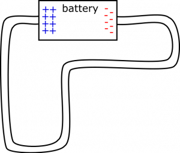
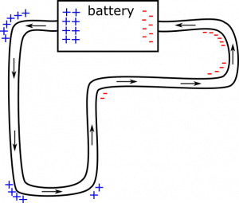

*[Return to Surface Charges around a Circuit](/notes/week-05-moving-charges-batteries/q_in_wires/)*

On the circuit shown below, draw how you would expect charge to distribute on the surface of the wire near the bends in the circuit.

Circuit with Bends

### Facts

- Electric field is constant in the wire - created by the surface charges on the wire, not the battery.
- Electric field points along the direction of the wire, from positive to negative.
- Charges can build up on the surface of the wire.

### Goal

- Draw charge distribution near the bends in the wire.

### Representations

- We represent the circuit as in the example statement above.
- We will represent the charge distribution with little pluses ($+$) and minuses ($-$).

## Solution

### Assumption

In order to talk about individual charged particles in the circuit, we will have to make an assumption about the charged particles which are actually moving, the ones we think about when we think about “current”.

- The mobile charge carriers are positive.

It doesn't so much matter what we choose, but we want to be clear about the assumption, so that our discussion take place with this in mind, and so our reasoning will be consistent.

We will also assume that we have a perfect battery in this case to drive a steady current and provide excess charges to be distributed on the wire.

Note that we are only looking for the surface charges on the bends here. We need to figure out a way to distribute them so that the electric field stays constant in magnitude and along the direction of the wire. Let's consider the nature of the electric field near the positive end of the battery. In the wire, it will be pointing left into the bend. It will also have a large magnitude since it is so close to the battery. To reduce the magnitude, and ensure that the electric field points down after the bend, we place a lot of positive surface charges on the outer edge of the bend.

What would have happened if we did not place these charges here? Conventional current would follow the electric field. An electric field vector near the bend would point left, and instead of following the wire, positive charge would build up along the outer surface of the bend (the wider part of the bend) in the wire. Charge would continue to build up until we reach a point where an electric field vector near the bend points down! See below for a representation of how the surface charges near the bends in the wire would look. The electric field (and direction of conventional current) is shown with arrows.

Circuit with Surface Charges on the Bends

Notice that as you traverse the length of the wire, the surface charges become less positive and more negative, and eventually start to accumulate on the tighter part of the bend. We require each bend to be more negative than the previous one, so that the electric field on the straight parts of the wire points in the desired direction. And we start to draw the bends with negative charge on the tighter part, because all we need is for the wider part of the bend to be more positive than the tighter part. When drawing positive charge, it will be on the wider part. When drawing negative charge, it will be on the tighter part.

### Note

The accumulation of charge around the bends might look slightly different if we had chosen for the mobile charge carriers to be *negative* in our assumption at the top of the solution. It's a worthwhile exercise to go through the reasoning again with the flipped assumption.
