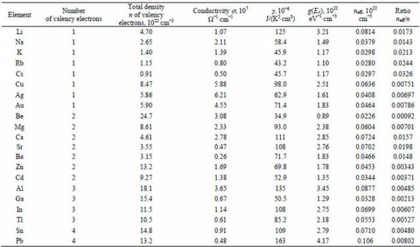

*[Return to current in wires](/empcubed/notes/week-06-resistors-combinations/current/)*

Suppose you have a two wires. Each has a current of $5\text{~A}$. One is made of copper (Cu) and has radius $0.5\text{~mm}$. The other is made of zinc (Zn) and has radius $0.1\text{~mm}$. What are the drift speeds of electrons in each wire? You may want to consult the table below.

Properties of Metals

### Facts

- The copper wire has $I = 5\text{~A}$, $r = 0.5\text{~mm}$.
- The zinc wire has $I = 5\text{~A}$, $r = 0.1\text{~mm}$.
- The charge of an electron is $q = - 1.6 \cdot 10^{- 19}\text{~C}$.
- Electron density of copper is $n_{\text{Cu}} = 8.47 \cdot 10^{22}\text{~cm}^{- 3}$.
- Electron density of zinc is $n_{\text{Zn}} = 13.2 \cdot 10^{22}\text{~cm}^{- 3}$.
- Electron current as $i = nAv_{avg}$.
- Current is $I = |q|i$.
  - Units of current is charge per second. Electron current is electrons per second. We multiply by $q$ (the electron charge) to get charge per second.

### Goal

- Find the drift speed for both wires.

### Approximations & Assumptions

- The wires have circular cross-sections. This is typical of real wires and allows us to use the diameter of the wire to calculate the area properly.
- Using the [Drude model](/empcubed/notes/week-06-resistors-combinations/current/) for electrons in the wire - the electrons are accelerated by the electric field, until they run into a positive nucleus, which reduces the speed back to zero.

### Representations

- We represent electron current as $i = nAv_{avg}$.
- We represent current as $I = |q|i$. Current is charge per second. Electron current is electrons per second. We multiply by $q$ (the electron charge) to get charge per second.

## Solution

We can use the [Drude model](/empcubed/notes/week-06-resistors-combinations/current/) for electrons in the wire - the electrons are accelerated by the electric field, until they run into a positive nucleus, which reduces the speed back to zero. This is where our definition of drift speed comes from, so it is worth including it in our solution for reference.

There are a lot of variables in this problem, so let's make a plan.

### Plan

We will do the following steps for each wire.

- Find the electron density of each material (see listed above, in Facts).
- Find the cross-sectional area of the wire.
- Find the electron current of each wire, using the given current.
- Use all the new information to find the drift speed.

To find the cross-sectional area of the wire, we just use the area of a circle. We know the radius, so this should be easy: $A = \pi r^{2}$.

We are given current, and we can solve for electron current using the charge of an electron: $i = \frac{I}{|q|}$.

We now have enough information to solve for the drift speed of electrons. We use positive numbers below, since we care only about speed for now, not direction.

$$
v_{avg} = \frac{I}{\pi r^{2}n|q|}
$$

Current ($I$), radius ($r$), electron density ($n$), and electron charge ($q$) are all things we know for our two wires. When we plug in the numbers, we get the following:

$$
\begin{matrix}
v_{\text{avg, Cu}} = 0.47\text{~mm/s} & , & v_{\text{avg, Zn}} = 7.5\text{~mm/s}
\end{matrix}
$$

Notice that this is actually really slow! Depending on the material, the electron only travels somewhere between 1 mm - 1 cm per second on average.
