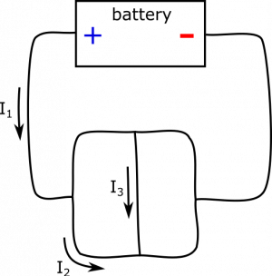
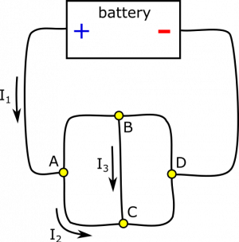
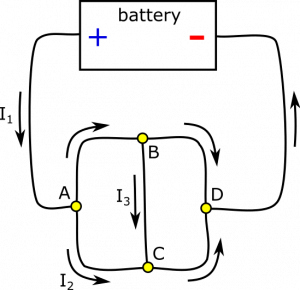

*[Return to current in wires](/notes/week-06-resistors-combinations/current/)*

Suppose you have the circuit below. You are given a few values: $I_{1} = 8\text{~A}$, $I_{2} = 3\text{~A}$, and $I_{3} = 4\text{~A}$. Determine all other currents in the circuit, using the [Current Node Rule](/notes/week-06-resistors-combinations/current/#current_in_different_parts_of_the_wire). Draw the direction of the current as well.

Circuit

### Facts

- $I_{1} = 8\text{~A}$, $I_{2} = 3\text{~A}$, and $I_{3} = 4\text{~A}$.
- $I_{1}$, $I_{2}$, and $I_{3}$ are directed as pictured.
- The Node Rule is $I_{in} = I_{out}$, for any point along the current.

### Goal

- Find all the currents in the circuit and their directions.

### Representations

For simplicity of discussion, we label the nodes in an updated representation:

Circuit with Nodes

### Assumption

We will assume we have a perfect battery to supply a steady current to the circuit and will not die over time.

## Solution

Okay, there is a lot going on with all these nodes. Let's make a plan to organize our approach.

### Plan

Take the nodes one at a time. Here's the plan in steps:

- Look at all the known currents attached to a node.
- Assign variables to the unknown currents attached to a node.
- Set up an equation using the Node Rule. If not sure about whether a current is going in or coming out of the node, guess.
- Solve for the unknown currents.
- If any of them are negative, then we guessed wrong two steps ago. We can just flip the sign now.
- Repeat the above steps for all the nodes.

Let's start with node $A$. Incoming current is $I_{1}$, and outgoing current is $I_{2}$. How do we decide if $I_{A \rightarrow B}$ is incoming or outgoing? We need to bring it back to the Node Rule: $I_{in} = I_{out}$. Since $I_{1} = 8\text{~A}$ and $I_{2} = 3\text{~A}$, we need $I_{A \rightarrow B}$ to be outgoing to balance. To satisfy the Node Rule, we set

$$
I_{A \rightarrow B} = I_{out} - I_{2} = I_{in} - I_{2} = I_{1} - I_{2} = 5\text{~A}
$$

We do a similar analysis for node $B$. Incoming current is $I_{A \rightarrow B}$, and outgoing current is $I_{3}$. Since $I_{A \rightarrow B} = 5\text{~A}$ and $I_{3} = 4\text{~A}$, we need $I_{B \rightarrow D}$ to be outgoing to balance. To satisfy the Node Rule, we set

$$
I_{B \rightarrow D} = I_{out} - I_{3} = I_{in} - I_{3} = I_{A \rightarrow B} - I_{3} = 1\text{~A}
$$

For node $C$, incoming current is $I_{2}$ and $I_{3}$. There is no outgoing current defined yet! $I_{C \rightarrow D}$ must be outgoing to balance. To satisfy the Node Rule, we set

$$
I_{C \rightarrow D} = I_{out} = I_{in} = I_{2} + I_{3} = 7\text{~A}
$$

Lastly, we look at node $D$. Incoming current is $I_{B \rightarrow D}$ and $I_{C \rightarrow D}$. Since there is no outgoing current defined yet, $I_{D \rightarrow battery}$ must be outgoing to balance. To satisfy the Node Rule, we set

$$
I_{D \rightarrow battery} = I_{out} = I_{in} = I_{B \rightarrow D} + I_{B \rightarrow D} = 8\text{~A}
$$

Notice that $I_{D \rightarrow battery} = I_{1}$. This will always be the case for currents going in and out of the battery (approximating a few things that are usually safe to approximate, such as a steady current). In fact, we could have treated the battery as another node in this example. Notice also that if you incorrectly reason about the direction of a current (incoming or outgoing), the calculation will give a negative number for the current. The Node Rule is self-correcting. A final representation with directions is shown below.

Circuit with Nodes
