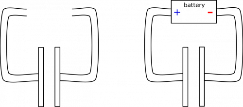
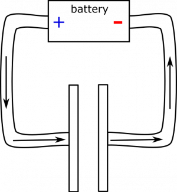
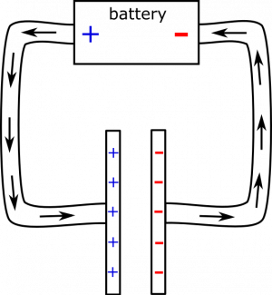
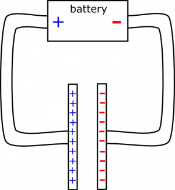

*[Return to Charging and Discharging Capacitors](/empcubed/notes/week-08-capacitors-combinations/cap_charging/)*

Suppose you have a parallel plate capacitor that is disconnected from any power source and is discharged. At time $t = 0$, the capacitor is connected to a battery. Sketch the graphs of current ($I$) in the wire, charge ($Q$) on the positive plate, and voltage ($\Delta V$) across the capacitor over time.

### Facts

- The capacitor is discharged.
- The capacitor is made up of parallel plates.
- The capacitor is connected to a power source at $t = 0$.

### Lacking

- Graphs of $I$, $Q$, $\Delta V$.

### Approximations & Assumptions

- There are no other circuit elements (except for the wire): This simplifies down the model, having resistors or other capacitors will change the graphs for a charging or discharging capacitor.
- The wire itself has a small resistance: If the wires had no resistance then the current at $t = 0$ would go to infinity by ohms law. This can be shown by solving ohms law for current in a circuit as the resistance approaches zero.
- Practically speaking, the capacitor becomes “fully charged” (with respect to the potential of the battery) at some finite time: The amount and time it takes for a capacitor to charge also depends on the circuit it is in and the voltage across it, this assumption simplifies down our graphs.

### Representations

- We represent the setup below. The capacitor is pictured both disconnected and hooked up to the power source.

Capacitor Setup

## Solution

Before the capacitor is connected, we know that it is discharged, so there is a net neutral charge both on the wire and on the parallel plates. At time $t = 0$, when the power source is connected, it sets up an electric field in the wire (quasi-steady state), which the charges on the wire and capacitor do not immediately oppose, since there is initially no charge on the capacitor. At time $t = 0$ (or maybe slightly after 0, once the electric field has propagated at the speed of light), the electric field in the wire may look like this:

Capacitor Circuit at time t=0

Slightly after time $t = 0$, charges start to move (setting up a current) and the capacitor begins to charge. Due to the high electric field at the very beginning, the charge flows very quickly at first. Since current is simply the movement of charge, our current graph will start at a very high value. However, we expect the current to drop pretty quickly, since the large flow of charge means a quickly charging capacitor. The charges on the capacitor create an electric field that opposes the electric field in the wire and diminishes it, slowing down the flow of charge. A few moments after time $t = 0$, the circuit and electric field may look like this:

Capacitor Circuit a Few Moments after Connection

During this time, the current is smaller than at the beginning, but it is also decreasing at a slower rate, since the plates are not charging as quickly, which means the electric field is not diminishing as quickly. The current actually decays exponentially, though this is not necessary knowledge for the qualitative graph. Before we produce our graphs, it is also useful to represent the circuit at a time after the capacitor has been “fully charged” (limited by the potential difference of the power source), which was our practical assumption. At this point, the charge on the plates fully opposes the electric field from the power source, and as a result no current exists in the circuit.

Capacitor Circuit a Long Time after Connection

Based on what we have argued so far, the graph of the current in the circuit should look something like this:

Current Graph

Notice that we also used the charge of the capacitor in our argument for why the current drops off like it does. We basically argue that the charge graph will look like a flipped current graph: rapidly accumulating charge at first, and gradually slowing down in accumulation until equilibrium (“fully charged”-ness) is reached. This yields the shape below. We are also happy with this result, because current is defined as the rate of change of the charge (amount of charge moving through a checkpoint per unit time). More formally, $I = \frac{\text{d}Q}{\text{d}t}$. If we know that current is a decaying exponential, then we can solve the differential equation to find that charge is the opposite of a decaying exponential. You don't need to be able to solve this to know how the charge accumulates, but it is a nice check that we have been consistent with our reasoning.

Charge Graph

Lastly, we wish to produce a graph of the potential difference between the plates. We can pull from a [previous in-class project](https://www.msuperl.org/wikis/pcubed/doku.php?id=184_projects:project_5) in which we found the electric field from a large plate of charge. If the plates are large and close together, the electric field is constant in the middle, and depends on the charge of the plate like so:

$$
E_{plate} = \frac{Q_{plate}}{2\epsilon_{0}A_{plate}}
$$

Notice that we do not necessarily need to remember this equation – the electric field of everything we have looked at so far has been directly proportional to the charge (not $Q^{2}$ or $Q^{5}$ or anything strange).

We also remember that potential difference across a constant electric field is just the electric field times the distance:

$$
\Delta V = E \cdot \Delta d
$$

Since the distance between the plates is unchanging and the electric field simply scales with $Q$, we can expect the voltage graph to have the same shape as the charge graph:

Voltage Graph

That's it! We can even do one more check to be sure we are happy with our result. Notice the the capacitance of a capacitor can be represented as the charge on a plate (or something else, depending on the shape of the capacitor) divided by the potential difference between the plates (or whatever):

$$
C = \frac{Q}{\Delta V}
$$

We know that capacitance is a constant, since it is an intrinsic property of the capacitor's structure. Therefore, $Q/\Delta V$ must be constant, so their graphs must have the same shape. This is consistent with how we reasoned above, so this check makes us happy.
