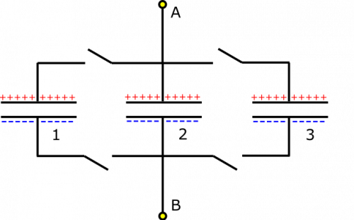
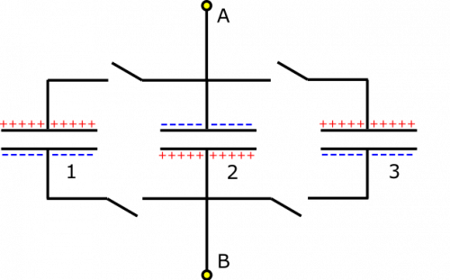

*[Return to Capacitors in Parallel notes](/empcubed/notes/week-08-capacitors-combinations/c_parallel/)*

Suppose you have the following setup of already-charged capacitors. The positive plates are all on the top half of the circuit. Capacitors are labeled 1 through 3 for convenience of reference, and the sign of the charge on the plates is indicated. You know that $Q_{1} = Q_{2} = Q_{3} = 1\text{~mC}$, and $\Delta V_{1} = \Delta V_{2} = \Delta V_{3} = 20\text{~V}$. Part 1: What is the equivalent capacitance (if the switches are closed) from Node A to Node B? What happens after the switches are closed? Part 2: What if Capacitor 2 were flipped?

Circuit with Capacitors in Parallel

### Facts

- $Q_{1} = Q_{2} = Q_{3} = 1\text{~mC}$​
- $\Delta V_{1} = \Delta V_{2} = \Delta V_{3} = 20\text{~V}$​
- Capacitors are aligned as shown in picture.
- Capacitor 2 is flipped in the second case.

### Lacking

- $C_{\text{equiv}}$​
- Explanations for what happens after the switches are closed, in both cases.

### Approximations & Assumptions

- The potential differences across the segments of wire are very very small in comparison to the potential differences across the capacitors.

### Representations

- We represent capacitance as

$$
C = \frac{Q}{\Delta V}
$$

- We represent the [Loop Rule](/empcubed/notes/week-06-resistors-combinations/r_energy/#energy_around_the_circuit) (for potential difference within a closed loop) as

$$
\Delta V_{1} + \Delta V_{2} + \Delta V_{3} + \ldots = 0
$$

- We represent the equivalent capacitance of multiple capacitors arranged in parallel as

$$
C_{\text{equiv}} = C_{1} + C_{2} + C_{3} + \ldots
$$

- We represent the situation with diagram given above.

## Solution

### Part 1

All the charges and potential differences across the capacitors are the same, so they should have the same capacitance (this is not always the case for capacitors in parallel, but just happens to be for this example):

$$
C_{1} = C_{2} = C_{3} = \frac{Q}{\Delta V} = 50\mu\text{F}
$$

Now, we can find the equivalent capacitance from Node A to Node B, since the capacitors are arranged in parallel:

$$
C_{\text{equiv}} = C_{1} + C_{2} + C_{3} = 150\mu\text{F}
$$

Okay, so what happens when we closed all the switches? Now the capacitors are connected to one another. A good check is to see if charge will move. If there is a potential differences anywhere across the capacitors, this would cause some or all of the charges to move. The notes tell us that the [potential differences across parallel capacitors](/empcubed/notes/week-08-capacitors-combinations/c_parallel/#loop_rule_and_voltage_in_parallel) will be the same in a steady state. If they are not the same, we can use the Loop Rule to show there is a voltage difference along the wire, which will cause charge to flow between capacitors. We are happy to see that the potential differences across our capacitors are the same, so the setup is already in a steady state! **Nothing changes when the switches are closed.**

### Part 2

Circuit with Capacitors in Parallel

In the case that Capacitor 2 is flipped, we have the setup shown to the right. When we check the potential differences in the different capacitors, we notice that the voltage across Capacitor 2 is the opposite as the voltage across the other capacitors. If we travel from Node B to Node A, we could travel through Capacitor 2 and go through $\Delta V_{2} = - 12\text{~V}$, or through one of the other capacitors and go through $\Delta V_{1,3} = + 12\text{~V}$. These are different, but that can't be! There must be some potential difference in the wire that we are not accounting for. This potential difference will cause charge to flow. The only question is how.

If we consider that charge cannot flow across a capacitor, we know that charges can only move through the wires (i.e., top plate to top plate or bottom plate to bottom plate). Initially, the total charge on the top plates is $1\text{~mC}$ since there is $1\text{~mC~} - 1\text{~mC~} + 1\text{~mC~}$ (and the total charge on the bottom plates is then $- 1\text{~mC}$). In order to reach a steady state, since each capacitor is the same, the charge should spread out evenly among the capacitors because they are connected by conductors. So each capacitor would have a charge of $0.33\text{~mC}$ after returning to equilibrium. This way, charge is conserved on the top and bottom, and each capacitor is charged to the same amount (though this happens because the capacitors all have the same capacitance, not because they are in parallel). The steady state should look the original diagram given, just with less (a third, to be exact) of the charge built up on the plates.
