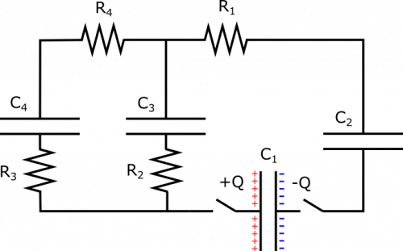
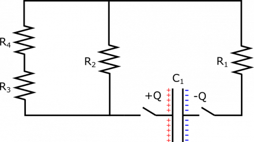
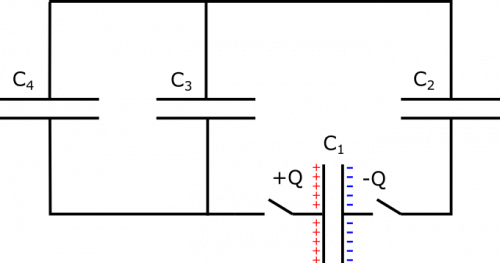
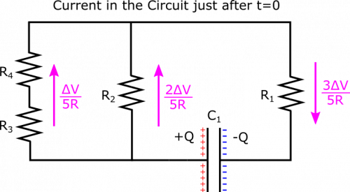
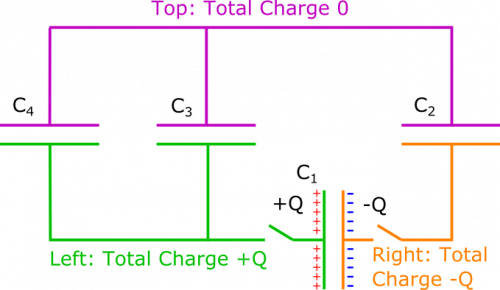
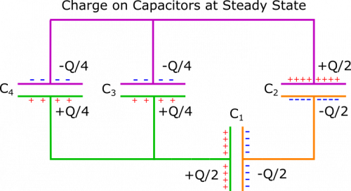

*[Return to Larger Combinations of Circuit Elements notes](/notes/week-07-combinations-part-2/combinations/)*

Suppose you have a the setup shown below. All capacitors have the same capacitance $C$, and all resistors have the same resistance $R$. Capacitor 1 is charged to $Q$ and $- Q$ on its plates, so that the voltage across it is $\Delta V$, and all the other capacitors are not charged at all. At time $t = 0$, the switches are closed. What happens? In what order to the capacitors finish charging (practically speaking)? Be as detailed as possible.

This is a challenging problem, but if you can figure out the currents in the circuit just after $t = 0$, and the charges on the capacitors at the steady state, then that is pretty awesome at this point in the course.

Circuit Setup

### Facts

- Capacitor 1 is charged to $Q$ and $- Q$ on its plates.
- The voltage across Capacitor 1 at $t = 0$ is $\Delta V$.
- $C_{1} = C_{2} = C_{3} = C_{4} = C$.
- $R_{1} = R_{2} = R_{3} = R_{4} = R$.
- Capacitors 2 through 4 are not charged at $t = 0$.

### Lacking

- An explanation of what happens.

### Approximations & Assumptions

- The wire has very very small resistance when compared to the other resistors in the circuit: This allows there to be no energy loss across the wires and no potential difference across them either, simplifying down the model.
- The resistors in the circuit are made of Ohmic materials: Ohmic materials have a linear relationship between voltage and current, this allows us to use ohms law.
- Practically speaking, the capacitors becomes “fully charged” (with respect to the potential differences in the circuit) at some finite time: Making this assumption means we are dealing with perfect capacitors that will not lose charge and will reach a peak charge in a finite time.

### Representations

- We represent the setup with the diagram given. We also may find it useful to look at an analogous circuit without any discharged capacitors at $t = 0$, which is pictured below. Circuit components have been arranged to preserved the structure of the circuit, but so that it might be easier to visualize what is going on and which components are parallel.

Resistors Only

- Another analogous circuit that may be useful is one without any resistors, which is pictured below. Circuit components have been arranged to preserved the structure of the circuit, but so that it might be easier to visualize what is going on and which components are parallel.

Capacitors Only

## Solution

*Just after time t=0:*

This is a pretty complicated setup, so let's try to break it down by first thinking about what happens right after $t = 0$. At this moment, the circuit will behave as if the discharged capacitors are not even there. This is because capacitors affect a circuit by creating a potential difference once they become charged. But when they are completely discharged, this potential difference is $0$, and so current will exist in the wire as if the discharged capacitor is not even there – note that this lasts only for a moment, as once current exists in the circuit, the capacitors will accumulate charge. Anyways, at $t = 0$, it is useful to look at the analogous circuit with only resistors, shown in the representations.

The resistors on the left strip are in series, so their equivalent resistance is $R_{\text{equiv, 3,4}} = R_{3} + R_{4} = 2R$. The left and middle strips are parallel with respect to the charged capacitor, so their equivalent resistance is given by

$$
\frac{1}{R_{\text{equiv, 2,3,4}}} = \frac{1}{R_{\text{left}}} + \frac{1}{R_{\text{middle}}} = \frac{1}{2R} + \frac{1}{R} = \frac{3}{2R}
$$

This yields $R_{\text{equiv, 2,3,4}} = \frac{2}{3}R$. Finally, this chunk and Resistor 1 are in series, and should form the equivalent resistance of the entire circuit:

$$
R_{\text{equiv, all}} = R_{\text{equiv, 2,3,4}} + R_{1} = \frac{5}{3}R
$$

The current just after $t = 0$ will then be dictated by Ohm's Law:

$$
I = \frac{\Delta V}{R_{\text{equiv, all}}} = \frac{3}{5}\frac{\Delta V}{R}
$$

This is the current near the capacitor, which applies for the right strip, but not the middle and left strips, as they are parallel. The current in those parts of the circuit is given by the Node Rule and Loop Rule: The Loop Rule tells us that the potential difference across the left and middle strips is the same, and the Node Rule tells us that currents in each strip should add to $\frac{3}{5}\frac{\Delta V}{R}$. Since the resistance in the left strip is twice the resistance in the middle ($2R$ vs. $R$), we expect the current in the left to be half the current in the middle, because of the equal potential differences. These constraints yield

$$
\begin{matrix}
I_{\text{left}} = \frac{1}{5}\frac{\Delta V}{R}, & & & & & I_{\text{middle}} = \frac{2}{5}\frac{\Delta V}{R}
\end{matrix}
$$

If you are not convinced of this (or if you are, and wish to do a check on the math), you can reach the same result by using Ohm's Law to find the potential difference in the right strip, and then using the Loop Rule to find the potential differences across the left and middle strips, and finally Ohm's Law again to find the currents in these strips. We show the currents in the circuit just after $t = 0$ below.

Currents in Circuit at t=0

*At a Steady State, t very large:*

Next, we want to understand what the circuit will look like when it has reached a steady state. Since there is no battery, we know this point has been reached when there is no current in the wire. We will refer to the circuit with no resistors because we do not care about resistance when there is no current ($\Delta V = (0)R$). We only care that there is no potential difference across the strips of wire, since this is the only way there can be no current. We want all the potential differences in the circuit to be across the capacitors. Below, we split the circuit into three sections, across which charge cannot flow, since the plates of the capacitors do not touch.

Disconnected Sections of Circuit

On the **top** (pink), the net charge is $0$. On the **left** (green), the net charge is $Q$. On the **right** (orange), the net charge is $- Q$. These values will not change no matter when we look at the circuit. At a steady state, you may remember that [capacitors in series have the same charge](/notes/week-08-capacitors-combinations/c_series/#node_rule_and_charge_in_series). So Capacitors 1 and 2 should have the same charge. We know from this that the plates in the **right** section should each have charge $- Q/2$. Since plates in a capacitor always have opposite charges, the corresponding opposite plates will each have charge $Q/2$.

In the **left** section, we need to have $Q/2$ spread over the positive plates on Capacitor 3 and 4. The Loop Rule dictates that in order to have zero potential difference across the wire, we need the potential differences across Capacitors 3 and 4 to be the same. Since they also have the same capacitance $C$, they must also have the same charge. So we distribute the total $Q/2$ as $Q/4$ on each capacitor. Therefore, each should have $- Q/4$ on its negative plate, which brings the total charge in the **top** section to 0, as desired. We have written charge on each plate below, once the circuit has reached a steady state.

Charge on Capacitors after a while

*Between t=0 and the Steady State:*

Okay, to recap what we have figured out so far, we know that when the switches are closed, we instantaneously have the following currents in each strip:

$$
\begin{matrix}
I_{\text{left}} = \frac{1}{5}\frac{\Delta V}{R}, & & I_{\text{middle}} = \frac{2}{5}\frac{\Delta V}{R}, & & I_{\text{right}} = \frac{3}{5}\frac{\Delta V}{R}
\end{matrix}
$$

We also know that once the circuit reaches a steady state, we have the following charges on the capacitors:

$$
\begin{matrix}
C_{1} = \frac{Q}{2}, & & C_{2} = \frac{Q}{2}, & & C_{3} = \frac{Q}{4}, & & C_{4} = \frac{Q}{4}
\end{matrix}
$$

When we think about how long it takes a capacitor to charge up, it is useful to think of what fraction of its final charge it has accumulated at a given time. This is a little weirder for Capacitor 1, which is discharging, but when we consider that there is no resistance in the **right** section, we can reason that Capacitor 1 discharge at the same rate that Capacitor 2 discharges.

For Capacitors 2 through 4, each begins charging at a different rate (rate of charging = current). As a fraction of its final charge ($I_{\text{initial}}/Q_{\text{final}}$), we have

$$
\text{Rate}_{\text{3, initial}} > \text{Rate}_{\text{2, initial}} > \text{Rate}_{\text{4, initial}}
$$

We are not formalizing anything here, just getting an idea for how the capacitors begin charging up. As the capacitors charge and build up potential differences, the potential differences across nearby resistors and stretches of wire are reduced. The current feeding the capacitor is correspondingly reduced, so a capacitor that charges up faster at first will also slow in charging up sooner. As it turns out, Capacitor 3 will charge up to $Q/4$, before Capacitor 2 charges up to $Q/2$, which will charge up before Capacitor 4 reaches $Q/4$. That is the order by which this circuit will reach a steady state.

In order to understand all the math behind this, we would need to solve some differential equations, which is not necessary for this course. It suffices to understand the mechanism by which the capacitors charge, which is the current in the circuit. This current depends on a lot of factors, including resistors, existing potential differences in the capacitors, and structures such as parallel branches of the circuit. If you can figure out the currents in the circuit just after $t = 0$, and the charges on the capacitors at the steady state, then that is pretty awesome at this point in the course.
