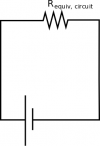
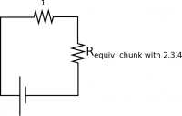
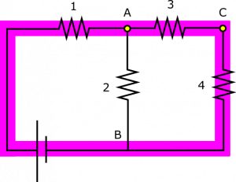
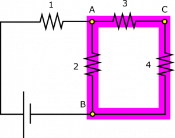

*[Return to Resistors in Parallel Notes](/empcubed/notes/week-06-resistors-combinations/r_parallel/)*

Suppose you have the following circuit. Resistors are labeled 1 through 4 and nodes in the circuit are labeled A, B, and C for convenience of reference. You know that the circuit contains a 12-Volt battery, $I_{1} = 50\text{~mA}$, $R_{1} = 80\Omega$, $R_{3} = 300\Omega$, $R_{4} = 500\Omega$, and $\Delta V_{4} = 5\text{~V}$. What are the potential differences $\Delta V_{1}$, $\Delta V_{2}$, $\Delta V_{3}$, and the resistance $R_{2}$?

Circuit with Resistors in Series and Parallel

### Facts

- $\Delta V_{\text{bat}} = 12\text{~V}$​
- $I_{1} = 50\text{~mA}$​
- $R_{1} = 80\Omega$​
- $R_{3} = 300\Omega$​
- $R_{4} = 500\Omega$​
- $\Delta V_{4} = 5\text{~V}$​

### Lacking

- $\Delta V_{1}$, $\Delta V_{2}$, $\Delta V_{3}$, $R_{2}$.

### Approximations & Assumptions

- The wire has very very small resistance when compared to the other resistors in the circuit: This allows there to be no energy loss across the wires and no potential difference across them either simplifying down the model.
- The circuit is in a steady state: It takes a finite amount of time for a circuit to reach steady state and set up a charge gradient. Making this assumption means the current is not changing with time in any branch of the circuit.
- Approximating the battery as a mechanical battery: This means the battery will supply a steady power source to the circuit to keep it in steady state.
- The resistors in the circuit are made of Ohmic materials: Ohmic materials have a linear relationship between voltage and current, this allows us to use ohms law.

### Representations

- We represent [Ohm's Law](/empcubed/notes/week-06-resistors-combinations/resistivity/#resistance) as

$$
\begin{matrix}
\Delta V = IR & & & & & & (1)
\end{matrix}
$$

- We represent the equivalent resistance of multiple resistors arranged in series as

$$
\begin{matrix}
R_{\text{equiv, series}} = R_{1} + R_{2} + R_{3} + \ldots & & & & & & (2)
\end{matrix}
$$

- We represent the equivalent resistance of multiple resistors arranged in parallel as

$$
\begin{matrix}
\frac{1}{R_{\text{equiv, parallel}}} = \frac{1}{R_{1}} + \frac{1}{R_{2}} + \frac{1}{R_{3}} + \ldots & & & & & & (3)
\end{matrix}
$$

- We represent the [Loop Rule](/empcubed/notes/week-06-resistors-combinations/r_energy/#energy_around_the_circuit) (for potential difference within a closed loop) as

$$
\begin{matrix}
\Delta V_{1} + \Delta V_{2} + \Delta V_{3} + \ldots = 0 & & & & & & (4)
\end{matrix}
$$

- We represent the [Node Rule](/empcubed/notes/week-06-resistors-combinations/current/#current_in_different_parts_of_the_wire) (for current through a point in the circuit) as

$$
\begin{matrix}
I_{\text{in}} = I_{\text{out}} & & & & & & (5)
\end{matrix}
$$

- We represent the situation with diagram given above.

## Solution

 Let's start with resistance. The equivalent resistance for the entire circuit can be found with Ohm's Law – equation (1):

$$
R_{\text{equiv, circuit}} = \frac{\Delta V_{\text{battery}}}{I_{1}} = 240\Omega
$$

 We use $I_{1}$ since this is the current in the wire connected directly to the battery. We can break this down further to find the equivalent resistance in the chunk of the circuit containing Resistors 2, 3, and 4. This chunk and Resistor 1 are connected in series to form the resistance of the whole circuit, so we can use equation (2) to write:

$$
R_{\text{equiv, circuit}} = R_{1} + R_{\text{equiv, chunk with 2,3,4}}
$$

This yields $R_{\text{equiv, chunk with 2,3,4}} = 160\Omega$.

Notice that this “chunk” is actually two parallel pieces of the circuit, starting at Node A and ending at Node B. The two parallel parts are Resistor 2, and then Resistors 3 and 4 together. We can use equation (3) to break down the chunk into these two pieces (we combine Resistors 3 and 4 below using equation (2)):

$$
\frac{1}{R_{\text{equiv, chunk with 2,3,4}}} = \frac{1}{R_{2}} + \frac{1}{R_{3} + R_{4}}
$$

We can plug in what we know and solve for the resistance of Resistor 2:

$$
R_{2} = 200\Omega
$$

Okay, now for the potential differences. It will be useful in the approach we choose to know the current through Resistor 4, which is found from Ohm's Law:

$$
I_{4} = \frac{\Delta V_{4}}{R_{4}} = 10\text{~mA}
$$

A simple application of Node Rule – equation (5) – at Node C should tell us that $I_{3} = I_{4}$. Now, we can reapply Ohm's Law to find the potential difference across Resistor 3:

$$
\Delta V_{3} = I_{3}R_{3} = I_{4}R_{3} = 3\text{~V}
$$

Loop 1 - Circuit with Resistors in Series and Parallel

A couple applications of the Loop Rule should help us find the rest of the unknowns. Consider the loop highlighted in the circuit above. The Loop Rule – equation (4) – tells us that if we travel completely around the loop, we should encounter a total potential difference of 0. If we travel along the direction of conventional current (clockwise in our representation), voltage decreases, so $\Delta V_{1}$, $\Delta V_{3}$, $\Delta V_{4} < 0$, whereas we have $\Delta V_{\text{bat}} > 0$. These four potential differences form a loop, so they should add to 0:

$$
\Delta V_{\text{bat}} - \Delta V_{1} - \Delta V_{3} - \Delta V_{4} = 0
$$

We know enough potential differences to find the voltage across Resistor 1:

$$
\Delta V_{1} = \Delta V_{\text{bat}} - \Delta V_{3} - \Delta V_{4} = 4\text{~V}
$$

Loop 2 - Circuit with Resistors in Series and Parallel

Now, consider the (different!) loop highlighted in the circuit above. The Loop Rule tells us that if we travel completely around the loop, we should encounter a total potential difference of 0. We see that current in Resistor 2 runs opposite to the current in the other resistors if we follow the loop in one direction. We have to choose a direction for the application of the Loop Rule. If we go clockwise, voltage increases across Resistor 2, but drops across Resistors 3 and 4. So we write:

$$
\Delta V_{2} - \Delta V_{3} - \Delta V_{4} = 0
$$

We know enough potential differences to find the voltage across Resistor 2:

$$
\Delta V_{2} = \Delta V_{3} + \Delta V_{4} = 8\text{~V}
$$

One way in which we can evaluate the solution here is to pick a few other loops in the circuit and make sure they are still valid. There are often times many more loops in a circuit than the solution goes through.

That's all! Note that there are a lot of ways to do this problem, but we chose an approach that showcases the power of knowing equivalent resistance for resistors in parallel, and the power of the Loop Rule. See if you can create a different method for finding the unknowns.
