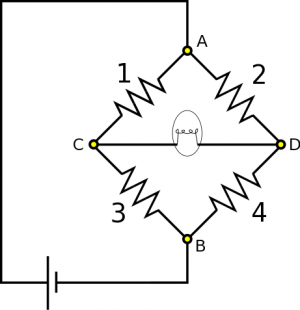
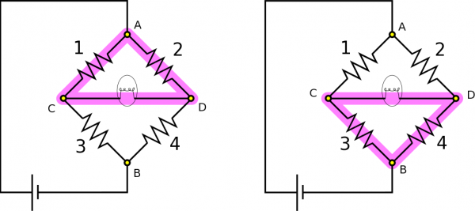
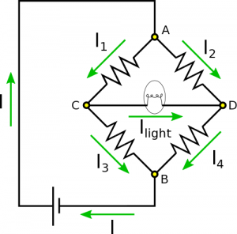
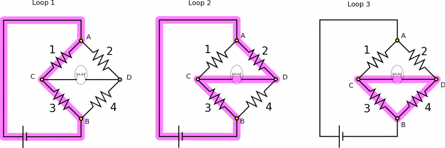

*[Return to Larger Combinations of Resistors and Capacitors notes](/notes/week-07-combinations-part-2/combinations/)*

Suppose you have the following circuit – it is similar to a well known circuit called [a Wheatstone bridge](https://en.wikipedia.org/wiki/Wheatstone_bridge). Resistors are labeled 1 through 4 for convenience of reference, and the fifth element is a light bulb, which also has some resistance. If any current at all flows through the light bulb, it will glow. You know $R_{1} = 150\Omega$, $R_{2} = 60\Omega$, and $R_{3}$ is variable, meaning you can choose its resistance. **Part A:** You find that when $R_{3} = 250\Omega$, the light bulb is off. What is $R_{4}$? **Part B:** Suppose we set $R_{3} = 500\Omega$, so that the light bulb glows. We also have the new information that $\Delta V_{\text{bat}} = 20\text{~V}$, and $\Delta V_{3} = 15\text{~V}$. Which direction does conventional current flow through the light bulb? What is the voltage across the light bulb?

Circuit with Wheatstone bridge

### Facts

- $R_{1} = 150\Omega$​
- $R_{2} = 60\Omega$​
- $R_{3} = 250\Omega$ for Part A, $R_{3} = 500\Omega$ for Part B.
- $I_{\text{light}} = 0$ for Part A.
- $\Delta V_{\text{bat}} = 20\text{~V}$ and $\Delta V_{3} = 15\text{~V}$ for Part B.

### Lacking

- $R_{4}$​
- Direction of conventional current in light bulb for Part B.
- Potential difference across light bulb for Part B.

### Approximations & Assumptions

- The resistors (including the light bulb) in the circuit are made of Ohmic materials: Ohmic materials have a linear relationship between voltage and current, this allows us to use ohms law.
- The wire has very very small resistance when compared to the other resistors in the circuit: This allows there to be no energy loss across the wires and no potential difference across them either simplifying down the model.
- The circuit is in a steady state: It takes a finite amount of time for a circuit to reach steady state and set up a charge gradient. Making this assumption means the current is not changing with time in any branch of the circuit.
- Approximating the battery as a mechanical battery: This means the battery will supply a steady power source to the circuit to keep it in steady state.

### Representations

- We represent [Ohm's Law](/notes/week-06-resistors-combinations/resistivity/#resistance) as

$$
\Delta V = IR
$$

- We represent the [Loop Rule](/notes/week-06-resistors-combinations/r_energy/#energy_around_the_circuit) (for potential difference within a closed loop) as

$$
\Delta V_{1} + \Delta V_{2} + \Delta V_{3} + \ldots
$$

- We represent the [Node Rule](/notes/week-06-resistors-combinations/current/#current_in_different_parts_of_the_wire) (for current through a point in the circuit) as

$$
I_{\text{in}} = I_{\text{out}}
$$

- We represent the situation with diagram given above.

## Solution (Part A)

Since there is no current flowing through the light bulb, we also know there is no voltage across it. We can then apply the Loop Rule to the loops highlighted below to find some equivalent voltages:

$$
\begin{matrix}
\Delta V_{1} = \Delta V_{2}, & & & & & \Delta V_{3} = \Delta V_{4}
\end{matrix}
$$

Here are the loops:

Circuit with Wheatstone bridge and highlighted loops

A simple application of Ohm's Law changes these equations into

$$
\begin{matrix}
I_{1}R_{1} = I_{2}R_{2} & & & & & (1) \\
I_{3}R_{3} = I_{4}R_{4} & & & & & (2)
\end{matrix}
$$

We can refer again to there being no current in the light bulb to say more about the current in the rest of the circuit. Since there is no current in that segment, we can use the Node Rule on Nodes C and D to say $I_{1} = I_{3}$ and $I_{2} = I_{4}$, respectively. When we plug this into the equation (2), we can find that

$$
R_{4} = \frac{I_{1}}{I_{2}}R_{3}
$$

It remains to determine the ratio between the two currents. To do this we simply rearrange equation (1) to express the ratio as being between resistors rather than currents. This gives us a final expression for $R_{4}$:

$$
R_{4} = \frac{R_{2}}{R_{1}}R_{3} = 100\Omega
$$

## Solution (Part B)

To reiterate the new information, we just found that $R_{4} = 100\Omega$. Now, we change Resistor 3 to $R_{3} = 500\Omega$, and the light bulb glows, so we know current is running through it. We also know $\Delta V_{\text{bat}} = 20\text{~V}$ and $\Delta V_{3} = 15\text{~V}$. We want to find which direction conventional current is directed through the light bulb, and the voltage across the light bulb.

The direction of current shouldn't be terribly hard to figure out. If current is directed to the left, it should then add via the Node Rule to the current directed down through Resistor 3. If current is directed to the right, it should then add via the Node Rule to the current directed down through Resistor 4. Before we changed $R_{3}$, current was zero. Now, we have increased $R_{3}$. We can imagine that with the increased resistance, current in Resistor 3 should decrease, so it makes sense for current to directed to the right. One could think of this result both as less current in Resistor 3, or more current in Resistor 4. There are also a lot of other arguments that would reach this same conclusion. For clearness, we have drawn the direction of conventional current in each segment below.

Circuit with Wheatstone bridge, and directed current

To find $\Delta V_{\text{light}}$, we will need to set up some equations using the Loop Rule and Node Rule. We will focus on Nodes A and B, and the Loops highlighted below. Note that if you want to be able to solve for everything in the circuit, you have to use some loop equations and some node equations (you can't use only loop or only nodes).

Highlighted loops in Wheatstone bridge circuit

Applying the Node Rule and the Loop Rule, we obtain the following equations:

$$
\begin{matrix}
I & = I_{1} + I_{2} & (\text{Node A}) \\
I & = I_{3} + I_{4} & (\text{Node B}) \\
\Delta V_{\text{bat}} & = \Delta V_{1} + \Delta V_{3} & (\text{Loop 1}) \\
\Delta V_{\text{bat}} & = \Delta V_{2} - \Delta V_{\text{light}} + \Delta V_{3} & (\text{Loop 2}) \\
\Delta V_{\text{light}} + \Delta V_{4} & = \Delta V_{3} & (\text{Loop 3})
\end{matrix}
$$

If we set the equations from Nodes C and D equal to one another then we find:

$$
I_{1} + I_{2} = I = I_{3} + I_{4}
$$

Then, we apply Ohm's Law $I = \frac{\Delta V}{R}$, so our resistances come into play, which we know. After applying Ohm's Law, what we have is:

$$
\frac{\Delta V_{1}}{R_{1}} + \frac{\Delta V_{2}}{R_{2}} = \frac{\Delta V_{3}}{R_{3}} + \frac{\Delta V_{4}}{R_{4}}
$$

Ultimately, we wish to express $\Delta V_{\text{light}}$ in terms of our known resistances, and $\Delta V_{\text{bat}}$ and $\Delta V_{3}$. We need to figure out a way to sub in for the unknowns $\Delta V_{1}$, $\Delta V_{2}$, and $\Delta V_{4}$ in terms of our known constants. Our approach (which is not the only way to solve this problem) will be to solve the chosen system of equations above.

First, we will use Loops 1 to solve for $\Delta V_{1}$ and we will use Loop 3 to solve for $\Delta V_{4}$. Then we can rewrite our most recent result:

$$
\frac{\Delta V_{\text{bat}} - \Delta V_{3}}{R_{1}} + \frac{\Delta V_{2}}{R_{2}} = \frac{\Delta V_{3}}{R_{3}} + \frac{\Delta V_{3} - \Delta V_{\text{light}}}{R_{4}}
$$

We can also use the equation from Loop 2 to sub in for $\Delta V_{2}$:

$$
\frac{\Delta V_{\text{bat}} - \Delta V_{3}}{R_{1}} + \frac{\Delta V_{\text{bat}} + \Delta V_{\text{light}} - \Delta V_{3}}{R_{2}} = \frac{\Delta V_{3}}{R_{3}} + \frac{\Delta V_{3} - \Delta V_{\text{light}}}{R_{4}}
$$

Since we know $\Delta V_{3}$ and all the resistances, all that remains is to rearrange and solve for $\Delta V_{\text{light}}$:

$$
\Delta V_{\text{light}} = \frac{\Delta V_{3}\left( \frac{1}{R_{1}} + \frac{1}{R_{2}} + \frac{1}{R_{3}} + \frac{1}{R_{4}} \right) - \Delta V_{\text{bat}}\left( \frac{1}{R_{1}} + \frac{1}{R_{2}} \right)}{\frac{1}{R_{2}} + \frac{1}{R_{4}}} = 2.37\text{~V}
$$

Looking at loop 2 alone between the power source and resistor 3 we would expect the voltage across any other elements in that loop to be small. Our answer agrees with this observation as 2.37 is quite small compared to both the battery and resistor 3.
