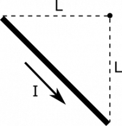
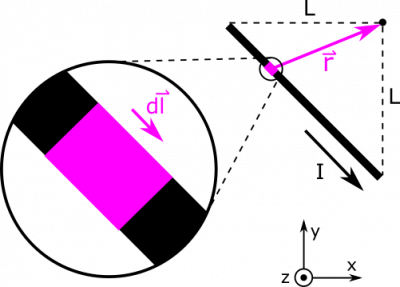

You may have read about how to find the [magnetic field from a very long wire of current](/notes/week-10-magnetic-field-of-a-wire/b_current/#magnetic_field_from_a_very_long_wire). Now, what is the magnetic field from a single segment? Suppose we have the configuration shown below. Your observation point is at the origin, and the segment of current $I$ runs in a straight line from $\langle - L,0,0\rangle$ to $\langle 0, - L,0\rangle$.

### Facts

- The current in the segment is $I$.
- The observation point is at the origin.
- The segment stretches from from $\langle - L,0,0\rangle$ to $\langle 0, - L,0\rangle$.

### Lacking

- $\overset{\rightarrow}{B}$​

### Approximations & Assumptions

- The current is steady, and the wire segment is uniform.

### Representations

- We represent the Biot-Savart Law for magnetic field from a current as

$$
\overset{\rightarrow}{B} = \int\frac{\mu_{0}}{4\pi}\frac{I \cdot d\overset{\rightarrow}{l} \times \overset{\rightarrow}{r}}{r^{3}}
$$

- We represent the situation with diagram given above.

## Solution

Below, we show a diagram with a lot of pieces of the Biot-Savart Law unpacked. We show an example $\text{d}\overset{\rightarrow}{l}$, and a separation vector $\overset{\rightarrow}{r}$. Notice that $\text{d}\overset{\rightarrow}{l}$ is directed along the segment, in the same direction as the current. The separation vector $\overset{\rightarrow}{r}$ points as always from source to observation.

For now, we write

$$
\text{d}\overset{\rightarrow}{l} = \langle\text{d}x,\text{d}y,0\rangle
$$

and

$$
\overset{\rightarrow}{r} = {\overset{\rightarrow}{r}}_{obs} - {\overset{\rightarrow}{r}}_{source} = 0 - \langle x,y,0\rangle = \langle - x, - y,0\rangle
$$

Notice that we can rewrite $y$ as $y = - L - x$. This is a little tricky to arrive at, but is necessary to figure out unless you rotate your coordinate axes, which would be an alternative solution to this example. If finding $y$ is troublesome, it may be helpful to rotate. We can take the derivative of both sides to find $\text{d}y = - \text{d}x$. We can now plug in to express $\text{d}\overset{\rightarrow}{l}$ and $\overset{\rightarrow}{r}$ in terms of $x$ and $\text{d}x$:

$$
\text{d}\overset{\rightarrow}{l} = \langle\text{d}x, - \text{d}x,0\rangle
$$

$$
\overset{\rightarrow}{r} = \langle - x,L + x,0\rangle
$$

Now, a couple other quantities that we see will be useful:

$$
\text{d}\overset{\rightarrow}{l} \times \overset{\rightarrow}{r} = \langle 0,0,\text{d}x(L + x) - ( - \text{d}x)( - x)\rangle = \langle 0,0,L\text{d}x\rangle = L\text{d}x\widehat{z}
$$

$$
r^{3} = (x^{2} + (L + x)^{2})^{3/2}
$$

The last thing we need is the bounds on our integral. Our variable of integration is $x$, since we chose to express everything in terms of $x$ and $\text{d}x$. Our segment begins at $x = - L$, and ends at $x = 0$, so these will be the limits on our integral. Below, we write the integral all set up, and then we evaluate using some assistance some [Wolfram Alpha](https://www.wolframalpha.com/input/?i=integral+from+-L+to+0+of+L%2F(x%5E2%2B(L%2Bx)%5E2)%5E(3%2F2)+dx).

$$
\begin{matrix}
\overset{\rightarrow}{B} & = \int\frac{\mu_{0}}{4\pi}\frac{I \cdot d\overset{\rightarrow}{l} \times \overset{\rightarrow}{r}}{r^{3}} \\
 & = \int_{- L}^{0}\frac{\mu_{0}}{4\pi}\frac{IL\text{d}x}{(x^{2} + (L + x)^{2})^{3/2}}\widehat{z} \\
 & = \frac{\mu_{0}}{2\pi}\frac{I}{L}\widehat{z}
\end{matrix}
$$
