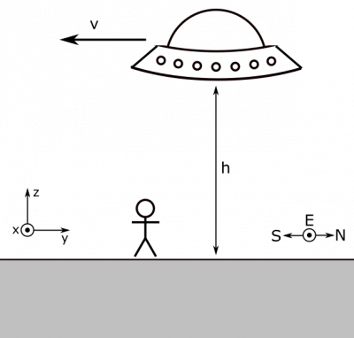

*[Return to Permanent Magnet notes](/empcubed/notes/week-11-sources-of-magnetic-fields/perm_mag/)*

You have spotted an unidentified flying object! Naturally, you wish to find its charge. You have a compass, a good sense of direction, and keen eyesight. You notice that it is flying due south on a course that will pass directly overhead, and it is $15\text{~m}$ above you, travelling at $200\text{~m/s}$. You observe the dial on your properly aligned compass as the object passes overhead. As a function of time, this is what you see:

Compass and Theta Graph

### Facts

- We know $B_{\text{earth}} = 32\mu\text{T}$.
- If we align our coordinate axes according to the representation below, ${\overset{\rightarrow}{B}}_{\text{earth}} = 32\mu\text{T~}\widehat{y}$.
- $h = 15\text{~m}$.
- $\overset{\rightarrow}{v} = - 200\text{~m/s~}\widehat{y}$.
- You have the graph of $\theta$ versus $t$.

### Lacking

- ${\overset{\rightarrow}{B}}_{\text{UFO}}$​
- $q$​

### Approximations & Assumptions

- $q$, $\overset{\rightarrow}{v}$, $h$, and ${\overset{\rightarrow}{B}}_{\text{earth}}$ are all constants: All these variable could easily be changing in this problem. However, to simplify down the model to better analyze the situation we will assume all these things are constant. This could be an accurate assumption if the UFO were cruising steadily over us at the given height.
- Your sense of direction and eyesight can be trusted.

### Representations

- We represent the Biot-Savart Law for the magnetic field from a moving point charge as

$$
\overset{\rightarrow}{B} = \frac{\mu_{0}}{4\pi}\frac{q\overset{\rightarrow}{v} \times \overset{\rightarrow}{r}}{r^{3}}
$$

### Approximation

We will approximate the UFO as a point charge. This may not be the most accurate assumption since the UFO is most likely a large object, but it is an approximation that must be made in order to apply our knowledge to the problem. Since the problem doesn't state anything otherwise and it is a necessary assumption to use the equation above, we will approximate it as a point charge.

- We represent the situation with the following pictures. Coordinate axes and cardinal directions are specified.

A Glimpse of the Unknown

Compass

## Solution

We can find the magnetic field from the UFO based on the compass measurement. Below we show the geometric argument.

Tangent = Opposite over Adjacent

We know that the UFO is closest when it is directly overhead, which is also when it will have the largest contribution to the magnetic field at our observation point, resulting in the largest displacement of the compass needle. On our graph, this would be $20^{\circ}$. We can also reason that the magnetic field of the UFO at our observation point will point in the $+ x$-direction, due to the [Right Hand Rule](/empcubed/notes/week-09-magnetic-field-moving-point-charge/rhr/), assuming the charge of the UFO is positive. First, you would point your fingers in the direction of the UFO's velocity then curl them toward the observation location (down) and your thumb would point out towards you or in the $+ x$-direction. (If the charge of the UFO were negative, we would expect the B-field to be directed in the $- x$-direction. This is not the case, so we can conclude that the UFO is positively charged.) This means that we can solve for the magnetic field from the UFO since we know Earth's magnetic field and the angle:

$$
{\overset{\rightarrow}{B}}_{\text{UFO}} = B_{\text{earth}}\tan\theta\widehat{x}
$$

Now we only have to relate the B-field from the UFO to the charge, which we'll do with the Biot-Savart law we just learned about. When the UFO is directly overhead, it should not be hard to see (pictured below) that the separation vector is $\overset{\rightarrow}{r} = - h\widehat{z}$ and the velocity of the UFO is $\overset{\rightarrow}{v} = - v\widehat{y}$. Their cross product is then

$$
\overset{\rightarrow}{v} \times \overset{\rightarrow}{r} = hv\widehat{x}
$$

UFO Directly Overhead

Then plugging these into the Biot-Savart law, we can find another expression for the B-field.

$$
{\overset{\rightarrow}{B}}_{\text{UFO}} = \frac{\mu_{0}}{4\pi}\frac{q\overset{\rightarrow}{v} \times \overset{\rightarrow}{r}}{r^{3}}
$$

$$
{\overset{\rightarrow}{B}}_{\text{UFO}} = \frac{\mu_{0}}{4\pi}\frac{qhv}{h^{3}}\widehat{x}
$$

At this point, we have two ways to express the magnetic field of the UFO, which should help us find an expression for $q$, the charge of the UFO. Setting these two expressions equal to one another, we find:

$$
B_{\text{earth}}\tan\theta\widehat{x} = \frac{\mu_{0}}{4\pi}\frac{qhv}{h^{3}}\widehat{x}
$$

Solving for $q$, we have

$$
q = \frac{4\pi h^{2}B_{\text{earth}}\tan\theta}{\mu_{0}v} = 131\text{~C}
$$

This is a lot of charge. Since magnetic fields are very small in magnitude, and this can be seen in the magnetic constant, it makes sense that we would need such a large amount of charge to have a noticeable effect on our compass. Uf we were to compare the magnetic field of a moving charge to the electric field from that charge, the electric field would be much larger.
