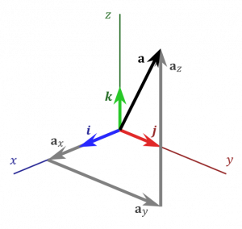
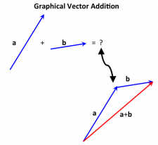
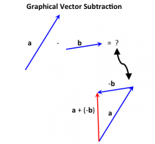

The following mathematical ideas are important to understand and to be able to use as we will rely on them fairly heavily in this course. These notes will provide a review of these ideas with links to more thorough resources if you feel like you need more information about a topic.

## Scientific Notation

[Scientific notation](https://en.wikipedia.org/wiki/Scientific_notation) is particularly useful to represent very large and very small numbers, which will show up in E&M frequently (e.g., charges are very small objects, but the forces they experience are very strong!). The basic form of a number in scientific notation is: $number \cdot 10^{exponent}$. For example, if you have a length of $x = 5,430,000m$ then in scientific notation, $x = 5.43 \cdot 10^{6}m$.

Scientific notation also ties into [unit prefixes](https://en.wikipedia.org/wiki/Unit_prefix), which are commonly used in physics. For example, we could write the length of $y = .00000458m$ as $y = 4.58 \cdot 10^{- 6}m$ or as $y = 4.58\mu m$ (micro-meters). The common prefix names, symbols and scientific notation are shown below.

| Symbol  | Prefix | Factor        | Scientific Notation |
|---------|--------|---------------|---------------------|
| G       | giga-  | 1,000,000,000 | $10^{9}$​          |
| M       | mega-  | 1,000,000     | $10^{6}$​          |
| k       | kilo-  | 1,000         | $10^{3}$​          |
| (none)  | (none) | 1             | $10^{0}$​          |
| c       | centi- | .01           | $10^{- 2}$​        |
| m       | milli- | .001          | $10^{- 3}$​        |
| $\mu$​ | micro- | .000001       | $10^{- 6}$​        |
| n       | nano-  | .000000001    | $10^{- 9}$​        |
| p       | pico-  | .000000000001 | $10^{- 12}$​       |

## Vectors and Scalars

Two types of quantities that are particularly important for describing physical systems are scalars and vectors.

- **Scalars** are quantities that can be represented by a single number (or magnitude). Typical examples of scalars include mass, time, [speed](/pcubed/notes/week-01-modeling-motion-no-net-force/displacement_and_velocity/#velocity_and_speed), [energy](/pcubed/notes/week-07-energy-transfer/define_energy/) and volume. These quantities inherently have no direction. For example, you would never say “I have a volume of 2 m3 to the left”. In E&M, you will encounter new scalar quantities like [electric potential](/notes/week-01-charges-field-potential/pc_potential/).
- **Vectors** are quantities that *do* have a magnitude *and* a direction. Typical examples of vectors include [displacement](/pcubed/notes/week-01-modeling-motion-no-net-force/displacement_and_velocity/#motion_changes_of_position), [velocity](/pcubed/notes/week-01-modeling-motion-no-net-force/displacement_and_velocity/#velocity_and_speed), [force](/pcubed/notes/week-02-modeling-motion-net-force/momentum_principle/#net_force), and [momentum](/pcubed/notes/week-02-modeling-motion-net-force/momentum/). These quantities must have both the number and direction. For example, you could describe a car's velocity as 20 m/s (45 mph) going east or 20 m/s in the +x direction. In E&M, you will encounter new vectors like [electric field](/notes/week-01-charges-field-potential/pc_efield/).

Scalar quantities are easy to add, multiply, or divide as they are just numbers. Vector quantities require specific ways to add and multiply because they have a direction associated with them. The rest of these notes will provide a brief overview of vector math, but a more [thorough review can be found here](/pcubed/notes/week-01-modeling-motion-no-net-force/scalars_and_vectors/).

## Vector Notation

A position vector defined in 3D space

Vectors are typically drawn as arrows. The length of the arrow represents the magnitude of the vector, and the arrow points in the same direction as the vector. The triangle end of the arrow is typically referred to as the “head” or “tip”, with the other end of the arrow being the “tail”. When drawn this way, a vector can easily be moved around in space as it is the difference between the tip and the tail that defines the vector itself. The tail of the arrow has no meaning besides what we assign it, for example, the location at which the vector quantities is measured.

We can also define a vector in “bracket” notation:

$$
\mathbf{a} = \overset{\rightarrow}{a} = \langle a_{x},a_{y},a_{z}\rangle
$$

where $a_{x}$, $a_{y}$, and $a_{z}$ are the vector components in the $x$, $y$, and $z$ direction respectively. They tell you “how much” of the vector $\overset{\rightarrow}{a}$ is aligned with each coordinate direction. The vector itself is denoted either in bold face (typical in textbooks) or with an arrow above it.

The magnitude (or length of a vector) is a scalar quantity and is denoted by vertical lines on either side of the vector. It can be found by using the [Pythagorean theorem](https://en.wikipedia.org/wiki/Pythagorean_theorem) in three dimensions:

$$
a = |\overset{\rightarrow}{a}| = \sqrt{a_{x}^{2} + a_{y}^{2} + a_{z}^{2}}
$$

## Unit Vectors

Any vector can be multiplied or divided by a scalar quantity. When you divide a vector by its own magnitude, the result is called the “unit vector.” Rather than arrow over a letter, we denote a unit vector with a “hat” over the letter.

$$
\widehat{a} = \frac{\overset{\rightarrow}{a}}{|\overset{\rightarrow}{a}|} = \frac{\langle a_{x},a_{y},a_{z}\rangle}{\sqrt{a_{x}^{2} + a_{y}^{2} + a_{z}^{2}}}
$$

The unit vector points in the same direction as the original vector, but it has a length of 1 and no units. This means that you can multiply a scalar value by a unit vector to give it a particular direction with out changing the value or units of the scalar. Using the idea of a unit vector, you can write any general vector in terms of its magnitude and direction:

$$
\overset{\rightarrow}{a} = |\overset{\rightarrow}{a}|\widehat{a}
$$

We also use unit vectors to describe the x, y, and z coordinate directions. These are represented by an $\widehat{x}$, $\widehat{y}$, and $\widehat{z}$ or by an $\widehat{i}$, $\widehat{j}$, and $\widehat{k}$. Using these coordinate unit vectors, you can write any vector in terms of its components. These are common alternative ways to write vectors (as opposed to the bracket notation).

$$
\overset{\rightarrow}{a} = a_{x}\widehat{x} + a_{y}\widehat{y} + a_{z}\widehat{z}
$$

$$
\overset{\rightarrow}{a} = a_{x}\widehat{i} + a_{y}\widehat{j} + a_{z}\widehat{k}
$$

## Vector Addition

graphical vector addition

graphical vector subtraction

Two vectors are added (or subtracted) component by component:

$$
\overset{\rightarrow}{a} + \overset{\rightarrow}{b} = \langle a_{x},a_{y},a_{z}\rangle + \langle b_{x},b_{y},b_{z}\rangle = \langle a_{x} + b_{x},a_{y} + b_{y},a_{z} + b_{z}\rangle
$$

$$
\overset{\rightarrow}{a} - \overset{\rightarrow}{b} = \langle a_{x},a_{y},a_{z}\rangle - \langle b_{x},b_{y},b_{z}\rangle = \langle a_{x} - b_{x},a_{y} - b_{y},a_{z} - b_{z}\rangle
$$

***Note: You CANNOT simply add or subtract the magnitudes.*** This disregards the direction that the vectors point in. Alternatively, you can use the ["tip-to-tail" method](/pcubed/notes/week-01-modeling-motion-no-net-force/scalars_and_vectors/#adding_subtracting_vectors) to add or subtract vectors if you have them drawn out graphically.

## Vector Multiplication

### Dot Product

The dot product is one way to “multiply” two vectors together, which has some important features:

- It takes two vectors and creates a ***scalar*** quantity (another name for the dot product is the scalar product).
- It measures “parallel-ness”. This is actually incredibly useful in physics. The Dot Product lets us pick out how much of one vector points in the same direction as another (i.e., [how much force points in the same direction as the displacement](/pcubed/notes/week-07-energy-transfer/work/#the_formal_definition_of_work)?).
  - If you dot two vectors that are perfectly parallel, you will simply be multiplying the magnitudes of each vector together.
  - If you dot two vectors that are perfectly perpendicular, you will get zero.
  - If you dot two vectors that point directly opposite each other, you will get the *negative* of the magnitudes multiplied together.
- The order of the dot product does not matter. This means that $\overset{\rightarrow}{a} \bullet \overset{\rightarrow}{b}$ will give you the same answer as $\overset{\rightarrow}{b} \bullet \overset{\rightarrow}{a}$, that is,
