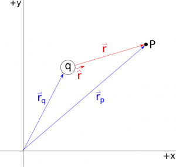
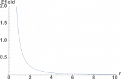
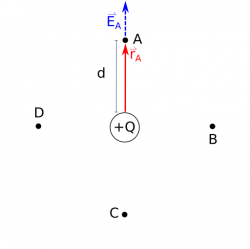
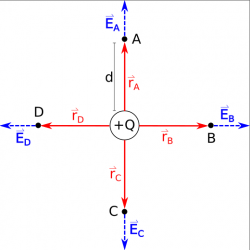

In electricity and magnetism, the idea of a field becomes a very powerful concept that allows us to explain and predict phenomena that we would not otherwise be able to (like how visible light, infrared, and x-rays work). In this course, we will start by talking about the electric field, which is produced by charge(s) and decreases with the distance away from the charge(s). These notes will explain the concept of the electric field, introduce the equation of electric field for point charge - the simplest model we have in E&M, and provide an example of what the electric field looks like for a positive point charge.

## What is a field?

In general, a **field** is something that has a value (either scalar or vector) at every location in space and is the result of some source. You have experienced fields in your everyday life. Two common examples are temperature and a wind velocity.

A temperature field is an example of a **scalar field**. At every point in space, the temperature is some number (specifically degrees Fahrenheit or Celsius). It can be different at separate locations: it's higher near the stove or oven in your house when it's on and lower near the AC or in the basement. This field is set up in your house by (or exists in your house because of) sources of thermal energy in your house (like ovens and air conditioners). When you see infrared or thermal maps [like this one](https://spaceplace.nasa.gov/review/comet-ocean/face2-lrg.jpg), these are really temperature fields at every point in space that the camera can see. There are a variety of [scalar fields](https://en.wikipedia.org/wiki/Scalar_field) that get used in science and engineering, but in E&M, we will focus on a particular scalar field called [electric potential](/notes/week-01-charges-field-potential/pc_potential/).

A wind velocity field is an example of a **vector field**. You might have seen these graphics on the news or the Weather Channel. At every point in space, the wind velocity has a speed (how fast the wind is blowing) and a direction (which way it's blowing). Again, it can be different at every point (both its magnitude and direction). This field is set up by pressure differences resulting from temperature differences (warm and cool air). These fields can be particularly interesting for [hurricanes](https://www.researchgate.net/profile/Xinlai_Peng/publication/304360364/figure/fig5/AS:381212368621573@1467899519573/Fig-156-Wind-vector-and-isotachs-representing-a-wind-velocity-field-of-2011-Joplin-MO.jpg) or other weather phenomena because the wind directions are very different in a relatively small amount of space. A [vector field](https://en.wikipedia.org/wiki/Vector_field) is a general concept that will show up in advanced science and engineering courses you might take, but in E&M we will focus on the electric field.

## What is an electric field?

The **electric field** is a *vector* field (it has a magnitude and direction) that is generated by electric charges at every point in space. That is, **charges generate an electric field**. As you will read soon, it can be [related to the electric force](/notes/week-03-electric-force-energy/pc_force/) between two charges. To begin to understand the electric field, we will start by making a *point particle assumption about our objects - this means that we take our object and crush it down to a single small point that has the same mass and charge as what our original object does but does not have a shape* ([we often make this assumption in mechanics as well](https://pcubed.msuperl.org/notes/week-07-energy-transfer/point_particle/)). Using a point particle assumption allows us to create a model first with very simple objects (which we call “point particles” or “point charges”) before adding more complexity to our model.

## The Electric Field



## The Electric Field Equation for a Point Charge

The general equation for electric field ( $\overset{\rightarrow}{E}$ ) from a point charge at some location (Point P) is given by:

$$
\overset{\rightarrow}{E} = \frac{1}{4\pi\epsilon_{0}}\frac{q}{r^{2}}\widehat{r}
$$

This equation has several pieces to it:

- **Charge** - the variable q represents the charge that is creating the electric field. (The letter C is already used for the unit of coulombs and for capacitance so we use q or Q as the variable for charge.) *q is a scalar number but can be positive or negative depending on the sign of the charge.* q is also directly proportional to the electric field, so this tells us that the more charge you have, the bigger the electric field will be.
- **Constant** - the first part of this equation $\frac{1}{4\pi\epsilon_{0}}$ is a constant value, where $\epsilon_{0} = 8.85 \cdot 10^{- 12}\frac{C^{2}}{Nm^{2}}$. This constant plays a similar role for electricity as the gravitational constant does for gravity. In other texts or previous classes, you may have seen this constant as k or Coulomb's constant: $\frac{1}{4\pi\epsilon_{0}} = k = 8.99 \cdot 10^{9}\frac{Nm^{2}}{C^{2}}$.

Distance vectors for finding E-field at Point P from charge q

- **Separation Distance** - r is the scalar distance between the point charge and the location at which you want to know the electric field (Point P). In the equation, r is squared and inversely related to electric field, which means if you want the field at half the distance, the electric field is four times as large. You can find this distance using the **separation vector** $\overset{\rightarrow}{r}$ that points from the source charge to the observation location (Point P in this case); r is simply the magnitude of the separation vector $\overset{\rightarrow}{r}$. Mathematically you can calculate r from the positions of the charge and location of interest using:

$$
r = |\overset{\rightarrow}{r}| = |{\overset{\rightarrow}{r}}_{obs} - {\overset{\rightarrow}{r}}_{source}| = |\overset{\rightarrow}{r_{p}} - \overset{\rightarrow}{r_{q}}|
$$

- **Direction** - **Electric field is vector quantity**, so it has a direction associated with it, given by the $\widehat{r}$ in the equation. $\widehat{r}$ is the unit vector that points in the same direction as the separation vector $\overset{\rightarrow}{r}$ (from the charge to the location of interest) but has a magnitude of 1. You can calculate $\widehat{r}$ by dividing $\overset{\rightarrow}{r}$ by its magnitude (definition of a unit vector): $\widehat{r} = \frac{\overset{\rightarrow}{r}}{r}$. Alternatively, you can plug the unit vector definition directly into the electric field equation to save a step in your calculations.

$$
\overset{\rightarrow}{E} = \frac{1}{4\pi\epsilon_{0}}\frac{q}{r^{2}}\widehat{r} = \frac{1}{4\pi\epsilon_{0}}\frac{q}{r^{3}}\overset{\rightarrow}{r}
$$

Together, these pieces tell you how the electric field from a point charge changes in space. The main take away here is: **the electric field is created by a charge and can be calculated for every point in space around the charge.**

### Units of Electric Field

The units of electric field can either be given in $N/C$ **(newtons per coulomb) or in** $V/m$ **(volts per meter)**. These units are equivalent, so it doesn't matter which is used. The size of an electric field is difficult to judge without other information about the charge that is creating that field. For example, a large electric field could be due to either a large amount of charge or being a short distance from the charge. Likewise, a small electric field could be due to a very small amount of charge or being far from the charge.

## Electric Field vs Distance Graph

Electric Field vs. Distance Graph

Because electric field is a vector quantity, it can be difficult to graph. Generally, we get around this by choosing a path and graphing the magnitude of the electric field vs distance *along that path* (the other option being to make three graphs, one for each vector component of the field). For any path moving away from a charge, we graph the magnitude of $\overset{\rightarrow}{E}$ vs the position away from the charge ( r ). In this case, $|\overset{\rightarrow}{E}| = \frac{1}{4\pi\epsilon_{0}}\frac{q}{r^{2}}$ because the separation between the point charge and where we are calculating the field is given by r along our path. This gives us a graph that is very similar to a $y = \frac{1}{x^{2}}$ graph, which shows that as you get closer to the charge, the magnitude of the electric field gets incrementally bigger. Eventually, the electric field gets infinitely large if you get extremely close to the charge. Likewise, the electric field rapidly gets smaller as you move away from the charge, but doesn't actually reach zero until you are infinitely far away.

## Electric Field Vectors

Electric Field at observation point A from Q

To understand the electric field around a point charge (or any other distribution of charge), we will often draw vectors around the charge called “electric field vectors” or just “field vectors.” **The magnitude or length of these vectors represents the magnitude of the electric field, and the direction of the vector points in the same direction as the electric field** (shown with the dashed blue $\overset{\rightarrow}{E_{A}}$ arrow in the figure on the right).

For a positive point charge Q, consider Points A-D, each a distance d from the charge. To draw the electric field vectors around this charge, we need to find the magnitude ***and*** direction of the electric field at each point. Starting with the electric field equation, we can find the electric field for Point A. We already know that the charge is Q, so we have:

$$
\overset{\rightarrow}{E_{A}} = \frac{1}{4\pi\epsilon_{0}}\frac{Q}{r_{A}^{2}}\widehat{r_{A}}
$$

All we need now is to find the separation vector $\overset{\rightarrow}{r_{A}}$, which will help us find the magnitude $r_{A}$ and unit vector $\widehat{r_{A}}$. The separation vector $\overset{\rightarrow}{r_{A}}$ will point from the charge to Point A (drawn as the solid red arrow in the figure). Using the traditional cartesian coordinate system (+x points to the right, +y points up, the origin at the positive point charge), then $\overset{\rightarrow}{r_{A}}$ points only in the +y-direction, so $\overset{\rightarrow}{r_{A}} = \langle 0,d,0\rangle$. The magnitude of $\overset{\rightarrow}{r_{A}}$ is then:

$$
r_{A} = |\overset{\rightarrow}{r_{A}}| = \sqrt{r_{Ax}^{2} + r_{Ay}^{2} + r_{Az}^{2}} = \sqrt{0^{2} + d^{2} + 0^{2}}
$$

$$
r_{A} = d
$$

The unit vector $\widehat{r_{A}}$ is then given by:

$$
\widehat{r_{A}} = \frac{\overset{\rightarrow}{r_{A}}}{r_{A}} = \frac{\langle 0,d,0\rangle}{d} = \langle 0,1,0\rangle
$$

$$
\widehat{r_{A}} = \langle 0,1,0\rangle = \widehat{y}
$$

Because $\widehat{r_{A}}$ only points in the y-direction, we use $\widehat{y}$ as a shortcut for $\langle 0,1,0\rangle$. Putting all of this together, we get the electric field at Point A to be:

$$
\overset{\rightarrow}{E_{A}} = \frac{1}{4\pi\epsilon_{0}}\frac{Q}{d^{2}}\widehat{y}
$$

Electric Field from a point charge

So we draw the electric field vector at Point A pointing straight up. If you follow the same steps for Points B-D, you find an important pattern from drawing this electric field vectors: **the electric field from a positive point charge points away from the charge**. If we were to look at points that were a distance of 2d away from the point charge, we would need to change the magnitude of the electric field by a factor of 4 (since it is $r^{2}$ in the denominator), but the directions would stay the same.

## Examples

- [Electric Field from a Negative Point Charge](/examples/week2_electric_field_negative_point/)
  - Video Example: Electric Field from a Negative Point Charge


