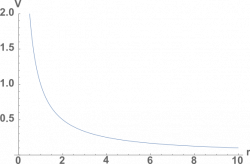
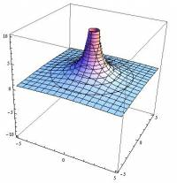

[In the last page of notes](/notes/week-01-charges-field-potential/pc_efield/), you read that the electric field is a vector field that any charge will produce. A charge will also produce a scalar field called the **electric potential field** (often shortened to just “electric potential” or “potential”), which is related to the charge's potential energy as [we will talk about later](/notes/week-03-electric-force-energy/pc_energy/). These notes will introduce the scalar potential field as a concept, incorporate electric potential into our point charge model, and show how [the electric field](/notes/week-01-charges-field-potential/pc_efield/) is related to electric potential.

## Electric Potential



## The Concept of Electric Potential

**Electric potential** is a *scalar* field that gives you an idea of the energy landscape that the electric field produces. Think of this analogy - positive charges make hills and negative charges make valleys in the energy landscape. The electric potential is like a [topographic map](https://en.wikipedia.org/wiki/Topographic_map) of the space surrounding the charges in question. Even though they are named similarly, **electric potential is not the same thing as electric potential energy** (we will relate electric potential to [electric potential energy](/notes/week-03-electric-force-energy/pc_energy/) soon). Just like we did with electric field, we will start by making a *point particle assumption* to create a simplest model.

Electric potential can be quite useful because it is a scalar field – a single number at each point in space characterizes the electric potential. This makes using electric potential a bit easier compared to electric field because it is a scalar quantity (we don't have to worry about a direction). Moreover, you already have some experience with electric potential (or “voltage” as it is often referred to), which might not be the case for electric field. For example, most batteries have an electric potential (technically, an electric potential difference - [more on this later](/notes/week-05-moving-charges-batteries/batteries/)) of 1.5 volts (volts is the unit of electric potential) while your wall outlet is closer to 120 volts. You can probably see that there's something about electric potential that is already suggestive of energy - you can power a TV or a vacuum with the wall outlet, but not a battery.

## Equation for Electric Potential of a Point Charge

Electric potential is usually represented with the variable “V.” The general equation for electric potential from a point charge at some location (Point P) is given by:

$$
V = \frac{1}{4\pi\epsilon_{0}}\frac{q}{r}
$$

Because potential is a scalar, it is usually easier to represent mathematically and has fewer parts to it - many of which are found in the electric field equation:

- **Charge** - the variable q represents the charge that is creating the potential (this is exactly the same as with electric field). q is a scalar number with units of coulombs (C) that can be positive or negative depending on the sign of the charge. q is directly proportional to electric potential - *the bigger the charge, the larger the electric potential*.
- **Constant** - the constant of $\frac{1}{4\pi\epsilon_{0}}$ is exactly the same as the constant in electric field, where $\epsilon_{0} = 8.85 \cdot 10^{- 12}\frac{C^{2}}{Nm^{2}}$.
- **Distance** - r is the scalar distance between the point charge and the location where you want to know the electric potential (Point P in this case). Mathematically, you can calculate r from the individual positions of the charge and point or from the separation vector that points from the charge to the Point P.

$$
r = |\overset{\rightarrow}{r}| = |\overset{\rightarrow}{r_{p}} - \overset{\rightarrow}{r_{q}}|
$$

Together these pieces tell you how the electric potential from a point charge changes in space. **The electric potential can be determined at every location in space.**

### Units of Electric Potential

The units of electric potential are called volts which is represented by a “V.” This can be very confusing because V is also used as the variable for electric potential - make sure you know which one you are referring to. For example, if you have the equation $V = 4\text{~V}$ this would be read as “the electric potential is equal to 4 volts” because the first “V” refers to the variable of electric potential and the second “V” refers to the unit of volts. If you were to just write just $V = 4$ you would be ignoring the units that potential has.

For a sense of scale, an electron has a potential of $1.4 \cdot 10^{- 7}\text{~V}$ when one cm away. We also use potential (or voltage) to describe the energy of batteries because we want to have a rough idea of what energy the battery has without knowing what we hooking the battery up to - which is why you have probably heard of a 9V (“nine volt”) battery. AA batteries, which are much smaller than a 9V battery, have a potential of 1.5V. An electric fence (which is made to stop cows) has a voltage on the order of 2000V.

## Potential vs Distance Graphs

Because electric potential is a scalar, it is generally easier to graph than electric field is. Typically, we will still specify a path and graph the electric potential along that path because when you have multiple charges, the electric potential does not necessarily take on the same value or change in the same way in all directions. For a single positive point charge, if we pick a path along any direction moving away from the point charge, we will get the potential vs distance graph that is shown to the right. From the $V=\frac{1}{4\pi\epsilon_0}\frac{q}{r}$ equation, we get a graph that looks very similar to a $y=\frac{1}{x}$ graph. This graph tells us that the closer you get to the point charge, the higher the electric potential; whereas, the only time the electric potential is zero is when $r=\infty$.

Electric Potential (v) vs Distance (r) graph

3D electric potential graph

If we wanted to see what the electric potential looks like everywhere around the charge, we could create a 3D topographical map, where the x and y axes show the space around the charge and the z axis shows the electric potential. For a positive point charge, this would look similar to a “hill”, going back the energy landscape analogy. This is shown in the figure to the left. [The final example](/examples/week2_potential_plots/) shows the source code in mathematica that we used to create this plot - you can plug this code into Wolfram Alpha and change the variables or rotate the plot. What would it look like if the charge were negative instead of positive?

## Examples

[Electric Potential from a Positively Charged Balloon](/examples/week2_electric_potential_positive_point/)

[Electric Potential from a Negatively Charged Balloon](/examples/week2_electric_potential_negative_point/)

[Plotting Electric Potential with Wolfram Alpha](/examples/week2_potential_plots/)
