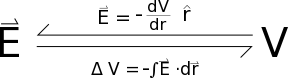

At this point you may have noticed some similarities between [electric field](/notes/week-01-charges-field-potential/pc_efield/) and [electric potential](/notes/week-01-charges-field-potential/pc_potential/):

- They use the same constant
- They both relate to the amount of charge you have
- They both get smaller when you increase the distance from the charge
- Neither describes an interaction (both are only based on a single charge)

However, there are differences between these quantities:

- Electric field is a vector and electric potential is a scalar
- Electric field relates to force and electric potential relates to energy
- Electric field depends on $\frac{1}{r^{2}}$ and electric potential depends on $\frac{1}{r}$

So while these are two distinct quantities, it makes sense for them to be related somehow. This page of notes goes into more detail about how you can get the electric field from electric potential and vice versa.



## Getting Electric Field from Electric Potential

When you look at the equations side-by-side, you see that electric field and electric potential appear to be different by a factor of r; however, it is not quite as simple as multiplying/dividing by r, especially since we need to be able to turn a vector quantity into a scalar quantity and vice versa.

$$
V = \frac{1}{4\pi\epsilon_{0}}\frac{q}{r}
$$

$$
\overset{\rightarrow}{E} = \frac{1}{4\pi\epsilon_{0}}\frac{q}{r^{2}}\widehat{r}
$$

If you know what the electric potential is in terms of r, you can calculate the electric field by taking the negative derivative of potential with respect to r, which will give you the electric field in the $\widehat{r}$ direction. *This assumes that your electric potential equation does not depend on an angle*. (If your electric potential does depend on an angle, then you have to use the [gradient](https://en.wikipedia.org/wiki/Gradient).)

$$
\overset{\rightarrow}{E} = - \frac{dV}{dr}\widehat{r}
$$

If you know the electric potential in terms of x,y, and z variables, you can calculate the electric field by taking the negative derivative with respect to each direction (this is the [gradient](https://en.wikipedia.org/wiki/Gradient) in cartesian coordinates).

$$
\overset{\rightarrow}{E} = - \frac{dV}{dx}\widehat{x} - \frac{dV}{dy}\widehat{y} - \frac{dV}{dz}\widehat{z} = - \left\langle \frac{dV}{dx},\frac{dV}{dy},\frac{dV}{dz} \right\rangle
$$

## Getting Electric Potential from Electric Field

If instead you start with the electric field and want to get the electric potential, we do the inverse operation: take the negative integral over a path. By integrating over a path (which has direction), we can use a [dot product](/notes/week-01-charges-field-potential/math_review/#vector_multiplication) between the electric field and a small position vector to get the scalar voltage. If you use an indefinite integral, you have to add a constant to the integral (which you can solve for if you know the voltage a certain point - usually you set the voltage to be zero at infinity)

$$
V = - \int\overset{\rightarrow}{E} \bullet d\overset{\rightarrow}{r} + C
$$

or if you take a definite integral, than you are really finding a change in voltage from some initial location to some final location:

$$
\Delta V = V_{f} - V_{i} = - \int_{r_{i}}^{r_{f}}\overset{\rightarrow}{E} \bullet d\overset{\rightarrow}{r}
$$

This relationship between field and potential is very similar to the relationship between [force and potential energy](https://pcubed.msuperl.org/notes/week-08-potential-energy-applications/force_and_pe/) (for good reason, as we will talk about [next week](/notes/week-03-electric-force-energy/pc_vefu/)).

Relationships between E-field and Potential
