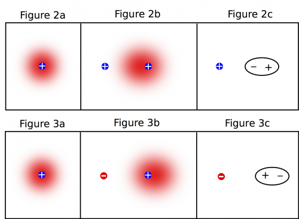

[Ordinary matter](https://en.wikipedia.org/wiki/Matter) (of all varieties) is composed of charged particles. Every atom is made up of some combination of protons and electrons. In these notes, we will add charged particles to our microscopic model of matter and discuss some of the applications of this model.

## Lecture Video



## Charges in Matter

All matter is made up of atoms, which are in turn made up of a dense positively charged nucleus (made up of protons and neutrons) and a sparse, negatively charged electron cloud. This is a different perspective than the most common model of electrons - [Bohr model](https://en.wikipedia.org/wiki/Bohr_model) - that has electrons moving in circular orbits around the nucleus ([any atom that you see in pop culture](https://www.google.com/search?q=atom&source=lnms&tbm=isch&sa=X&ved=0ahUKEwiu_6OS57_UAhVL5oMKHVf4BrkQ_AUICigB&biw=1304&bih=1327) is usually a Bohr model of the atom). We favor using an electron cloud rather than in circular orbits to model the electrons around an atom because electrons are not actually restricted to staying in a singular path around the nucleus. The electron cloud instead represents the areas where it is likely that you will find an electron - so the cloud is very dense near the positive nucleus and becomes less dense the farther away you get from the nucleus. The electron cloud is roughly the same idea as [atomic orbitals](https://en.wikipedia.org/wiki/Atomic_orbital) that is a frequently used model in chemistry. These models are just a few of a [number of historical (and more modern) models of the atom](https://en.wikipedia.org/wiki/Atomic_theory).

Electron cloud around positive nucleus

**Most matter is neutral, which means that the net charge (or sum of all the charges) of most atoms is zero.** Since the charge of a proton is $+ 1.602 \cdot 10^{- 19}\text{~C}$ and the charge of an electron is $- 1.602 \cdot 10^{- 19}\text{~C}$ (and the charge of a neutron is $0\text{~C}$), this tells us that the number of protons in a neutral atom has to equal the number of electrons. *Notice that if an object is neutral, it does not mean that the object has zero charge. It means that the amount of positive charge in the atom is equal to the amount of negative charge in the atom, so the **net** charge is zero.*

**If an object is *charged*, this means that the net charge of the object is no longer zero**. If the object has a negative net charge, this means that the object has an excess of electrons. If an object has a positive net charge, this means that the object is missing electrons. In theory you could also get a negative net charge by removing protons (or a positive charge by adding protons); however, protons are extremely difficult to remove (or add) because they are held together in the nucleus by the [strong interaction](https://en.wikipedia.org/wiki/Strong_interaction). Since electrons are relatively easy to remove compared to a proton, almost all charged objects that you will encounter will be due to electrons being added or removed.

We can use this model of the atom (dense positive nucleus with an electron cloud) then to talk about how we get charged objects (charging/discharging) and how atoms respond to charges nearby (polarization).

## Polarization

Polarization of a neutral atom from a positive charge (Figures 2a-2c) and a negative charge (Figures 3a-3c).

If we start with a neutral atom by itself, we know that there will be a positive nucleus with a negative, circular electron cloud around it. The electron cloud is circular (spherical in 3D) because it is equally likely that the electrons are anywhere around the nucleus (shown in Figure 2a/3a).

*What would change about our atom if we put a charge next to a neutral atom?*

The electrons cannot leave their nucleus (unless [the interaction is very strong](https://en.wikipedia.org/wiki/Ionization)), but they are attracted to the positive charge. With a positive charge nearby, it is now more likely that the electrons will be on the left side of nucleus compared to the right (shown in Figure 2b), shifting the electron cloud toward the positive charge. Often, we will simplify this drawing to be just an oval that indicates which side of the atom is more positive and which side is more negative (shown in Figure 2c).

If instead a negative charge is placed next to a neutral atom (Figure 3b), the
