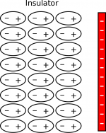
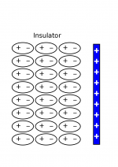
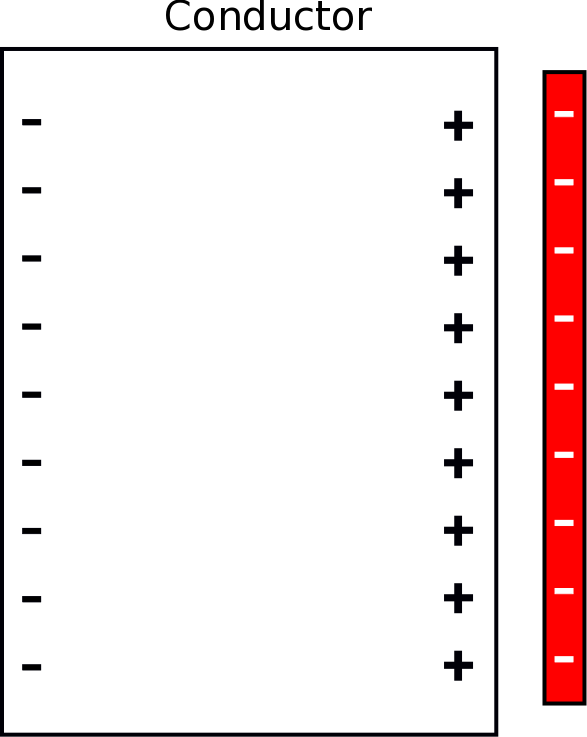
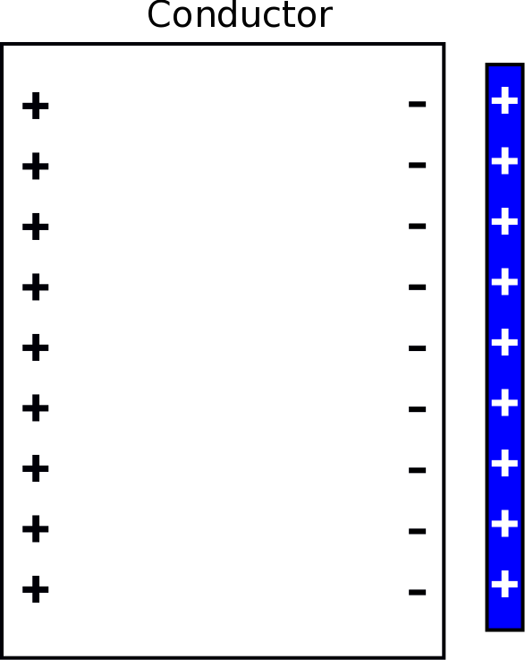

[Ordinary matter](https://en.wikipedia.org/wiki/Matter) (of all varieties) is composed of charged particles. Every atom is made up of some combination of protons and electrons. In these notes, we will add charged particles to our microscopic model of matter and discuss some of the applications of this model.

## Lecture Video



## Charges in Matter

All matter is made up of atoms, which are in turn made up of a dense positively charged nucleus (made up of protons and neutrons) and a sparse, negatively charged electron cloud. This is a different perspective than the most common model of electrons - [Bohr model](https://en.wikipedia.org/wiki/Bohr_model) - that has electrons moving in circular orbits around the nucleus ([any atom that you see in pop culture](https://www.google.com/search?q=atom&source=lnms&tbm=isch&sa=X&ved=0ahUKEwiu_6OS57_UAhVL5oMKHVf4BrkQ_AUICigB&biw=1304&bih=1327) is usually a Bohr model of the atom). We favor using an electron cloud rather than in circular orbits to model the electrons around an atom because electrons are not actually restricted to staying in a singular path around the nucleus. The electron cloud instead represents the areas where it is likely that you will find an electron - so the cloud is very dense near the positive nucleus and becomes less dense the farther away you get from the nucleus. The electron cloud is roughly the same idea as [atomic orbitals](https://en.wikipedia.org/wiki/Atomic_orbital) that is a frequently used model in chemistry. These models are just a few of a [number of historical (and more modern) models of the atom](https://en.wikipedia.org/wiki/Atomic_theory).

Electron cloud around positive nucleus

**Most matter is neutral, which means that the net charge (or sum of all the charges) of most atoms is zero.** Since the charge of a proton is $+ 1.602 \cdot 10^{- 19}\text{~C}$ and the charge of an electron is $- 1.602 \cdot 10^{- 19}\text{~C}$ (and the charge of a neutron is $0\text{~C}$), this tells us that the number of protons in a neutral atom has to equal the number of electrons. *Notice that if an object is neutral, it does not mean that the object has zero charge. It means that the amount of positive charge in the atom is equal to the amount of negative charge in the atom, so the **net** charge is zero.*

**If an object is *charged*, this means that the net charge of the object is no longer zero**. If the object has a negative net charge, this means that the object has an excess of electrons. If an object has a positive net charge, this means that the object is missing electrons. In theory you could also get a negative net charge by removing protons (or a positive charge by adding protons); however, protons are extremely difficult to remove (or add) because they are held together in the nucleus by the [strong interaction](https://en.wikipedia.org/wiki/Strong_interaction). Since electrons are relatively easy to remove compared to a proton, almost all charged objects that you will encounter will be due to electrons being added or removed.

We can use this model of the atom (dense positive nucleus with an electron cloud) then to talk about how we get charged objects (charging/discharging) and how atoms respond to charges nearby (polarization).

## Polarization

Polarization of a neutral atom from a positive charge (Figures 2a-2c) and a negative charge (Figures 3a-3c).

If we start with a neutral atom by itself, we know that there will be a positive nucleus with a negative, circular electron cloud around it. The electron cloud is circular (spherical in 3D) because it is equally likely that the electrons are anywhere around the nucleus (shown in Figure 2a/3a).

*What would change about our atom if we put a charge next to a neutral atom?*

The electrons cannot leave their nucleus (unless [the interaction is very strong](https://en.wikipedia.org/wiki/Ionization)), but they are attracted to the positive charge. With a positive charge nearby, it is now more likely that the electrons will be on the left side of nucleus compared to the right (shown in Figure 2b), shifting the electron cloud toward the positive charge. Often, we will simplify this drawing to be just an oval that indicates which side of the atom is more positive and which side is more negative (shown in Figure 2c).

If instead a negative charge is placed next to a neutral atom (Figure 3b), the electrons are repelled by the negative charge and are more likely to be found on the right side of the nucleus. Thus, the electron cloud shifts away from the negative charge. Again, most of the time we will draw a simplified representation of the atom (Figure 3c) rather than draw out the electron cloud.

When the electron cloud is pushed to one side or other of the nucleus, we say that the atom or molecule is **polarized**. *Note that even though the atom is polarized in both cases, it is still neutral - we did not add or take away electrons or protons.*

## Types of Matter

Charge distribution in an insulator from a negative charge

Now that we know what happens to a single atom, it makes sense to talk about what happens when you collect atoms into matter or objects. For our purposes, we will be considering two types of matter that behave differently when near charge: insulators and conductors. There are other types of matter like [semiconductors](https://en.wikipedia.org/wiki/Semiconductor) and [superconductors](https://en.wikipedia.org/wiki/Superconductivity) that behave in interesting ways, but we will focus on conductors and insulators.

### Insulators

An insulator is an object or material where the electrons are tightly bound to the nucleus. This means that the electrons in an insulator can only move very small amounts and must stay close to their nuclei. **Charges cannot move freely through an insulator.** Common insulators include: plastic, glass, rubber, paper, wood, etc.

Charge distribution in an insulator from a positive charge

If you put a negative charge next to (but not touching) a neutral insulator, the electron clouds of the atoms on the surface will be pushed away, causing polarization to occur in the insulator. This means that the surface of the insulator now has a positive charge on the surface, with a negative line of charge behind it. The positive charges on the surface will try to attract the negative charge while the negative charges will try to repel it. Because the positives charges are closer, the attraction will be slightly stronger than the repulsion, causing a small attraction between the insulator (even though it is overall neutral) and the negative charge. (The first few layers of atoms on the surface of the insulator are shown to the left with a negative charge.)

If instead you put a positive charge next to a neutral insulator, the electron clouds on the surface will be pulled toward the positive charge, causing the surface to have a small negative charge. Because the insulator is now polarized, there will be a small attraction between the positive and the insulator, even though it is electrically neutral overall. (The first few layers of atoms on the surface of the insulator are shown to the right with a positive charge.) This is why a charged balloon (that you rubbed on your hair) will stick to a wall, even though you did not do anything to charge the wall.

**Note that in both cases, it is the electron distribution that shifts.** Electrons have much less mass than the protons to which they are bound, so that the electron cloud is much more likely to be affected than the nucleus.

### Conductors

**A conductor is an object or material where charged particles can move easily through the material.** In some conductors (like salt water), there are charged ions ($\text{Na}^+$ and $\text{Cl}^-$) that can travel relatively freely through the material (water). In other conductors, like metals, the inner electrons of every atom are tightly bound to the nucleus, but the outer electrons (or [valence electrons](https://en.wikipedia.org/wiki/Valence_electron)) of the atom are much easier to remove. When you have lot of metal atoms together, generally one electron from each atom can leave the atom and join a “sea” of electrons that are free to move through the metal. These electrons are not completely free - it is very difficult to remove these electrons from the metal - but they are relatively free to move within the piece of metal. This is how we model the metal as a conductor - a mobile electron sea. Common conductors include: salt water, copper, iron, aluminum, gold, etc.

Charge distribution in a conductor from a negative charge

When you put a negative charge next to a conductor, like a piece of metal, the negative charge repels the free electrons (the electron sea). Since these electrons are free to move through the metal, they move as far from the negative charge as they can, which makes the opposite surface of the conductor negatively charged (shown in the figure to the right). At the same time, the surface closest to the negative charge is now lacking negative charges because all of the free electrons have been repelled. This leaves the right surface of the metal with a net positive charge. Because the negative charges are on far side of the metal, the attraction from the positive surface is much stronger than the repulsion from the negative surface, making the attraction between the conductor and negative charge much stronger than it was in the insulator.

Charge distribution in a conductor from a positive charge

When you put a positive charge next to a conductor (shown in the figure to the left), the electrons in the electron sea are attracted to the surface of the metal closest to the positive charge. This leaves the opposite surface with a positive charge because those atoms now look like they are missing an electron. Since the positive charges are much further away from the positive charge than the negative charges, the attraction from the conductor is much stronger than the repulsion. This means that the positive charge is strongly attracted to the metal even though the metal is overall neutral.

*Again, the electrons are what moves in both cases.*

You might have experienced this effect when you were working with the tape challenge in the first class. Your body is mostly composed of salt water, which is a very good conductor. No matter what kind of charge was on your tape, you may have observed that it was always attracted to your hand, sometimes more than it was to the other piece of tape. This microscopic model of conductors would explain why the tape was always attracted to your hand.

## Examples

[Interactions Between Charged and Neutral Objects](/examples/week2_charged_thing_neutral_thing/)
