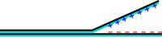
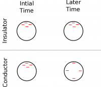
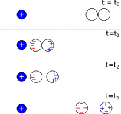
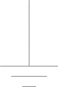

Using our [microscopic model of the atom](/notes/week-02-charges-superposition/charge_and_matter/), we can now talk about how objects become charged (called charging) and how they return to being neutral (often called discharging). These notes will discuss how these processes occur and how they are different for insulators and conductors.

## Charging



Objects become charged by either gaining extra electrons (becoming negatively charged) or by giving up electrons (becoming positively charged). There are generally two ways to create charged objects: *by conduction* or *by induction*.

Tape being pulled apart, therefore charging by conduction

- **Charging by conduction** means charging by contact. For example if you have one piece of tape on top of another then rip them apart, electrons or negative ions from one piece of tape are transferred to the other, making one tape negatively charged and leaving the other positively charged. This happens by breaking the polymers that make up the tape adhesive. Which materials will take electrons and which materials will give up electrons is highly dependent on the chemical composition of the materials and which material it is paired with (the specific adhesive used in the tape, in this case). In a well known case, a plastic rod will gain electrons (become negatively charged) when rubbed with wool, but the same plastic rod will lose electrons (become positively charged) when rubbed with silk. When charging by conduction, rubbing is not necessary for charges to transfer - only contact is needed, but rubbing increases the time and parts of the surfaces that are in contact, which helps facilitate this transfer.

Charges in a conductor are free to move with time

**Conduction with an insulator**: When you use conduction to add charge to an insulator, the charges stay very close to the same location where they are placed because charges are not free to move through an insulator. In the case of the tape, which is a pretty good insulator, the charges are on the sticky side of the upper tape and the non-sticky side of the lower tape because those are the surfaces in contact. The charges on the sticky side of the upper tape are unable to move to the non-sticky side because tape is an insulator.

**Conduction with a conductor**: When you use conduction to add charge to a conductor, the charges are free to move and will spread out evenly through the conductor. This is because the added charges (of the same sign) will repel each other. If the material is a conductor, these charges are free to move through the material, and will disperse evenly so that each charge is as far away from the others as possible.

Induction with Conductors

- **Charging by induction** occurs when you use a previously charged object to separate charges between two conductors. For example, say you have two neutral conductors that are far away from a positive charge - shown in the figure at $t=t_0$. You place the conductors side-by-side so that they are touching (when they are still far away from the positive charge). While still touching you bring the conductors close to the positive charge. When you do this, the electron sea from *both* conductors (because they are touching and the electrons are free to move) is attracted toward the positive charge. This means that the conductor that is closest to the positive charge holds more electrons (net negative charge) and the conductor that is farther away is lacking electrons (net positive charge) - shown at $t=t_1$ in the figure. While still close to the positive charge, you separate the conductors, which traps the electron sea in one conductor (net negative) and leaves the other conductor with a net positive charge - shown at $t=t_2$. When you bring the two conductors far away again ($t=t_3$), the electrons in both conductors spread out so the excess charge in both conductors is spread out evenly around the conductors. So now you have two charged conductors, even though they both started out as neutral.

## Discharging



Discharging occurs when excess charges leave a charged object, often, making it return to its original, neutral state. When you were dealing with the charged pieces of tape, you may have noticed that if you touched the tape or let it sit for too long there was no longer charge on the tape - it had discharged. If you let the tape sit for too long, the tape will discharge because the water molecules in the air (which are polarized because of the shape of the molecule) act as small conductors and are able to remove charges when they bounce into the tape. This is also why your clothes have more static in the winter (drier air) than they do in the summer (more humid air).

Symbol for an electrical ground

If you touch the tape, your finger acts as a neutral conductor and the charges are able to move from the tape into your finger. Unfortunately, you cannot shock your friend using your finger because the charges then spread through your body and you are not adding enough charge compared to all the charges and atoms in your body to be able to notice. We call a vast collection of positive and negative charges **an electrical ground** or just **ground** (it is called ground because the Earth is typically used as an electrical ground). A ground is able to absorb small amounts of charge and remain neutral because the added charge is so small compared to the total number of charges in the ground. In the tape example, your body was acting as a ground. The symbol for a ground is three horizontal lines, decreasing in size (shown to the right).

From the calculation side, dealing with discharging objects is dependent on time and is very complicated. For the purpose of this class, *we will often make the assumption that discharging does not occur*. Another way to say this would be that we *assume charge is constant*, or we *assume that the charged object does not interact with the air or another surface.*

## Examples

[Attempting to Charge Insulators by Induction](/empcubed/examples/week2_conducting_insulating_balls/)

[Demonstration of charging by induction](https://www.youtube.com/watch?v=cMM6hZiWnig)
